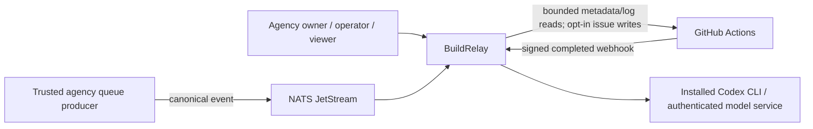
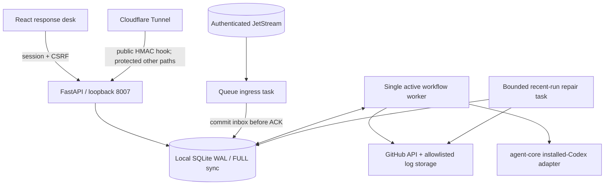
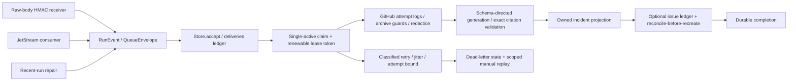
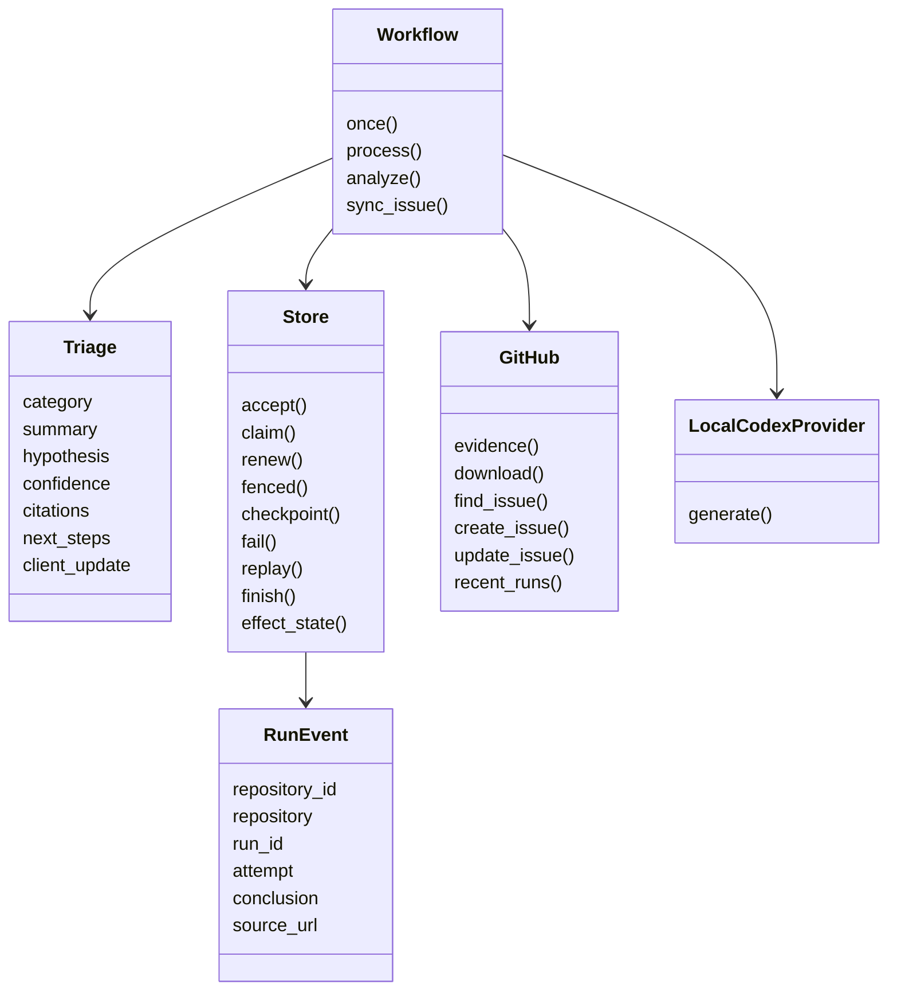

# Architecture — C4 levels 1–4

## Level 1: system context

## Level 2: containers

API and worker are separate processes. Queue and repair tasks run within the worker;
AI/log work is offloaded from its async event loop. The broker is an independently
managed process/service, not silently provisioned by `make up`. No Docker is required.
SQLite must be on a local disk, not a network share. Application code does not call
a model API directly; installed Codex still needs authentication/network inference.

## Level 3: components

Validation failures, timeouts, retries, steps, effects and operator actions are
records in SQLite's application audit. Audit is append-only by application
convention, not cryptographically tamper-proof or independent retention storage.

## Level 4: code and persistence

Code: `packages/contracts/.../buildrelay.py`, `apps/buildrelay-api/src/buildrelay_api/`.
`select_archive` and `triage_evidence` are shared pure production/evaluation ports;
benchmark interpretation of Travis logs does not fabricate GitHub run identities.
Tables: `clients`, `repos`, `events`, `deliveries`, `incidents`, `effects`, `audit`,
`users`, `grants`, `sessions`, `heartbeat`, `cursors`.

Canonical event identity is SHA-256 of configured repository ID, source run ID,
attempt, conclusion and workflow version. Delivery IDs are additionally checked
for collisions. Incident identity is repository/run ID. Separate source attempts
are not duplicates. Same business event arriving via HTTP and queue is a duplicate.

## Failure semantics

`pending → processing → done`, or `processing → retry → processing`, or `dead`.
Four attempts including reclaimed expired leases bound crash loops. A 600-second
lease is renewed every 20 seconds during normal execution. Expired tokens cannot
write checkpoints or finalize work. Checkpoints avoid redoing completed analysis.

The external create state is persisted **before** POST. A lost response or worker
crash leaves an ambiguous ledger entry. The next attempt enumerates repository
issues for its marker. If none can be confirmed, automation stops for verification;
it does not blindly POST again. PATCH is repeatable but this is not a universal
exactly-once guarantee against arbitrary external races/administrative edits.

Processing is serialized on one host to bound AI load and action races. This is
not a horizontally distributed worker design. A bounded historical scanner is
repair assistance, not guaranteed durable ingress while the laptop is offline.

The [baseline validation](real-data-validation-2026-10-18.md) exposed a crash when
failure recording itself encountered an expired lease. Fencing now raises typed
`LeaseLost`, and an outer boundary covers both normal processing and failure
recording. It appends a `lease_lost` audit entry without changing event state,
checkpoints or the replacement worker's token. Analysis must propagate this type,
not treat it as malformed model JSON. Ordinary `ValueError` is a contract failure;
message text containing "lease" is not a classification mechanism.

The job remains expired/reclaimable (or owned by its replacement). A successful
heartbeat is not permission to resurrect it. This is a single-host lease protocol,
not protection against all external-write races during arbitrary host suspension.
The regression simulates lease expiry; it does not certify actual Windows sleep.

## Evidence-selection boundary

The baseline's alphabetical 6,000-character file tails omitted initiating errors.
The corrective selector reads the same bounded, redacted archives but spends a
64,000-character aggregate evidence allowance across all files. Complete archives
that fit are kept. Otherwise, priority is early diagnostic clusters, bounded
terminal slices, recent diagnostic windows and heads. Overlapping lines are
deduplicated; ordering is deterministic. No annotation, expected category or
repository-specific rule participates in selection.

This doubles the earlier 32,000-character content allowance; it is an explicit
resource/coverage tradeoff, not a claim of token savings. Numbered prompt JSON and
instructions add overhead; characters are not model tokens. Download, expansion,
file-size and file-count limits remain unchanged, as do the 90-second provider
timeout and at-most-two schema attempts.

Window headers identify ranges in the **redacted source**, not necessarily the raw
archive: redaction can alter line structure. Citation line numbers always address
the selected evidence sent to the model. Skipped unsafe/oversized files and omitted
content mark coverage partial and cap confidence at 0.49. Selection remains lossy;
passing a corpus-retention target does not establish causal diagnosis accuracy.
