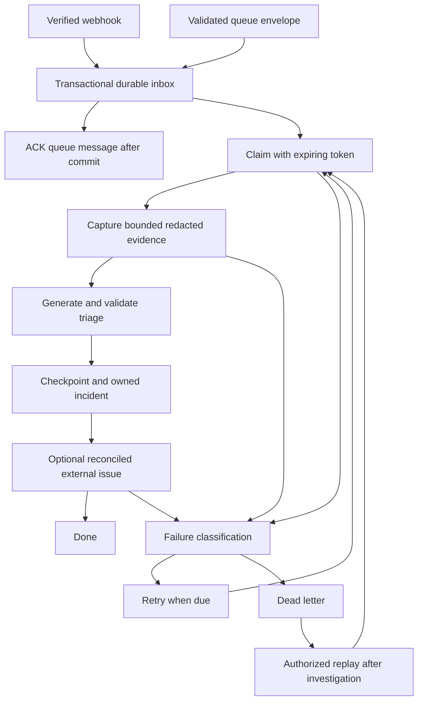

# BuildRelay study guide: event-triggered automation that survives redelivery

Day 8 of the product challenge. Read this alongside the [architecture](architecture.md),
[runbook](implementation-and-operations.md) and [corrective validation report](fixes-and-validation-2026-10-19.md).
The validation report is the authority for measured results and remaining release
gates. Implemented concepts are not the same as independently accepted production quality.

## 1. Start with the customer problem

An agency maintains multiple clients' repositories. Failed builds arrive while
engineers are busy or the service is temporarily offline. Someone must establish
what failed, assign investigation, preserve evidence and prepare a client update.
Repeated notifications must not create repeated incidents or external issues.

BuildRelay turns a completed CI run into an owned response record. AI proposes a
grounded explanation and next steps. It does **not** edit code, deploy fixes, merge
changes or send client updates. The draft is useful without pretending to be a
verified root-cause diagnosis.

That distinction determines the architecture: delivery and state transitions are
deterministic code; interpreting unstructured logs is a constrained model call.

## 2. Map every Day 8 concept to this product

| Concept | Concrete implementation | Read and test |
| --- | --- | --- |
| Webhooks **and** queue | HMAC-verified GitHub completed-run endpoint; authenticated NATS JetStream consumer | [API](../../apps/buildrelay-api/src/buildrelay_api/api.py), [queue](../../apps/buildrelay-api/src/buildrelay_api/queue.py), [transport tests](../../tests/test_buildrelay_transports.py) |
| Execute a workflow on a trigger | Durable event is claimed; evidence and triage are checkpointed; incident is projected; optional issue is synchronized | [Workflow](../../apps/buildrelay-api/src/buildrelay_api/workflow.py), [workflow tests](../../tests/test_buildrelay_workflow.py) |
| Idempotent execution | Business-event identity, transactional insert, checkpoints, incident identity and external-effect reconciliation | [Store](../../apps/buildrelay-api/src/buildrelay_api/store.py), [core tests](../../tests/test_buildrelay_core.py) |
| Dead-letter handling | Permanent/exhausted work is visible as `dead`; authorized replay requires a reason and preserves checkpoints | Store `fail` / `replay`, [API tests](../../tests/test_buildrelay_api.py), [fault tests](../../tests/test_buildrelay_acceptance_faults.py) |
| Retry logic | Transient/permanent classification, backoff and jitter, rate-limit delay, four attempts including expired claims | [GitHub adapter](../../apps/buildrelay-api/src/buildrelay_api/github.py), Store `claim` / `fail`, [recovery tests](../../tests/test_buildrelay_recovery.py) |

The queue, database, provider and issue adapter are different boundaries. A single
successful HTTP request does not prove all of them work.

## 3. Follow one event end to end



The diagram is simplified: checkpoints let retries skip completed evidence/triage,
and provider failures can produce an explicit manual-triage incident rather than
a workflow retry. Successful runs update recovery state without asking the model
to invent a failure.

An HTTP `202` or queue ACK means the service accepted the event durably. It does
**not** mean analysis finished, the diagnosis is right or an issue was delivered.
That separation keeps ingress responsive while analysis is slower.

Hosting the API and installed Codex adapter on a Windows laptop does not imply
offline inference. Codex's authenticated model service can require network access.
The provider is behind an adapter; the product does not embed a direct LLM API call.

## 4. Understand the three identities

A transport delivery ID identifies one webhook/queue delivery. A canonical event
identifies the business occurrence. An incident groups attempts of one source run.

BuildRelay's event hash uses configured repository ID, source run ID, source
attempt, conclusion and repository workflow-version value. It is not a hash of
arbitrary log text. Incident identity is repository plus run ID. A later source
attempt is not a transport duplicate.

Suppose the same failed attempt arrives once by webhook and repeatedly by queue.
Different delivery IDs should still converge on one event. The transaction records
both delivery bookkeeping and event insertion; a reused delivery ID bound to a
different event is rejected. SQLite uniqueness and `BEGIN IMMEDIATE` provide the
concurrency boundary, not an in-memory Python set.

A later successful attempt must not be overwritten by a delayed older failure.
Study the supersession checks in `Workflow.process` and `Store.finish`. Event-time
ordering matters independently of arrival order.

## 5. ACK placement is a reliability decision

In `consume_message`, validate the envelope and repository binding, commit inbox
acceptance, then call `ack_sync`.

If the consumer dies before commit, the broker can redeliver. If it dies after
commit but before ACK, the broker can also redeliver—but canonical deduplication
recognizes the accepted event. ACKing before commit would open a loss window.

Storage failures cause delayed NAK, not ACK. Invalid envelopes are different:
retrying the same malformed bytes cannot repair them. Their rejection audit stores
a SHA-256 digest, byte count and correction guidance, not a potentially secret
raw payload, before terminating delivery. If that audit cannot be persisted, the
consumer NAKs instead.

The broker's pending deliveries and BuildRelay's workflow dead letters are not the
same queue. A message can be ACKed while its accepted workflow later becomes dead.
The database then owns investigation and replay.

## 6. A lease is permission that expires

`Store.claim` serializes active workflow execution on this host. It issues a random
token with a 600-second lease, renewed every 20 seconds. Mutations require the same
token, `processing` state and an unexpired lease.

Consider this sequence:

1. Worker A claims an event and starts a source request.
2. Its lease expires during a long pause.
3. Worker B may reclaim the event with a different token.
4. A's request returns—or raises a network error.
5. A must not checkpoint, retry, complete or clear B's event.

The original defect was at step 4: `Store.fail` correctly rejected A, but that
exception escaped the workflow's error handler and stopped its supervising loop.
The fix uses typed `LeaseLost` and an outer handler that covers **both** execution
and failure recording. It appends an audit entry without changing the event.

Lease loss during analysis auditing must also propagate; it is not invalid model
JSON and must not trigger a schema-repair call. Matching exception-message text
for the word "lease" is unsafe: an unrelated contract error can contain that word.

Read the replacement-token and audit-propagation tests in
[workflow tests](../../tests/test_buildrelay_workflow.py). The host-sleep regression
injects expired lease state; it is not a physical Windows suspend/resume experiment.

## 7. Retrying safely involves more than exponential backoff

Failures such as temporary upstream outages are retriable. Missing/expired source
logs and permission failures need intervention rather than endless retries.
Provider parse errors have their own at-most-two generation attempts; they are not
the same counter as workflow claims or the source run's attempt number.

`Store.fail` schedules a transient retry using an exponential component capped at
300 seconds, small random jitter, and any longer bounded adapter retry-after
delay. Four claims, including reclaimed expired leases, bound a crash loop.
`due` is persisted, so a process restart does not erase the schedule.

Replay resets scheduling/attempt state, not business identity or every checkpoint.
Deleting checkpoints casually would repeat model work and could complicate external
effects. An operator should first diagnose the dead letter, remove the actual
blocker and record why replay is safe.

## 8. External effects have a different failure window

You cannot wrap GitHub's issue POST and local SQLite commit in one transaction.
An issue can be accepted while the response is lost.

BuildRelay persists `sending` before POST and includes an incident marker in the
issue body. On ambiguity it looks for that marker before deciding what to do. If
creation cannot be confirmed, it stops for review rather than blindly POSTing again.
An existing external ID is reused for updates. Internal ownership is durable before
optional external delivery, so the handoff does not disappear with a failed POST.

This supports idempotent business handling in the tested scenarios. It is not a
universal exactly-once guarantee against external races, manual issue edits, source
API inconsistencies or every possible host failure. Live external-write acceptance
is separate from a controlled SQLite effect stand-in used in crash tests.

## 9. Evidence quality is part of automation reliability

The original selector used alphabetical file tails. That can show cleanup output
while omitting the actual failed assertion. An AI can quote the selected text
perfectly and still provide an unhelpful answer.

The corrective selector keeps complete small archives, otherwise ranks early
diagnostics, terminal slices and recent diagnostic windows across files, within
64,000 evidence characters. It deduplicates overlapping lines. This doubles the
earlier content allowance, so coverage improved at a resource cost; characters
must not be presented as an exact token allowance.

Skipped unsafe/oversized files or omitted content mark coverage partial and cap
confidence at 0.49. Since incident confidence below 0.75 routes to `needs_triage`,
partial evidence cannot silently become a high-confidence investigation. Even
complete evidence does not make self-reported confidence calibrated.

Pydantic validates generated structure. `validate_triage` checks that every quote
exists at the specified selected-evidence line. Neither check proves relevance or
causation. Window headers refer to **redacted-source** ranges; redaction may change
raw line structure. Never silently present these as original archive line numbers.

The internal manual fallback has no invented citations and is explicitly marked
with a fallback reason. Do not count it as a successful generated diagnosis.

## 10. Read the validation evidence correctly

Use the [baseline](real-data-validation-2026-10-18.md) and
[corrective report](fixes-and-validation-2026-10-19.md) side by side.

- The 797-log corpus measures selection across 80 repositories and 29 languages.
  Only literal scorable annotation anchors enter the retention denominator.
- The fixed 80-case model campaign is one case per repository, not 80 random
  delivery duplicates. Gold text is excluded from prompts.
- Exact quote validity and lexical overlap with an annotated failure are separate
  measures. Neither is independently reviewed causal accuracy.
- The GitHub campaign replays actual captured metadata/logs through real local
  HTTP/NATS and installed Codex. Envelopes are reconstructed, not observed native
  GitHub webhook traffic.
- Ten thousand repeated queue envelopes stress delivery handling. They do not
  represent ten thousand independent AI-quality examples.
- Crash tests use actual child termination and broker redelivery, but a controlled
  proposer/effect stand-in. They do not certify a physical broker power loss.
- Selector revisions were evaluated against the known development corpus. This is
  a frozen-baseline comparison, not a newly independent held-out result.

Keep failed iterations and immutable raw captures. Reselect from saved ZIPs rather
than quietly reusing stale `evidence.json`. Compare source hashes and the same case
IDs. Do not change a threshold after seeing a failed result to make it pass.

## 11. A practical reading and testing session

Read the [wire contracts](../../packages/contracts/src/contracts/buildrelay.py),
then API/queue ingress, Store, Workflow, GitHub evidence selection and the fault
tests—in that order. The [C4 diagrams](architecture.md) show how those files fit
the larger system.

From the repository root:

```sh
.venv/bin/python -m pytest -q tests/test_buildrelay_core.py tests/test_buildrelay_workflow.py tests/test_buildrelay_evaluation.py
npm --prefix apps/buildrelay-web test
make buildrelay-up
make buildrelay-status
make buildrelay-down
```

Startup needs explicit credentials; use the runbook rather than publishing secrets
in commands or screenshots. Windows uses the configured Python launcher/virtual
environment equivalent. Tests involving real sockets/broker processes need an
installed NATS binary and the documented integration flags. A default run that
skips them is not a completed integration check.

Exercise the fault suite in isolated temporary storage, never a client service
database. Follow the corrective report for bounded real-model reproduction; it
consumes model quota and is not part of an ordinary fast unit-test run.

## 12. Check your understanding

1. Why ACK before analysis, but after inbox commit? Acceptance is durable without
   holding delivery open for slow model execution.
2. Why are different delivery IDs insufficient for deduplication? The same business
   event can arrive through both transports.
3. Why not simply retry an issue POST after a timeout? The remote side may already
   have accepted it.
4. Why can a correct fenced write still crash a worker? Its rejection must also be
   handled inside the error-recording path.
5. Why is a `done` workflow not proof of a correct diagnosis? It may contain an
   explicit manual fallback, partial evidence or an unverified hypothesis.
6. Why does a 90% lexical gate not mean 90% root-cause accuracy? It measures text
   overlap with annotated failure evidence, not independent causal review.

If you can explain those six answers using this code, you understand the core
lesson: reliable agent automation is primarily a durable workflow with explicit
uncertainty boundaries, not a prompt attached to a webhook.
