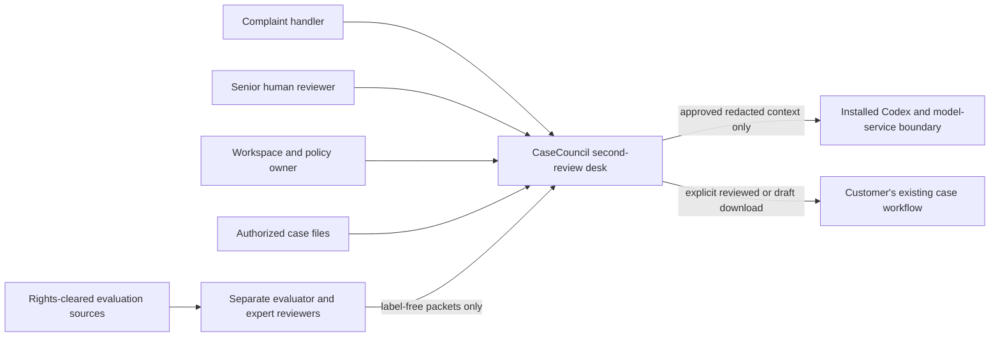
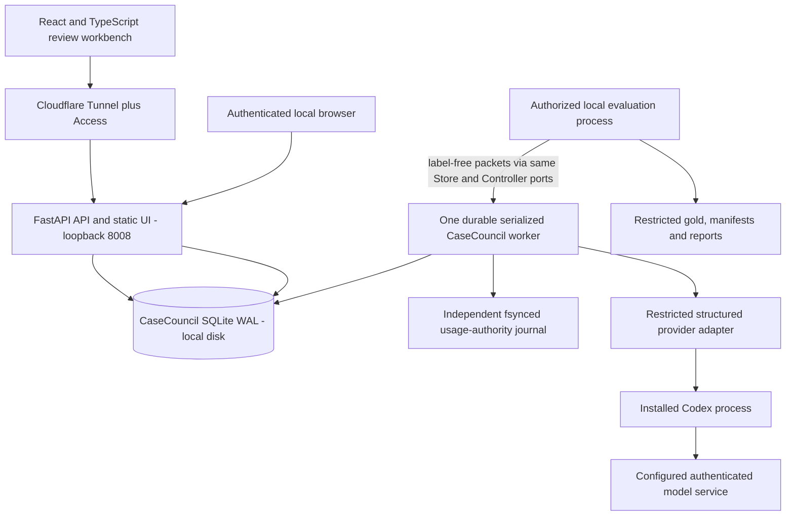
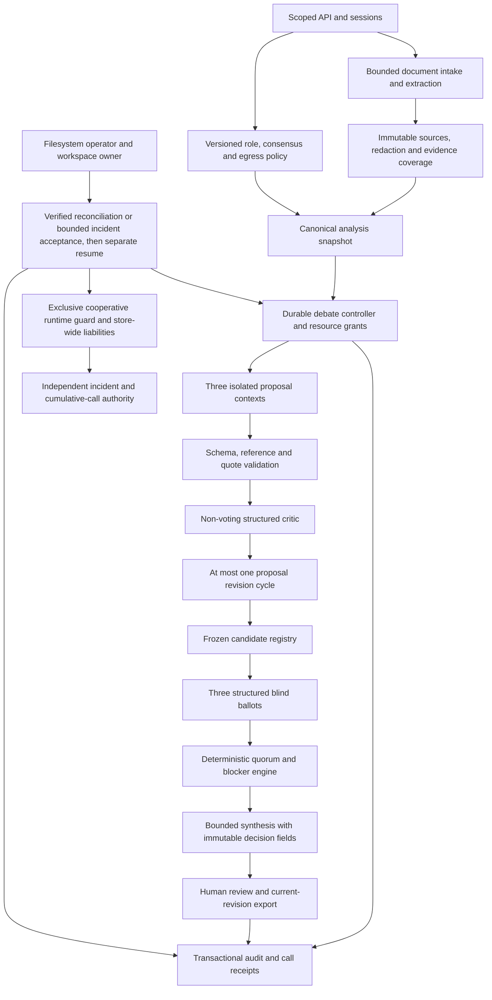
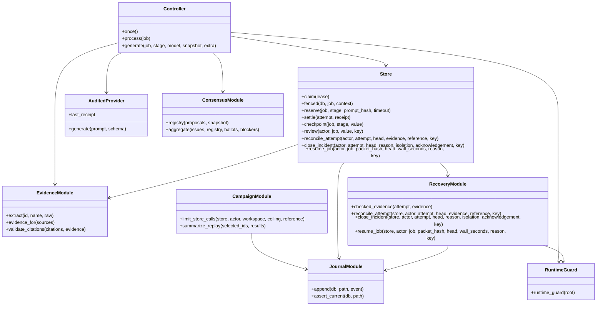
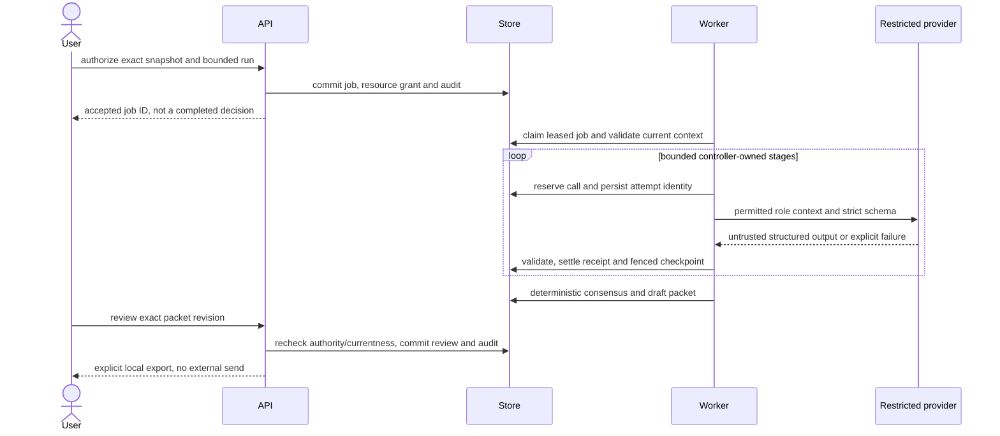

# Architecture — C4 levels 1–4

The application components below are implemented; Cloudflare/Windows deployment
and independent expert evaluation remain target boundaries, not accepted deployments.
CaseCouncil's service, database, credentials and evaluator are separate from Days 1–8.
See the [actual module map and deviations](implementation-and-operations.md).
20 October adds [owner-approved irrecoverable incident closure](incident-closure-2026-10-20.md),
a cooperative runtime fence and monotonic campaign call ceiling. These do not
convert unknown receipts into observed usage or independent semantic acceptance.
Alternative-source research adds an explicit isolated IE evaluation Store/factory;
normal UK intake/publication rejects IE. Source reuse and external-model egress are
separate gates. See [source evidence](fspo-source-and-validation-2026-10-19.md).

## Level 1 — system context

FOS acquisition is not a live application feature. Source permission and commercial
validation are outside the model's authority. Nothing sends a final response for a user.

## Level 2 — containers

API/worker are separate local processes under a restricted Windows service identity.
Only the UI/API are eligible for tunnel ingress. No public model, database, artifact
directory, debug server or worker endpoint. Cloudflare identity is additional to,
not a substitute for, application authorization. Local-host access also authenticates.

The runtime receives extracted/redacted permitted evidence, not evaluator originals
containing decisions. Separate directories alone are not a security boundary:
service-account ACLs and disabled/audited model tools must enforce the intended separation.

## Level 3 — application components

If revision is unnecessary, the controller freezes validated initial proposals.
Provider output cannot mutate policy, choose its role, change permissions, fabricate
ballots or declare consensus. Mechanical validators cannot prove semantic truth;
critic findings and independent human acceptance remain distinct layers.

## Level 4 — implemented code relationships

Implemented modules under `apps/casecouncil-api/src/casecouncil_api/`: `api`,
`store`, `controller`, `consensus`, `evidence`, `pdf_worker`, `runtime`, `worker`,
`journal`, `backup`, `evaluation`, `recovery`, `verification`. Auth/audit are in Store/API; roles and synthesis
in Controller. `EvidenceModule`, `ConsensusModule`, `RecoveryModule` and `JournalModule` denote
Python modules/functions, not additional classes. Sources and packets are immutable
SQLite rows/BLOBs. Contracts live in `packages/contracts`, UI in `apps/casecouncil-web`.

## Execution and failure sequence

No database transaction spans parsing, inference or human waiting. Checkpoints make
restart economical, not exactly-once inference: a process can die after model usage
but before checkpoint. Reserve/receipt reconciliation retains that ambiguity.
Lease loss is typed and handled in both execution and error-recording paths.
Changed evidence, policy, authority, cancellation or restore epoch prevents stale
publication. See [recovery](audit-and-recovery.md) and [operations](operations.md).
