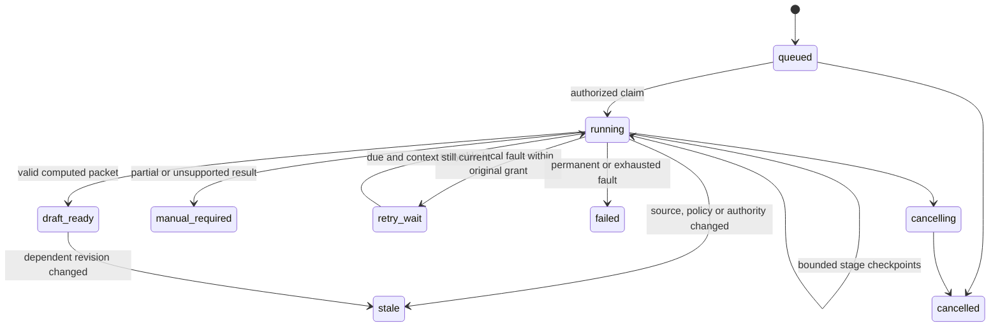

# Durable audit, cancellation and recovery

Implemented recovery update: [20 October diagnostic, reconciliation and resume contract](recovery-fix-2026-10-20.md).
It preserves original receipts/reservations, archives partial packets/checkpoint
projections and retries only eligible failed stages. Missing evidence keeps the
live unknown-usage hold closed; acknowledgement alone does not release it.

Requirements baseline, now backed by checkpoint-crash, lease, journal and quarantined
restore tests. See [measured evidence](implementation-validation-2026-10-19.md) and
[actual recovery commands](implementation-and-operations.md). Source/packet
artifacts are SQLite BLOBs/rows rather than separate files; the usage journal is
external. Backups are plaintext and require protected encrypted storage. Physical
Windows recovery and privileged-tamper resistance have not been accepted.

## Store and checkpoints

Proposed local SQLite WAL with foreign keys, FULL synchronization and short
transactions. Immutable versioned artifacts live under a distinct CaseCouncil data
root, with content integrity verified at use boundaries. No SQLite network share.

Logical tables: workspaces, members/grants, cases, source/context/policy revisions,
snapshots, run grants/jobs, stage attempts, proposals, critiques, candidate registries,
ballots, computed consensus, packets, human reviews, exports, call receipts, audit,
heartbeats and restore metadata. Final schema follows contract tests; a diagram is
not a migration. Application tests must verify database constraints too.

Atomic operations include job creation plus grant/audit, call reservation plus attempt
identity, each validated checkpoint plus receipt/audit, ballot commitment, consensus
commit and review plus audit. No transaction spans a provider call or user waiting.
Source-file writes use staged files, verified digest and atomic publication before
the database makes them available; recovery detects orphaned/missing artifacts.

## Job lifecycle

Human review is a separate attributed object; `draft_ready` is not `approved`.
Historical completed output remains visible as stale only to users still entitled
to inspect it. A new run links previous work but does not rewrite history or reset
workspace usage holds.

## Lease and attempt fencing

Proposed lease 600 seconds, renewal every 20 seconds, at most four job claims
including expired reclaims. Stage time/call allowances survive all claims; a retry
cannot reset the 22-invocation or 30-minute active-run ceiling. Record each stage
reservation and its conservative time allowance so restarts cannot gain free time.

Before dispatch and commit, check lease token/expiry, cancellation, exact snapshot,
current grants/egress and restore epoch. Typed lease loss must propagate through
provider-audit/schema code and be caught around both processing and failure
recording. A stale worker records safe loss evidence where possible, but must not
clear, renew, retry or complete the replacement worker's job.

Completed checkpoints can be reused only within identical valid bindings. An
ambiguous call after a crash is not automatically replayed: it may already have
consumed usage. A surviving valid output can be validated and reconciled against
its attempt identity; otherwise retain unknown usage and open a runtime circuit.
Provider failure is never silently converted into an abstention or fake ballot.

## Retry, cancellation and safe degradation

Retry only diagnosed transient local/provider conditions under the original remaining
grant and runtime policy. One schema repair per logical stage is separate from
workflow restart attempts. Exponential backoff and jitter are persisted, bounded by
the run deadline; permanent rights/authority/schema exhaustion needs intervention.

Cancellation is idempotent and fences future dispatch/results. Kill the local model
process tree where supported, but do not assume remote usage is zero. A late output
is recorded safely and cannot revive cancelled work. New evidence requires explicit
new authorization; no background infinite debate or “continue until agreement.”

Any usable earlier proposals/critic/ballots remain in a deterministic manual packet
when later work fails. Do not publish a review-ready majority from only available
roles, blend different registry revisions or hide an expensive failed synthesis.

## Audit content and integrity limits

Record actor/stage/attempt IDs, scope/revisions, source and prompt digests, provider
profile, call reservation/receipt, safe validation failure class, critic response,
candidate freeze, ballots, computed agreement, blockers, cancellation, review/override,
export, grant/policy change, erasure and restore events. Separate event categories
for parse/quote errors, timeout, tool-audit rejection, lease loss and source staleness.

Routine audit holds no raw private prompt or source body. An authorized evidence
viewer resolves immutable source references separately. Reviewer corrections record
old/new values and reasons; a human override does not edit past automated ballots.

Sequence/hash-chain events detect accidental divergence when compared with an
independently trusted head/backup. This is not tamper-proof against a host admin
rewriting both store and chain. Specify stronger anchoring/retention before asserting
regulated audit assurance. An audit write failure prevents the domain commit.

## Backup, restore and retention

Operator-driven encrypted snapshots use SQLite's online backup mechanism and a
manifest of schema/store identity, artifact hashes, audit head, grant/call state and
retention policy. Never copy an actively written database file alone and call it a
verified backup. Test restore into a new disposable root first.

For a real restore: stop API/worker, verify manifest/artifacts/schema, allocate a
new restore epoch and invalidate old sessions, leases, pending egress grants and
current-review eligibility. Restore must retain/reconcile call liabilities; it cannot
erase unknown spend. Quarantine in-flight/ambiguous stages, revalidate sources and
require explicit operator authorization before inference. No automatic replay of
every historical case on startup.

Erasure/expiry previews enumerate raw and derived content, exported files and backup
retention obligations. No promise that downloaded copies or third-party model context
can be recalled. Follow approved customer/source policy; document deletion and legal
holds without retaining sensitive content in a supposed deletion audit.
