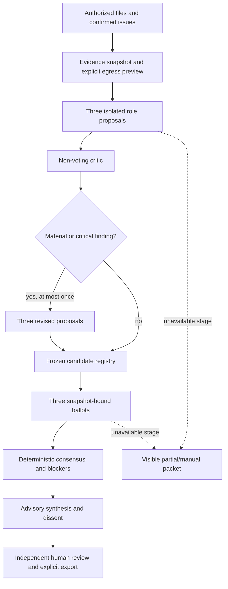

# CaseCouncil study guide: multi-agent debate with accountable consensus

Day 9 of the 14-day, 12-product challenge. Written 20 October 2026 after the
[real-data continuation](real-data-continuation-2026-10-20.md).

The user accepted this delivery checkpoint and requested the learning documents.
That closes this learning cadence, not the outstanding browser, independent domain
or Windows/tunnel acceptance gates. Use the measured validation report as the
authority for results; use this guide to understand how and why the product works.

## 1. Begin with the product, not the number of agents

CaseCouncil is an advisory second-review desk for motor-insurance complaints.
A handler supplies authorized evidence, confirmed issues and a proposed response.
The product prepares competing interpretations, challenges them, records votes,
and assembles an evidence-linked review packet for a separate human reviewer.

The intended buyer is a complaint-handling team. The proposed value is better
challenge and a clearer review handoff—not replacing an ombudsman or automatically
rejecting claims. Commercial benefit has not yet been independently demonstrated.

The original product scope is UK motor insurance. Actual replay used Irish FSPO
party summaries in an explicitly isolated evaluation store. Irish research evidence
does not establish UK legal correctness or prospective case-file performance.

Ask this question throughout the code: **which decisions may the model propose,
and which decisions must the application own?**

## 2. Map all five concepts to implementation

| Day 9 concept | What happens in CaseCouncil | Code and tests |
| --- | --- | --- |
| Multiple agents propose solutions | Customer, insurer and fairness roles independently propose issue-level alternatives with evidence, missing information and counterarguments | [Controller](../../apps/casecouncil-api/src/casecouncil_api/controller.py), [protocol tests](../../tests/test_casecouncil_protocol.py) |
| Critique evaluates | A separate non-voting critic reviews proposals; material/critical findings trigger at most one three-role revision cycle | Controller, [contracts](../../packages/contracts/src/contracts/casecouncil.py), protocol tests |
| Voting | Three role-bound ballots select a frozen candidate or explicitly abstain; each ballot binds the snapshot and registry hash | [Consensus](../../apps/casecouncil-api/src/casecouncil_api/consensus.py), [consensus tests](../../tests/test_casecouncil_consensus.py) |
| Consensus logic | Pure Python validates participation, counts votes, preserves blockers/dissent and determines qualification | Consensus `aggregate`, consensus tests |
| Aggregate synthesis with confidence | A bounded synthesis accompanies the stored computed result; confidence is low/medium and uncalibrated, with human review still required | Controller, [packet verification](../../apps/casecouncil-api/src/casecouncil_api/verification.py), [verification tests](../../tests/test_casecouncil_verification.py) |

These are distinct stages and responsibilities, not five names for one prompt.
Separate roles are also not necessarily separate models: their errors can be correlated.

## 3. Trace one case through the system



This is simplified: checkpoints make completed stages reusable; the full controller
also preserves earlier work when critique, revision or synthesis is unavailable.
An accepted run request means queued work, not a completed or correct recommendation.

The service uses FastAPI, React/TypeScript, Pydantic contracts and its own SQLite
database. The separate worker calls a provider port backed by installed Codex.
The target is an old Windows laptop behind protected Cloudflare access, but that
physical deployment has not been accepted. Local CLI execution does not imply
offline inference; approved context may reach its configured model service.

## 4. Independent proposals reduce one kind of influence

Initial proposers receive the same authorized evidence but not the other initial
answers. Their roles have different responsibilities:

- Customer: develop the strongest supported customer interpretation.
- Insurer: test handling against supplied evidence, not defend every action.
- Fairness: examine supported alternatives without impersonating an adjudicator.

Each `Candidate` includes an issue ID, disposition, remedy, conditions, rationale,
counterargument, citations and missing evidence. A substantive disposition requires
citations; `undetermined` requires named missing evidence. The controller also
requires exact coverage of the confirmed issues.

Isolation limits initial copying or anchoring between roles. It does not create
independent expertise or prove that shared evidence is sufficient. Three prompts
to one model can repeat the same mistaken interpretation.

## 5. Critique is not another vote

The critic sees the proposals and identifies targeted findings with severity and
support. It has no ballot and cannot alter the policy or decide the outcome.

A material/critical finding triggers one revision cycle for all three proposers.
Each revised proposal must respond to the supplied finding IDs as accepted,
contested or unresolved. Those responses do not self-certify that a human has
resolved the finding: material/critical findings remain review blockers.

An empty findings list means the critic returned no findings. It does not establish
that there were no defects. In the six real cases, all critics returned empty
findings, so that replay did not exercise revision or establish defect-detection
recall. Authored tests exercise the revision mechanism separately.

## 6. Freeze alternatives before collecting votes

`registry` validates the full proposer roster and hashes canonical candidate
payloads. Exact-equivalent candidates merge while retaining proposer lineage.
Candidates with the same disposition but different remedies, rationale, conditions
or evidence are not automatically the same choice.

The registry hash binds the alternatives being voted on. A ballot includes the
analysis snapshot, registry hash and exactly one choice per confirmed issue.
Unknown candidates, wrong-issue candidates, stale bindings and forged voters fail.
Ballots are generated without earlier ballots in their prompt.

Abstention and unavailability are different. `candidate_id: null` is a valid role's
explicit abstention. A missing/invalid ballot is an unavailable participant. Neither
can silently disappear from the fixed denominator of three.

## 7. Learn consensus with a fictional example

The following is an authored teaching example, not a replayed complaint or legal advice.
Assume candidates A and B are valid choices for the same issue.

| Submitted ballots | Blocker | Computed interpretation |
| --- | --- | --- |
| A, A, A | None | Unanimous agreement |
| A, A, B | None | Majority agreement; B's dissent stays visible |
| A, A, explicit abstention | None | Majority agreement with three valid participants |
| A, A, unavailable third role | None | Insufficient participation, not qualified agreement |
| A, A, B | Missing decisive policy evidence | Agreement blocked |
| A, B, explicit abstention | None | No consensus |

The implementation requires all three valid ballots for an agreement status and
at least two votes for a winning candidate. Context/coverage blockers, unresolved
material critique, unassessed issues, ballot missing-evidence statements and the
winner's missing evidence can prevent qualification. An `undetermined` candidate
does not become qualified simply because it wins votes.

Qualification means eligible for **human review under these rules**, not approved,
legally correct or ready to send. The controller assigns medium confidence only
when every issue is qualified; otherwise low. Neither label is calibrated.
Two votes out of three are not a 67% probability of correctness.

## 8. Separate syntax, grounding and truth

Pydantic rejects invalid shapes, unsupported fields and out-of-bounds values.
Application checks validate issue coverage, role identity, candidate references
and exact citations against permitted evidence spans.

A citation has `source_id`, Unicode `start`/`end` offsets and `quote`. Python text
indices are not JavaScript UTF-16 offsets, which is why the frontend converts by
Unicode code points before highlighting.

There are at least three different questions:

1. Does the answer match the contract?
2. Does its cited text exist in the permitted source span?
3. Does that source actually support the interpretation?

The first two have mechanical checks. The third still needs substantive review.
A correctly quoted party allegation is not automatically an established fact.
Synthesis observations carry checked citations; this does not certify every inference
in free-text response/action fields. The synthesizer cannot rewrite stored votes
or approval, but reviewers must still catch misleading prose.

For that reason the UI labels synthesis an internal advisory summary, not a customer
letter. The human response editor starts from the handler's draft, not AI voting metadata.

## 9. Durability turns a debate into a service

Read [Store](../../apps/casecouncil-api/src/casecouncil_api/store.py) next.
It owns permissions, revisions, immutable evidence, idempotency, leases, checkpoints,
attempt receipts, review and export. A snapshot binds evidence, context, rights,
policy and relevant authority revisions. A changed source cannot silently inherit
an old review.

A worker lease fences writes by expired/replaced workers. A checkpoint records a
validated stage result. On resume, a completed proposer should not be called again
just because a later ballot failed. An idempotency key makes an uncertain retry of
the same request converge; conflicting reuse is rejected.

Bounds are cumulative: eight normal calls, eleven with one full revision cycle,
at most two attempts per stage and 22 calls per run. Calls reserve 90 seconds;
run allowances and claim limits still apply after restart/recovery. Schema/source
repair is not permission to retry unknown usage or unsafe runtime indefinitely.

## 10. Study the failure that made recovery concrete

The original real-data campaign completed two cases. A ballot call on the third
exited without known usage or a verified tool audit. The product retained earlier
proposals/critic and stopped further dispatch. Three cases remained unstarted.
The old failure lacked enough retained diagnostics to establish its root cause;
do not describe it as proven quota, authentication or network failure.

The subsequent work added sanitized failure diagnostics, verified-evidence recovery,
and then an explicitly owner-approved path for an irrecoverable incident:

- Preserve the unknown receipt and full reserved call/time charge.
- Require owner/operator authority, an expected journal head and stopped-runtime
  isolation attestation; a cooperative file lock fences active cooperating workers.
- Reject explicit unsafe-tool/integrity incidents and already-reviewed packets.
- Allow one closure per store-authority lifetime, not one per workspace.
- Resume separately, with current rights/snapshot and original remaining allowances.
- Keep incident warnings and a required reviewer resolution in packets/exports.

Read [recovery](../../apps/casecouncil-api/src/casecouncil_api/recovery.py),
[runtime guard](../../apps/casecouncil-api/src/casecouncil_api/runtime_guard.py) and
[incident tests](../../tests/test_casecouncil_incidents.py).
Operator acceptance is not evidence of known usage or safe historical tools.

The independent fsynced [journal](../../apps/casecouncil-api/src/casecouncil_api/journal.py)
preserves accounting across database restores. The campaign's monotonic 132-call
ceiling counts original attempts too. It cannot be raised by another grant or
reset through a new workspace. These controls do not defeat a hostile host administrator.
Unknown tokens/monetary cost remain unknown; retained reservation is not a fabricated bill.

## 11. Interpret the measured evidence correctly

| Evidence layer | Observed result | What it does not establish |
| --- | --- | --- |
| Source acquisition | 132 actual Irish decisions; 122 usable excerpts | Independent groups, full original files or UK source rights |
| Local-only corpus checks | 122 cases with an explicit test provider | Real-model semantic accuracy |
| Approved actual-model replay | Six complete artifact sets; five fully audited histories and one accepted unknown | Six clean audited passes or held-out benchmark quality |
| Calls/citations | 49 calls, 48 known receipts; 71 exact citation occurrences rechecked | Exact total cost or factual support of every interpretation |
| Real outcomes | All low confidence; zero qualified issues; no human approvals | Production decision quality or useful qualified coverage |
| Engineering | 681 Python tests, zero skips; 148 product tests included; six frontend tests/build passed | Browser, Windows or independent domain acceptance |
| Actual-data local restore | Six stale jobs, 49 attempts, incident retained, zero sessions, quarantine on | Physical Windows outage/disk-loss recovery |

All six lack full original policy/case evidence. Two produced `agreement_blocked`
and four `no_consensus`. Missing evidence was not removed to force a reassuring
success result. The final recheck deliberately exits nonzero because the historical
unknown remains; all artifacts present and fully audited acceptance are different metrics.

## 12. Hands-on reading and testing path

Start with contracts, then `consensus.py`, `Controller.process`, `Controller.generate`,
Store, recovery/journal and finally the [React workbench](../../apps/casecouncil-web/src/main.tsx).
Follow one issue through those boundaries rather than reading every file alphabetically.

From an already configured repository environment:

```sh
.venv/bin/python -m pytest -q tests/test_casecouncil_consensus.py tests/test_casecouncil_protocol.py
.venv/bin/python -m pytest -q tests/test_casecouncil_incidents.py tests/test_casecouncil_resume.py
npm --prefix apps/casecouncil-web test
CASECOUNCIL_PROCESS_TEST=1 make casecouncil-test
```

These use authored providers, not new real-case model calls. The last command needs
loopback permission and builds the UI; without the process flag, socket acceptance
is skipped. On Windows use `.venv/Scripts/python.exe` for direct Python commands.
Do not replay an expired source grant or infer new model-spend approval from this guide.

Exercises in a disposable test store, never the preserved live campaign:

1. Add a wrong-snapshot ballot. Predict the validation error before running it.
2. Compare an explicit abstention with an unavailable voter; inspect denominator three.
3. Add missing evidence to a winning candidate. Show that a majority cannot erase it.
4. Trigger a material critique. Trace finding IDs through revision and human review.
5. Fail a ballot with unknown usage. Confirm partial work, unchanged charge and global hold.
6. Resume an approved incident. Assert only unfinished model stages run.
7. Remove an incident notice before verification. Confirm the verifier rejects it.
8. Restore a disposable backup. Confirm quarantine, stale jobs and revoked sessions.

## 13. Explain it back in your own words

You understand this product when you can answer:

- Why are three role contexts not three independent experts?
- Why does the critic not vote, and why can't a revision self-clear its finding?
- What exactly is frozen by the registry hash?
- Why can two matching votes still be unqualified?
- What can an exact citation prove—and what can it not prove?
- Why must a later stage failure preserve earlier checkpoints and budget use?
- How is incident acceptance different from verified reconciliation?
- Why can all six packets be complete while audited campaign acceptance is false?
- What evidence would show debate is worth its extra calls compared with a single agent?

The last question still needs a matched baseline comparison and independent review.
Learning the architecture and accepting this delivery checkpoint does not answer it.

Continue with [architecture](architecture.md), [measured continuation](real-data-continuation-2026-10-20.md),
[incident policy](incident-closure-2026-10-20.md) and the [engineering blog](blog.md).
