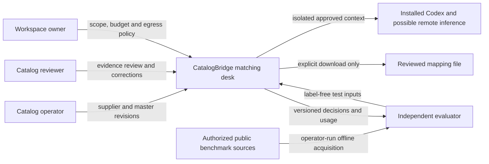
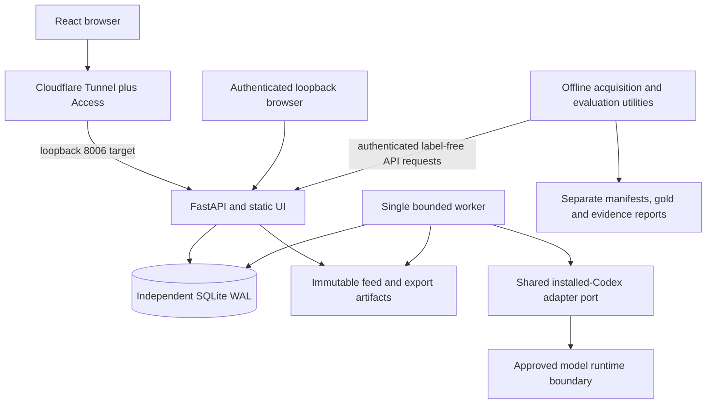
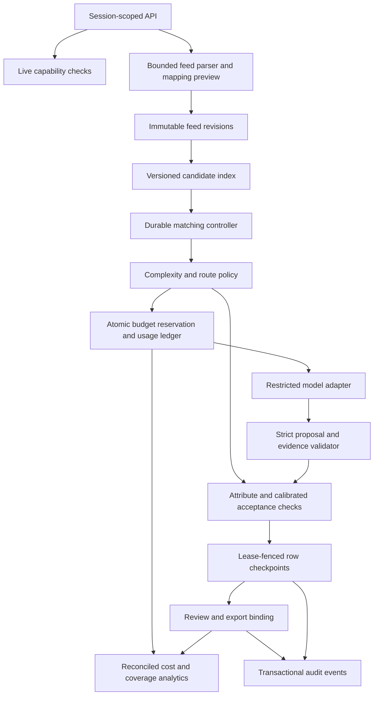
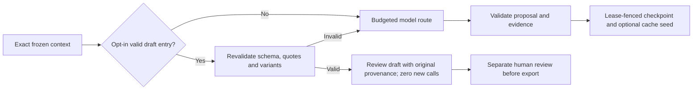
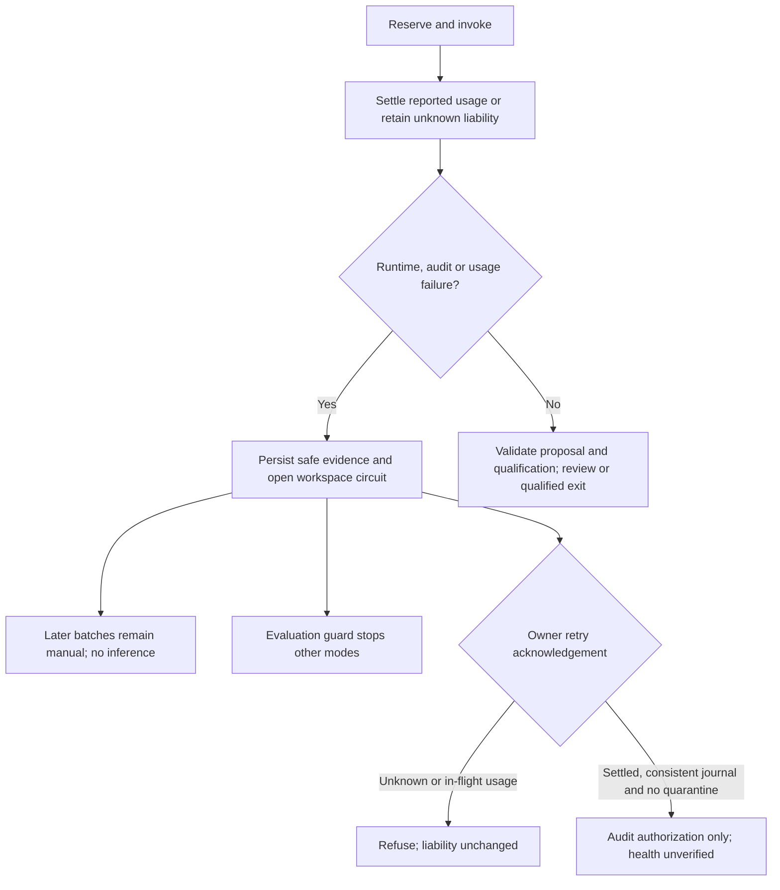
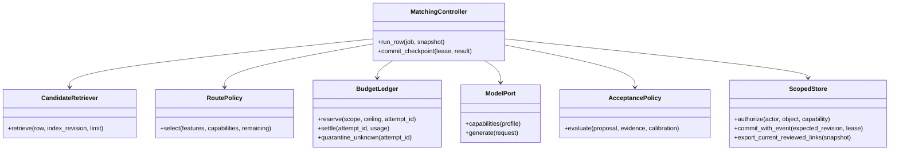
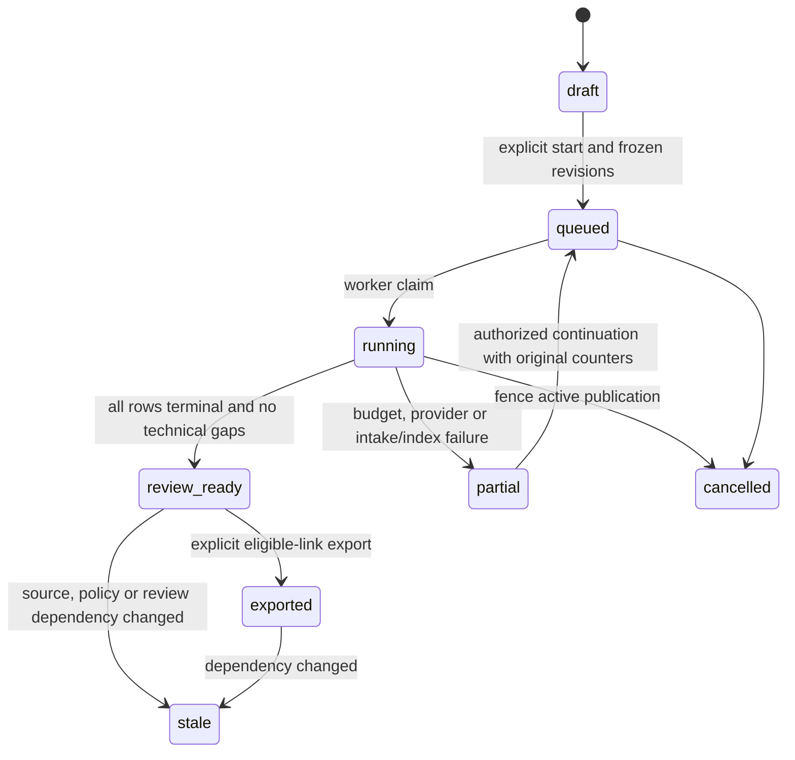

# Architecture — C4 levels 1–4

Status: original target design; the implemented pilot and deviations are mapped in the [runbook](implementation-and-operations.md). Illustrative C4 classes are not all separate implemented classes. Python/FastAPI/Pydantic, React/TypeScript, independent local SQLite and one durable worker follow the monorepo pattern. Existing products' data/controllers remain independent; provider telemetry is a product-owned subclass, not a changed shared result contract.

## C4 level 1 — context



No store-writing or arbitrary website-fetch integration. Evaluator labels never enter application storage/prompts. Local hosting does not imply offline inference.

## C4 level 2 — containers



API and worker are separate processes under a limited Windows identity. Proposed `var/catalogbridge` data is local disk; evaluator gold sits outside runtime-accessible paths. Protected HTTPS and application authorization are both required. Port 8006 is a convention to verify, not an active endpoint.

## C4 level 3 — components

Implemented amendment: the optional [local pair scorer](../../apps/catalogbridge-api/src/catalogbridge_api/local_router.py) runs after egress/runtime-hold checks, before draft reuse and LLM reservation. The controller binds a service-configured profile hash; bounded JSON trees produce only source-validated review drafts. Ambiguity returns to the existing budgeted route. Profile availability is exposed through authenticated API/UI. This is a local classification component, not a second model API or autonomous acceptance service. [Current validation and limits](local-routing-validation-2026-10-18.md).



Model proposals never choose budgets, permissions, model identity or final acceptance. The deterministic controller performs those actions. No transaction spans inference, file parsing or user waiting. Short transactions atomically reserve or settle allowance and append corresponding events.

### Runtime safety amendment — 18 October

Latest additions: [timeout receipts and exact-context draft reuse](receipts-and-repeat-work-2026-10-18.md). The adapter captures partial timeout telemetry and rejects ambiguous multi-turn totals. Settlement and sanitized receipt share an application transaction; the independent journal remains fail-closed. Opt-in workspace-keyed `draft_cache` references original tasks, expires after 24 hours and is seeded by lease-fenced checkpoints. Source/master/candidate/policy hashes and fresh evidence validation gate lookup. Reuse yields a provenance-linked `needs_review` draft, never calibrated acceptance.



Egress and workspace-hold checks precede the cache path. Source-task human review/cancellation invalidates lookup. Hits do not renew expiry or seed reuse chains.

The adapter's `runtime.py` creates safe failure evidence; the store persists workspace-scoped provider holds and discovers historical unknown liabilities. Reservation checks enforce the hold across batches. The evaluator has an additional shared guard across its independent mode stores. The UI reads circuit state from analytics; only the owner can authorize a new trial after all usage is settled. No acknowledgement verifies health or refunds liabilities. [Implementation/evidence](runtime-hardening-2026-10-18.md).



The optional classifier instruction asset is packaged, hashed and profile-bound; `legacy` remains default. Operator-attested calibration cannot authorize confidence exits, and owner uploads cannot promote themselves to empirical verification. Backend/provider/asset snapshots and phase hashes distinguish successive implementations; no retrospective root cause or complete release acceptance is inferred from a later successful run.

Policy v2 adds a pure serialized-input preflight ahead of reservation. The worker distinguishes draft-completion exits from calibrated acceptance, and effective-identity verification from permission to escalate an uncertain draft. Every validated proposal is kept in an attempt-bound history; a failed escalation publishes the prior draft as degraded/manual review while preserving liability. Retrieval and attribute normalization are implemented in `matching.py`; changed policy/prompt/retrieval and code hashes invalidate old calibration bindings. These changes do not add a provider-side hard token limit or independent model-identity attestation.

## C4 level 4 — illustrative code relationships



Proposed footprint: `apps/catalogbridge-api/src/catalogbridge_api/` with `api.py`, `store.py`, `ingest.py`, `candidates.py`, `routing.py`, `budgets.py`, `model_boundary.py`, `evidence.py`, `worker.py`, `reports.py`, `backup.py`; `apps/catalogbridge-web/`; `packages/contracts/src/contracts/catalogbridge.py`. Illustrative interfaces are not promises of exact class decomposition. Add shared typed usage/capabilities under `agent-core` without changing existing products' defaults.

## Dispatch and settlement sequence

```mermaid
sequenceDiagram
  participant API as Scoped API
  participant DB as Store and ledger
  participant W as Worker
  participant M as Installed model adapter
  API->>DB: Freeze inputs, policy and budget; enqueue
  W->>DB: Claim lease; load exact revisions
  W->>W: Retrieve candidates and evaluate cheap route
  alt Evidence and calibrated policy permit exit
    W->>DB: Commit recommendation, exit reason and event
  else Model route needed
    W->>DB: Atomically reserve row/batch allowance and dispatch intent
    W->>M: Selected model, bounded context and deadline
    M-->>W: Proposal plus usage/model/audit evidence or failure
    W->>DB: Settle once or retain unknown liability
    W->>W: Validate evidence and calibrated confidence
    W->>DB: Commit checkpoint or bounded escalation/review state
  end
  API->>DB: Reviewer decision using expected revision
  API->>DB: Export only current eligible mappings
```

Reservation settlement may commit even when a stale worker cannot publish its recommendation: real incurred usage must remain recorded. Separate idempotent accounting permission from result-publication lease fencing. Crash after dispatch can create unknown usage; do not treat missing result as free or blindly redispatch.

## State model



`review_ready` can contain unresolved rows; it does not mean all rows matched. Row stages and attempt states are separate. Prior successful rows remain reviewable after later failure. Exports are immutable historical snapshots; stale downloads cannot be recalled, but new export is blocked until revalidation.

## Persistence and architectural decisions

Proposed tables: workspaces/users/grants/sessions; feed_revisions/records/field_mappings; index_revisions; policy_versions/model_profiles/rate_cards/calibration_versions; batches/row_jobs/attempts/leases; budget_accounts/reservations/usage_events; candidates/proposals/evidence/decisions/reviews; exports/audit_events/restore_epoch.

Use integer resource units and fixed-point money, immutable provenance, foreign keys, unique attempt/settlement IDs, scoped idempotency keys and compare-and-swap revisions. Authorize and commit current scope together. Cancellation forbids new dispatch; already incurred cost is retained. At-least-once jobs plus fenced commits are not exactly-once provider invocation.

| Decision | Rationale and consequence |
| --- | --- |
| Bounded retrieval before model comparison | Avoids catalog-wide prompts; missed candidates must be measured separately |
| Deterministic conflict checks plus calibrated exit | Evidence checks constrain acceptance but do not prove identity |
| Explicit real model profiles | Cost/complexity routing cannot be demonstrated by renaming one model |
| Reservation/settlement ledger | Prevents concurrent admission overspend; unknown usage can intentionally stop work |
| Reviewed exports first | Prevents model suggestions becoming unapproved catalog writes |
| Local SQLite and one worker | Fits target host; capacity and full seven-product coexistence require measurement |

Recovery must preserve external usage liabilities and current revocation/deletion authority outside any older restored snapshot. See [operations](operations.md) and [budget design](budgets-and-analytics.md).
