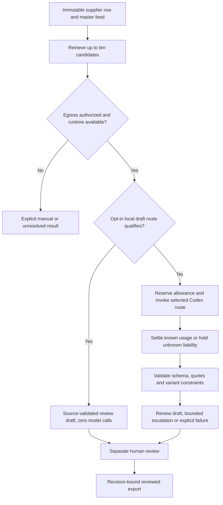

# Study guide: cost-aware agents through CatalogBridge

Day 7 of the AI product challenge. Updated 18 October 2026.

Read this alongside the [architecture](architecture.md), [operator runbook](implementation-and-operations.md) and [latest routing experiment](local-routing-validation-2026-10-18.md). This guide explains the implemented system and its limitations; it is not a declaration of production acceptance.

## 1. Start with the customer decision

CatalogBridge helps a catalog operator answer: **“Does this supplier listing refer to one of our existing products?”**

For example, “Crucial 8GB DDR4 SODIMM” and “Crucial 16GB DDR4 SODIMM” look similar but identify different variants. Linking them incorrectly can contaminate a catalog. Sending every comparison to a large model can also waste allowance without improving the decision.

The intended product benefit is less matching/review effort at controlled error and processing cost. Customer benefit and willingness to pay remain unproven. The delivered workflow imports immutable feeds, retrieves candidate products, produces evidence-backed drafts, supports human review and exports reviewed mappings. It does not autonomously merge inventory or reprice products.

Three questions must stay separate:

1. Did the workflow execute and preserve its evidence?
2. Was the proposed identity decision correct?
3. Did the router deliver a worthwhile quality–cost tradeoff?

A passing unit test answers only the behavior that it actually checks.

## 2. Map the four requested concepts to the product

| Concept | What CatalogBridge does | Where to read |
| --- | --- | --- |
| Token budgeting per task | Reserves advisory allowance before dispatch; settles reported usage; retains unknown liabilities; counts escalation and failures | [Store](../../apps/catalogbridge-api/src/catalogbridge_api/store.py): `reserve`, `settle`, `analytics`; [accounting tests](../../tests/test_catalogbridge_accounting.py) |
| Routing by complexity/cost | Simple candidate-count/missing-brand gate chooses economy-first or strong-first; optional local scorer can avoid a model call for a bounded review draft | [worker](../../apps/catalogbridge-api/src/catalogbridge_api/worker.py): `run_once`; [local scorer](../../apps/catalogbridge-api/src/catalogbridge_api/local_router.py) |
| Early exit on confidence | Automatic model-based recommendations require applicable empirical calibration and effective identity; real automatic acceptance remains unqualified. Local benchmark bands can stop inference only for review drafts | [contracts](../../packages/contracts/src/contracts/catalogbridge.py): `Calibration`; [routing policy](routing-and-confidence.md); [worker tests](../../tests/test_catalogbridge_worker.py) |
| Cost-per-decision analytics | Keeps measured usage, reference estimates and actual charges separate; reports row/call denominators, holds and model routes | Store.`analytics`; [analytics design](budgets-and-analytics.md); [frontend helpers](../../apps/catalogbridge-web/src/domain.ts) |

Coverage in code is not the same as empirical acceptance. In particular, fixture-based confidence exits do not prove that real confidence acceptance is qualified.

## 3. Understand one task from ingestion to export

One task is one supplier row against a frozen master feed. Candidate comparisons share that task's allowance; ten candidates are not ten independently budgeted supplier rows.



The worker also supports opt-in exact-context draft reuse. That is distinct from the local scorer: reuse remembers a prior unchanged draft; the scorer computes features for a fresh pair.

The API and durable worker are separate processes. Local SQLite stores state, while a separate liability journal provides an additional accounting check. The installed Codex CLI is behind a product-owned adapter. Hosting on a Windows laptop does **not** mean inference is offline: the CLI may use remote inference.

Read [the actual contracts](../../packages/contracts/src/contracts/catalogbridge.py) before assuming the original architecture's proposed interfaces all exist.

## 4. Token budgeting is a ledger, not a prompt instruction

Imagine a row with a 30,000-token advisory allowance. Before a model call, the worker reserves 12,000. Suppose runtime telemetry later reports 7,000 input and 300 output tokens. The settled usage is 7,300; the reservation is replaced by the observed value.

If the call fails without usable usage telemetry, its reservation stays held. The remaining advisory allowance is conceptually:

```text
original allowance + authorized increases
  - known settled usage
  - outstanding reserved/unknown liabilities
```

The actual unknown usage could exceed the reservation. This is why a local ledger does not become a hard provider-enforced spending ceiling.

Important distinctions:

- Cached input is a subset of input, not extra input tokens.
- Reasoning output is a subset of output, not an additional charge to add again.
- Failed calls may consume allowance.
- A timed-out process is not proof of zero usage.
- A missing usage payload means **unknown**, not free.
- The supported strict-budget request is refused because the installed port does not establish hard-token enforcement. It is not silently downgraded.

Actual preflight bounds the serialized prompt/schema envelope in **bytes**. That is not an exact model-token count.

Run [core ledger tests](../../tests/test_catalogbridge_core.py), [accounting tests](../../tests/test_catalogbridge_accounting.py) and [runtime safety tests](../../tests/test_catalogbridge_runtime_safety.py). Look for race-safe reservations, idempotent known settlement, held liabilities, journal divergence and restore quarantine.

## 5. Why a cheaper model may not save tokens

“Cheaper” can refer to a different unit price, fewer consumed tokens, fewer calls or less review effort. They are not interchangeable.

The original controller sends ordinary cases to the economy route and ambiguous multi-candidate cases directly to strong. An economy response that is uncertain or invalid can trigger a stronger call. The current worker has two normal model stages; a separately implemented general third schema-repair stage should not be inferred from broader design limits.

If both routes receive a similar context, their token consumption can be nearly identical:

```text
one economy call ≈ shared context + small answer
economy then strong ≈ two contexts + two answers
```

A lower hypothetical token price does not prove fewer tokens or lower subscription charges. The earlier compact-instruction experiment reduced absolute context overhead for **both** models. It did not establish a routing advantage over an equally compact strong-only baseline.

This motivated a genuinely different stage: a small local classifier can sometimes avoid the context-bearing call entirely. That changes the execution graph, not merely the requested model name.

## 6. Study the local scorer without confusing it with an LLM

The new [local scorer](../../apps/catalogbridge-api/src/catalogbridge_api/local_router.py) is a bounded boosted-tree classifier represented as JSON. Training is in [the development utility](../../scripts/train_catalogbridge_local_router.py). Its features include title-token/character overlap, identifying-number/code overlap, brand information and variant-conflict indicators.

Product IDs and prices are not prediction features. Evaluator labels and entity-group IDs never enter runtime feature vectors. Features are symmetric: swapping the two products should not change their pair score. The score is a classifier output, **not an independently calibrated probability that a customer decision is correct**.

Inference evaluates small trees directly. There is no pickle loading, generative prompt or network call for that stage. Profile validation checks finite values, feature version, tree bounds and declared band statistics. It does not independently authenticate the training evidence; the service must use a trusted, reproducibly generated artifact.

The first experiment separated 12,233 fitting pairs, 3,186 tuning pairs and 20,381 qualification pairs by product entity groups. No group or offer crossed those boundaries. Threshold selection happened on tuning data before qualification.

The numeric negative-band check selected 1,077 offer-disjoint cases; 1,073 agreed with publisher labels. Its naive pair-level Wilson lower bound exceeded 99%. But product groups repeat within those cases, so independent statistical safety is **not established**. The profile is explicitly restricted to benchmark review drafts.

The same-product band failed: 717 agreements among 775 selected cases. It stays disabled. A runtime flag cannot turn that failed result into confidence.

For a multi-candidate row, one easy negative is not enough to exit. Every retrieved candidate must fall in the enabled negative band. Even then, the result means “different from these candidates,” not “absent from the entire catalog.”

See [local-router tests](../../tests/test_catalogbridge_local_router.py), [training tests](../../tests/test_catalogbridge_local_training.py) and [worker integration tests](../../tests/test_catalogbridge_local_worker.py).

## 7. Separate three kinds of stopping

**A confidence-based automatic recommendation:** needs qualified evidence, a matching policy binding, verified effective identity and applicable thresholds. Supported owner calibration uploads cannot simply declare themselves empirically verified. Real automatic acceptance remains blocked.

**A completed review draft:** a valid binary proposal can stop further spending while remaining `needs_review`. This avoids paying for another opinion without claiming the draft is safe to apply. Local-scoring exits also stay in this category.

**A cached review draft:** exact source/master/candidate/policy context reuses an earlier unreviewed draft for up to 24 hours. Quotes and constraints are revalidated; review is still required. Expiry is not renewed by hits, and reviewed/cancelled sources are excluded.

All three may avoid a later call. They do not have the same authority or evidence. A study or blog that calls every no-call result “qualified autonomous early exit” would teach the wrong concept.

Read [draft-cache tests](../../tests/test_catalogbridge_draft_cache.py) for isolation, invalidation and export exclusion.

## 8. Schema validation and grounding are necessary, not sufficient

`Proposal` is a strict Pydantic contract. The validator also checks candidate membership, exact quotations from both sides and conflicts with same-product claims.

These checks prevent invented candidate IDs, malformed responses and fabricated quotations. They do not prove semantic identity. A genuine quote can identify a similar but different item. A short excerpt can omit a critical variant. A model can return perfectly valid JSON containing a wrong conclusion.

Follow `validate_proposal` in [matching.py](../../apps/catalogbridge-api/src/catalogbridge_api/matching.py). Then inspect a benchmark disagreement rather than assuming every validated proposal is a correct match.

## 9. Runtime failures are part of the product's economics

The adapter consumes runtime JSON events, not token counts invented inside the generated answer. [Official Codex documentation](https://learn.chatgpt.com/docs/non-interactive-mode#make-output-machine-readable) describes the JSON event stream and usage-bearing completion events.

If a timeout occurs after one complete, unambiguous completion receipt, that usage can be retained. If the stream is truncated, contains multiple completions or starts another unfinished turn, the first completion cannot safely stand in for the whole invocation.

Sanitized receipts preserve categories, byte counts, hashes and bounded runtime thread correlation. They do not retain raw logs or credentials. A thread ID helps correlate an incident; it does not prove which model actually served the request.

Workspace circuits block subsequent inference after failures or unknown usage. The evaluation campaign has an additional shared stop across its three mode stores. Already-authorized in-flight calls can still fail after the first stop. Owner acknowledgement cannot erase unknown liabilities, journal divergence or restore quarantine, and never proves runtime health.

The latest live comparison demonstrates why this matters. It stopped on quota after **123 dispatches**: 120 with known usage, totaling **640,523 reported tokens**, plus **three unknown liabilities**. The stop worked. The comparative experiment nevertheless remained incomplete.

The original 61 unknown attempts are separate and remain held. A later quota error does not retrospectively establish the cause or usage of those old failures.

## 10. Evaluate cost and quality on the same work

For a complete, eligible cohort:

```text
token reduction = 1 - router total tokens / strong-only total tokens
```

Include routing, retries, escalation and failures. Compare the same cases, prompts/allowance rules and cache conditions. Preserve unfinished cases in the declared denominator. Also report correctness, unresolved/review rates, latency and actual review burden.

In the latest quota-stopped run, the modes processed 45, 43 and 35 rows respectively. Dividing their whole-mode token totals would compare different work. The report correctly marks `comparison_eligible=false`; the raw ratio is not an accepted savings result.

Other lessons from the current evidence:

- The frozen 600-pair offline challenge produced 101 local exits and one benchmark disagreement. **16.83% call-avoidance coverage is not measured token savings.**
- The local stage made five actual no-call draft exits before the live campaign stopped. This proves the path executed, not that the 20% target passed.
- A separate cross-source candidate failed qualification and emitted no profile. Its 974 reserved challenge pairs remain unscored.
- The earlier 400-query HTTP run achieved 196/200 positive retrieval hits. That is retrieval recall, not final matching precision.
- Benchmark-driven review fixtures are workflow tests, not actual human adjudication.
- Replaying the same records is not additional independent data volume.

The original targets remain >=20% measured token reduction with no more than one percentage point lower decision accuracy and no more than five points lower automatic-decision coverage on the required paired cohort. Independent automatic-match acceptance still requires its separate high-precision evidence. None of these gates is waived by the new scorer.

## 11. Trace the implementation in this order

1. [Contracts](../../packages/contracts/src/contracts/catalogbridge.py): identify which fields a model may propose versus owner/worker-controlled fields.
2. [Matching](../../apps/catalogbridge-api/src/catalogbridge_api/matching.py): retrieval, conflicts, evidence validation and policy binding.
3. [Worker](../../apps/catalogbridge-api/src/catalogbridge_api/worker.py): permission/hold checks, local exit, cache path, routing, settlement and checkpoint.
4. [Model boundary](../../apps/catalogbridge-api/src/catalogbridge_api/model_boundary.py): installed CLI restrictions, event parsing and usage extraction.
5. [Runtime evidence](../../apps/catalogbridge-api/src/catalogbridge_api/runtime.py): safe diagnostics and persistence whitelist.
6. [Store](../../apps/catalogbridge-api/src/catalogbridge_api/store.py): short transactions, lease fencing, independent journal and reviewed export.
7. [API](../../apps/catalogbridge-api/src/catalogbridge_api/api.py) and [workbench](../../apps/catalogbridge-web/src/main.tsx): authenticated operations and honest display of review/unknown states.
8. [Live evaluator](../../scripts/run_catalogbridge_real_models.py): cohort freezing, shared stop, full denominators and comparison eligibility.

## 12. Hands-on learning and self-check

Safe engineering checks from the repository root:

```sh
.venv/bin/python -m pytest tests/test_catalogbridge*.py -q
npm --prefix apps/catalogbridge-web test
npm --prefix apps/catalogbridge-web run build
```

Latest completed whole-repository regression: **476 Python tests**, eight frontend tests and web build pass; six existing dependency warnings remain. A frontend build is not a browser journey or Windows acceptance.

Use the existing tests to explore these questions:

1. Why does a one-token budget still permit an eligible local draft? Because no model dispatch/reservation is needed; the draft still requires review.
2. Why does changing a profile hash prevent a local exit? Because the batch authorized one exact policy artifact, not any later file at the same path.
3. Why can increasing a batch budget fail to resume inference? A workspace circuit or unknown liability is a separate safety condition.
4. Why is a quote-valid wrong answer possible? Source provenance and semantic interpretation are different checks.
5. Why is “1,073/1,077 correct” insufficient for automatic production acceptance? Correlated entities, benchmark-versus-customer truth and deployment evidence remain unresolved.
6. Why is an interrupted cheaper-looking run not a savings pass? It has missing work and unknown usage, not an equivalent completed comparison.

For a development-only local profile, configure `CATALOGBRIDGE_ROUTER_PROFILE` to the trusted generated JSON and inspect `/api/routing-profile` after login. Select the local policy explicitly in batch setup. Do not treat arbitrary count fields in a JSON file as independently certified evidence.

Do not start paid validation commands while quota is unavailable or treat new evaluation storage as a way to clear prior liabilities. Follow the [runbook](implementation-and-operations.md) and [latest experiment report](local-routing-validation-2026-10-18.md) for exact artifacts and outstanding gates.

The takeaway: **a cost-aware agent owns the entire decision process—when to spend, what authority the result has, how uncertainty survives failure, and whether the measured customer benefit actually holds.**
