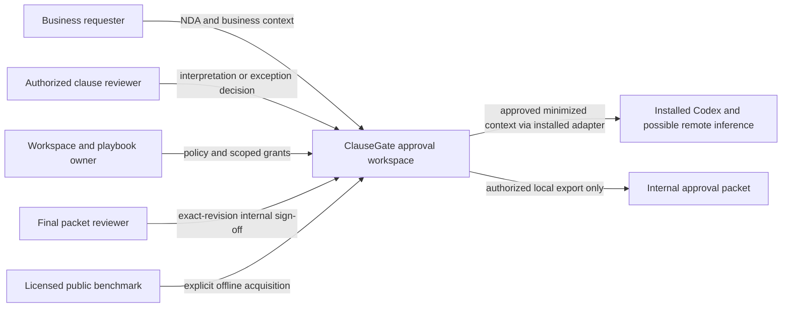
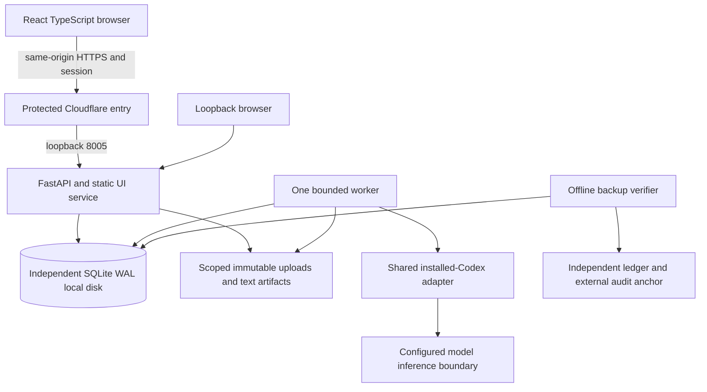
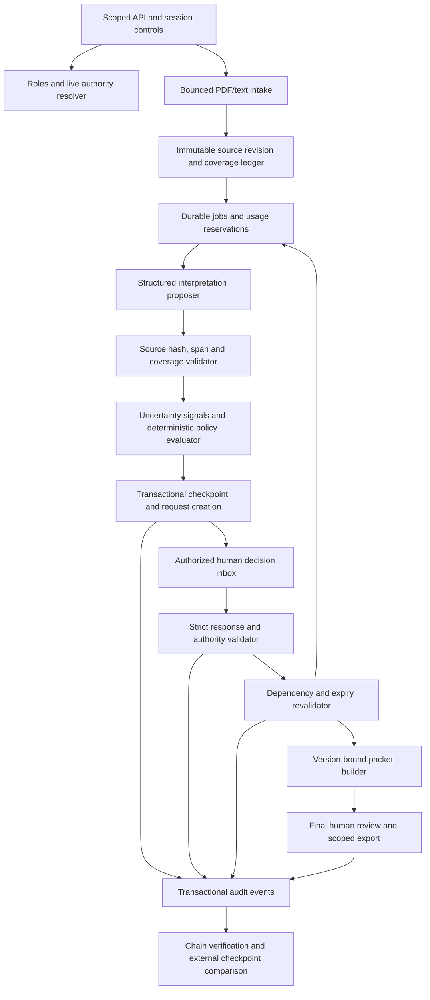
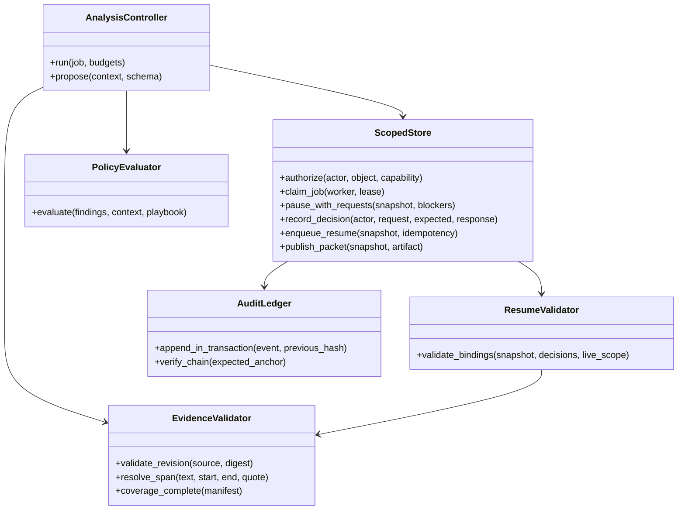
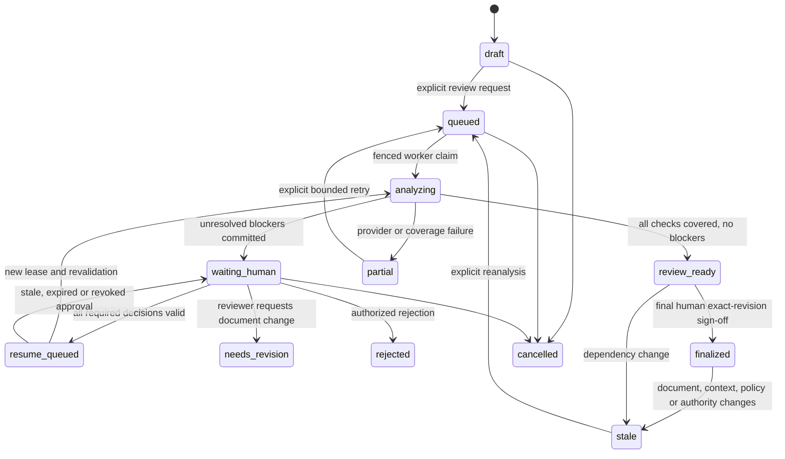

# Architecture: C4 levels 1–4

## Read consistency boundary — post-validation correction

[Rigorous validation](rigorous-validation-2026-10-17.md) rejected the earlier build because audit and case reads could observe different committed snapshots. The [post-validation correction](fixes-and-validation-2026-10-17.md) introduces `Store.coherent_read()`: a short `BEGIN IMMEDIATE` fence shared by case/audit/source/worker-check/export reads and anchor publication. Backup verification/copy also holds that fence, using a separate SQLite source connection for the backup operation. This serializes these reads against domain writes and ordinary external-head publication; no model/PDF/network/human waiting occurs inside it. Actual loopback testing now passes 600 reads during 100 updates, with a valid audit. Throughput on the older Windows target remains unverified; the fix is not a claim of lock-free or highly concurrent reads. Source-byte authorization/retrieval is atomic, and the independent erasure receipt blocks source access before local reconciliation finishes.

Status: implemented pilot, 17 October 2026. Diagrams preserve intended C4 boundaries; indicative classes are folded into Store methods/worker functions. See [actual code mapping](implementation-and-operations.md) and [measured evidence](implementation-validation-2026-10-17.md). Independent API/worker, SQLite and React run on macOS; Windows/edge remain targets. No earlier product business logic/database is imported.

## C4 level 1 — system context



No e-sign, CRM, email, payment or counterparty-write integration. Public benchmark ingestion is an operator-controlled evaluation capability, not arbitrary network fetch driven by a contract.

## C4 level 2 — containers



Browser/API and worker are separate processes on one host. The API owns decisions and transactions. The worker claims bounded analysis/continuation tasks; waiting for people is a database state, not a sleeping subprocess. Static assets and API share origin; application auth remains required even behind Access. External audit anchoring is optional operational hardening until configured and tested, not a built-in immutable service claim.

## C4 level 3 — components



The model proposes interpretations and question wording. It cannot choose its own permission, approve an exception, assign an untrusted reviewer, mutate playbooks, waive blockers or decide that a partial document is complete. Deterministic state reduction owns those transitions. Human input is validated data, not a new system prompt.

## C4 level 4 — proposed code relationships



Class/module names are illustrative interfaces, not implemented classes. Suggested files under `apps/clausegate-api/src/clausegate_api/`: `api.py`, `store.py`, `ingest.py`, `evidence.py`, `policy.py`, `approvals.py`, `worker.py`, `audit.py`, `reports.py`, `backup.py`. Web client under `apps/clausegate-web/`; strict contracts under `packages/contracts/src/contracts/clausegate.py`.

## Decision and continuation sequence

```mermaid
sequenceDiagram
  participant Q as Requester
  participant A as Scoped API
  participant D as SQLite
  participant W as Worker
  participant H as Human reviewer
  Q->>A: Start review for document/playbook revision
  A->>D: Atomic job, input snapshot and audit
  W->>D: Claim fenced job and reserve call
  W->>W: Analyze, validate evidence, evaluate policy
  W->>D: Commit checkpoint, blockers, requests and audit
  W-->>W: Release lease; no waiting model process
  H->>A: Decision with expected request/context revision
  A->>D: Live role, binding and expiry checks; commit decision
  A->>D: If all blockers satisfied, enqueue one continuation
  W->>D: Recheck context and current authority
  alt Bindings changed
    W->>D: Stale/reopen request and audit; no final packet
  else Bindings valid
    W->>D: Build packet; commit only after final fence
  end
```

No SQLite transaction remains open during human waiting, network access or model calls. Atomic domain transitions include their audit event and outbox/job entry. Decisions and queued continuation are not an exactly-once subprocess guarantee: use at-least-once jobs plus idempotent, lease-fenced commits.

## State model



Finalized means internally reviewed for the recorded scope—not legally safe, signed or enforceable. Request/decision/job lifecycles are separate and detailed in [approval lifecycle](approval-lifecycle.md).

## Storage and concurrency

Proposed tables: users/sessions, workspaces/memberships, cases, document_versions/text_spans/coverage, playbook_versions/rules, business_context_versions, jobs/stage_checkpoints, findings/uncertainty_signals, approval_requests/decisions/delegations, packets/reviews/exports, audit_events/outbox, settings/restore_epoch and independent erasure/authority records.

Source identity includes bytes hash, canonical text hash and extraction version. A new upload creates a new document revision even if the filename is unchanged. Original text is preserved for exact offsets; normalization for model input needs an explicit reversible map. Rules and context are immutable versions. Foreign keys, unique keys and compare-and-swap revisions enforce idempotency and conflict behavior. Use short `BEGIN IMMEDIATE` transitions where needed; live grant checks and final writes must share the transaction or use an equivalent revision fence.

## Deployment and decisions

Old Windows laptop: proposed independent limited-account API and worker startup tasks, local disk DB/uploads, installed Codex authenticated under the service identity, bounded rotating logs. Cloudflare exposes only the application through Access; never the model CLI. No GPU/Docker/vector service is required. Actual host compatibility and all-six-product capacity are acceptance gates, not assumptions.

| Decision | Reason / consequence |
| --- | --- |
| Durable domain state rather than an in-memory interrupt | Waiting survives restart and consumes no model runtime |
| Default deny, final human packet review | Prevents model certainty from becoming organizational authority |
| Approval bound to full versioned context | Conservative invalidation costs reviewer time but avoids approval reuse on changed content |
| Deterministic rules plus model proposals | Workflow semantics testable without provider dependence |
| Source-linked interpretation, not exact-quote-only NLI | ContractNLI needs classification over exceptions/multiple spans; exact provenance does not prove the classification |
| Independent audit/deletion recovery authority | Ordinary DB rollback cannot safely reauthorize old decisions or resurrect deleted evidence |
