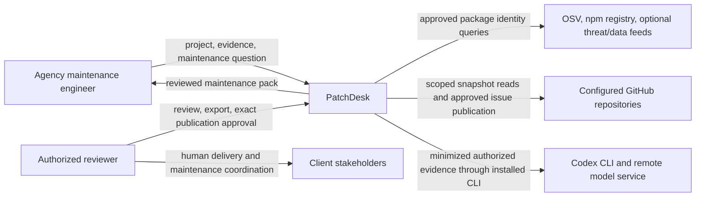
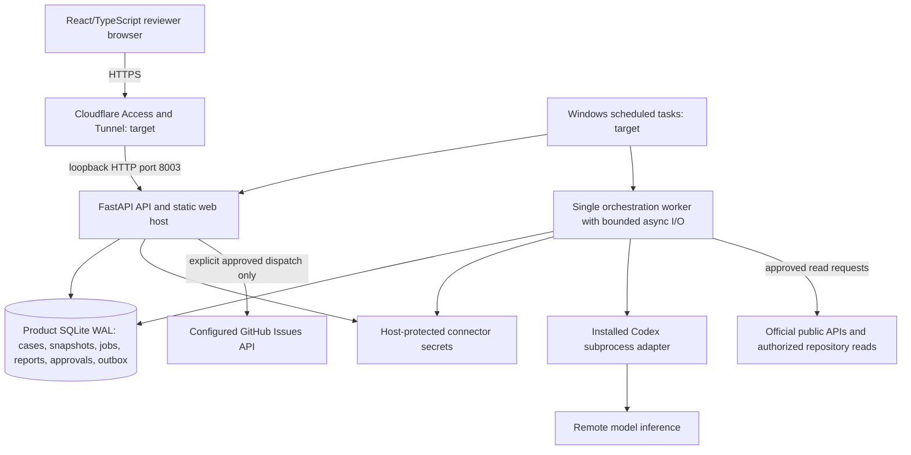
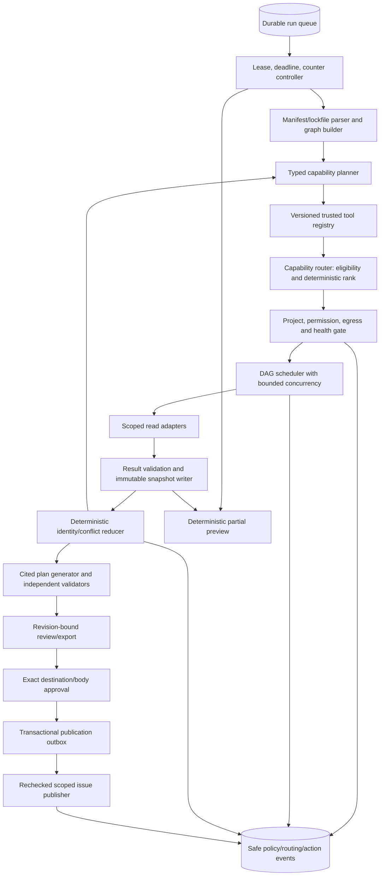
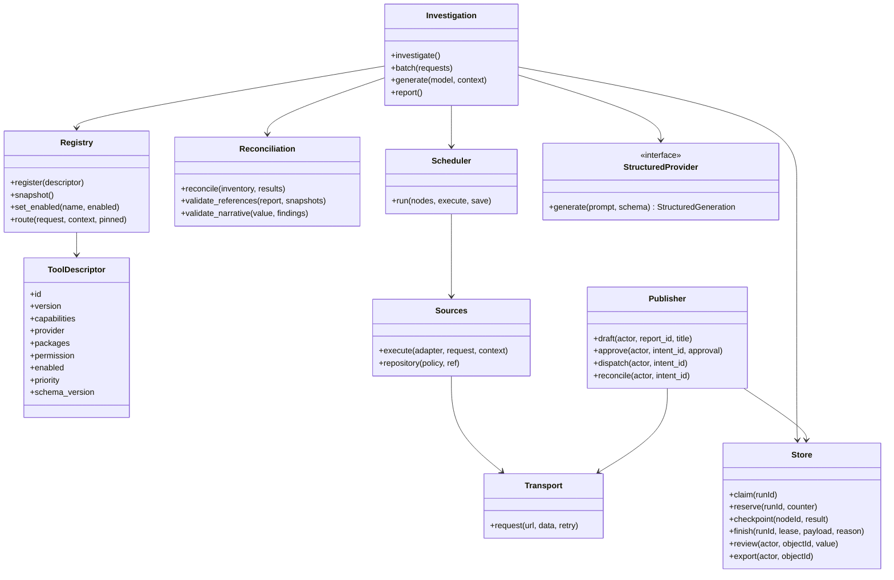
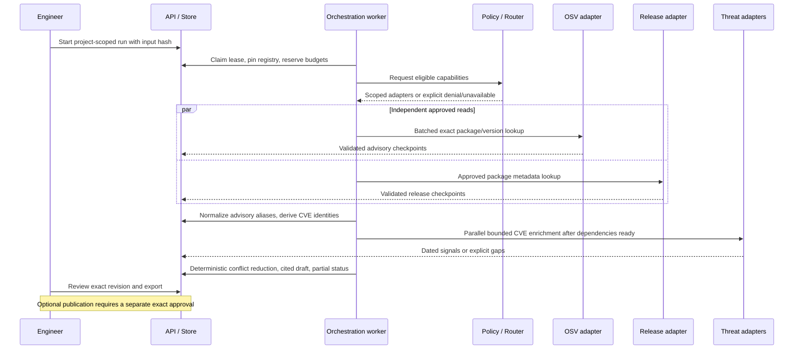
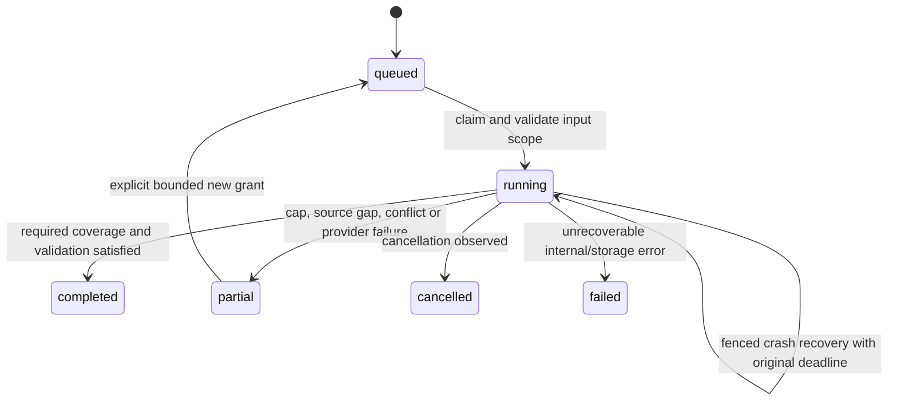

# Architecture

Status: implemented local pilot; Windows/Cloudflare portions remain deployment targets. C4 follows the [C4 model](https://c4model.com/diagrams). Separate API/worker/store and installed Codex adapter run locally on port 8003; [validation](implementation-validation-2026-10-15.md) records actual observations.

16 October assessment: [larger validation](validation-2026-10-16.md) blocks release. Current fixed selection represents only 69.15% of captured provider instance/advisory pairs. The bounded scheduler protects the host but is not a completeness mechanism. Bounded continuation/unassessed-identity reporting and safe structured-plan diagnostics are next architecture work, not implemented completion claims.

## C4 level 1 — system context

PatchDesk does not contact clients, deploy patches or execute application code. Source retrieval and inference require network access. Private-context egress to the model and package-query egress to public providers are separate permissions.

## C4 level 2 — containers

API/worker/database are local service containers in the C4 sense, not Docker requirements. SQLite holds immutable source payloads/export records transactionally to avoid a separate snapshot-file publication race. Large optional corpus/log files remain outside it and need separate retention/backup decisions. One active investigation initially protects the old laptop; parallelism is bounded I/O inside that run, not unbounded workers or model processes.

## C4 level 3 — orchestration components

The planner sees capability descriptions and safe metadata, not credentials or arbitrary code. The router selects concrete adapters; the scheduler owns execution. A registry revision is pinned for reproducibility, but live permission revocation/adapter disablement always takes precedence at dispatch. The publisher is an effectful boundary, not another automatically parallelized lookup.

## C4 level 4 — implemented code boundaries

Actual placement: `apps/patchdesk-api/src/patchdesk_api/{api,worker,store,inventory,registry,scheduler,adapters,reconcile,corpus,common,reports,publisher,backup}.py`, `apps/patchdesk-web/`, strict contracts in `packages/contracts/src/contracts/patchdesk.py`, and `tests/test_patchdesk*.py`. Router/policy are functions within registry/store/worker; reconciliation is functional, not an extra class hierarchy. `StructuredProvider` is the shared protocol. Live issue dispatch is an explicit authenticated API call, not an automatic background worker action.

Existing shared code to evaluate for reuse: [StructuredProvider](../../packages/agent-core/src/agent_core/provider.py), [LocalCodexProvider](../../packages/agent-core/src/agent_core/codex_local.py), [observability events](../../packages/observability/src/observability/events.py), and [service runner](../../scripts/run_product_service.py). Their existence does not make them PatchDesk-compatible without additive integration/tests. Reuse the audited isolated provider pattern with remaining-deadline propagation; independently verify that native runtime tools cannot bypass scoped application adapters. No earlier product's database/orchestrator may be imported.

## Dynamic sequence — bounded parallel investigation

## States and persistence

Node states: pending, ready, running, succeeded, partial, failed, skipped, denied, cancelled. A dependent node runs only when its declared prerequisites are satisfied; partial results must be explicitly accepted by its contract, not treated as success automatically. Run/report/review/publication states are separate.

Actual tables: users, sessions, login_attempts, projects, memberships, objects, runs, events, settings, resume_keys and publications. Client is a project field. Immutable `objects` contain input/snapshot/report/export JSON; run JSON holds conversation messages, registry snapshot, per-node results/counters; settings holds heartbeat and disabled registry. Connector credentials remain outside exported/restorable report data; password/session hashes are in the protected database. Every artifact lookup enforces project scope.

Parallel tasks never share a SQLite connection. A serialized short transaction writer or per-operation connections prevent long network work under database locks. Persist results independently and reduce by stable identity/order, not arrival order. A failed sibling cannot erase successful nodes. Lease/node fencing and pre-call counter reservations prevent stale saves and hidden duplicate attempts.

## Architecture decisions

| Decision | Reason / consequence |
| --- | --- |
| One run, bounded parallel I/O | Fits old host; graph/provider quotas still constrain throughput |
| Capability-based planner plus deterministic router | Makes provider selection observable and permission-constrained |
| Trusted registry manifests, revision pinning | Dynamic availability without arbitrary plugin/code execution |
| Deterministic evidence/constraint reconciliation | Natural-language confidence cannot settle range/identity conflicts |
| Local persistence, minimized authorized egress | Local service hosting does not imply private/offline inference |
| Explicit outbox publication | Remote writes are auditable; ambiguous remote outcomes need reconciliation |
| No project installation/execution | Avoids untrusted scripts and heavy runner requirements on Windows laptop |

See [permissions](permissions-and-security.md), [orchestration](orchestration.md) and [operations](operations.md) for enforceable limits and acceptance gates.
