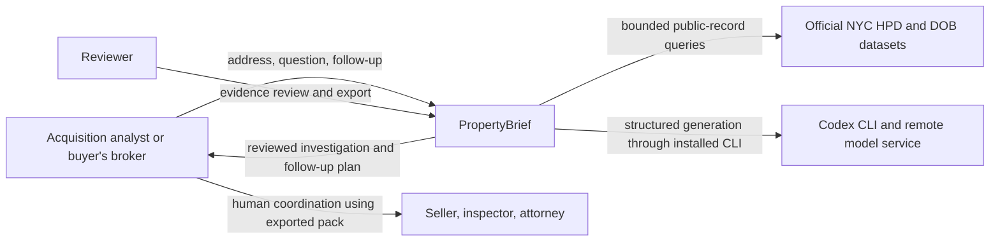
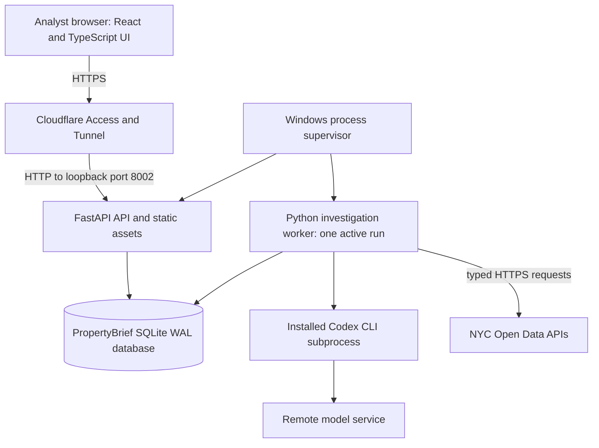
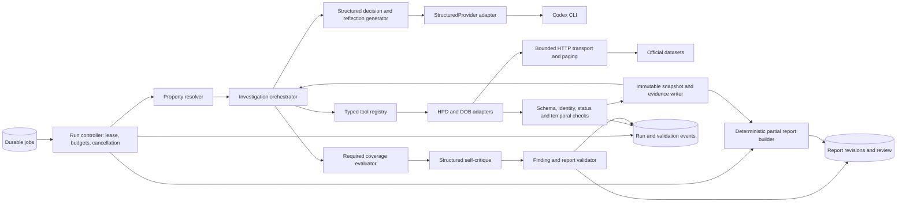
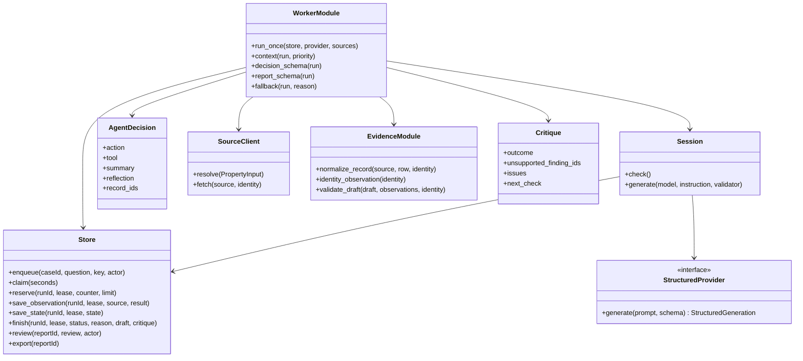
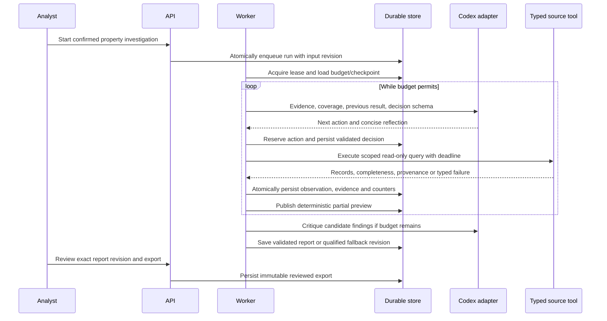
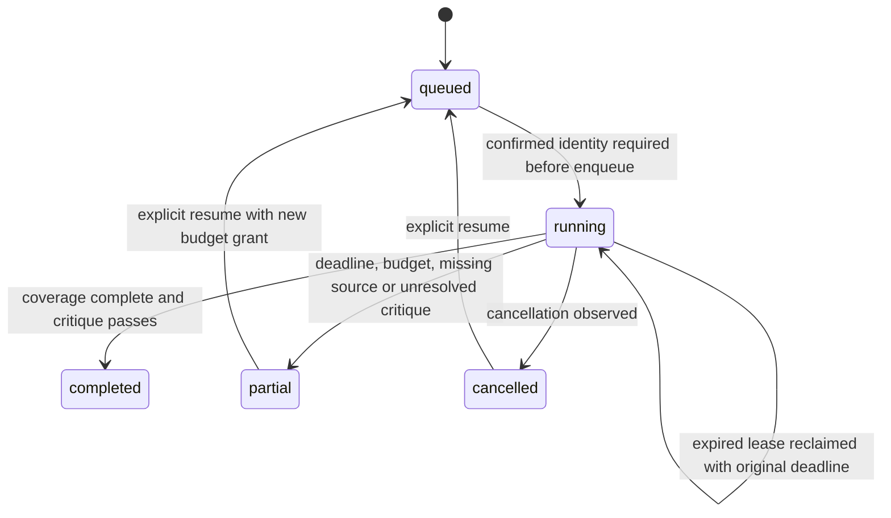

# Architecture

Status: implemented pilot architecture, updated 15 October 2026. C4 levels follow the [C4 model](https://c4model.com/diagrams). Local API/worker execution is tested; the Windows/Cloudflare deployment shown is the target topology and remains unverified there.

## C4 level 1 — system context

The application does not send messages to professionals. Their tasks are proposed checklist items. ACRIS is an optional future context integration, outside first-release coverage.

## C4 level 2 — containers

API, worker and database are intended to live on the old Windows laptop; current validation used macOS. Raw snapshots, reports and immutable export payloads are stored in the same SQLite database. Rotated service logs and optional frozen evaluation corpora are separate files. The browser may be remote. Model inference and source acquisition need network access. No vector database, GPU, Docker, or Kubernetes is required. Runtime data/process state are separate from TenderLens and ResolveDesk.

## C4 level 3 — worker components

Typed public-record tools execute in application code. Codex returns a decision describing a tool request; it does not own the application loop. `RESTRICTED_CONFIG` disables shell, web search, apps, hooks, plugins, memories, browser/computer tools and other alternate execution paths. The isolated adapter additionally audits JSON events, rejects unexpected native-tool item types and requires `turn.completed`. This is application/runtime defense in depth, not an OS-level no-network sandbox: Codex itself needs network for inference. A CLI upgrade requires repeating this acceptance.

## C4 level 4 — implemented code structure

Actual placement: `apps/propertybrief-api/src/propertybrief_api/{api,worker,store,sources,evidence,backup,corpus}.py`, `apps/propertybrief-web/`, and `packages/contracts/src/contracts/propertybrief.py`. Resolver and transport live in `sources.py`; orchestration/dispatch live in `worker.py`; report persistence/review live in `store.py`; Markdown rendering lives in `api.py`. No speculative orchestrator/tools/resolver/reports modules were added.

Reusable interfaces: [StructuredProvider](../../packages/agent-core/src/agent_core/provider.py) and [LocalCodexProvider](../../packages/agent-core/src/agent_core/codex_local.py). `Session.generate` creates a provider with the remaining deadline on each invocation. Optional adapter isolation/config overrides preserve earlier products' defaults. PropertyBrief stage events live in its own SQLite `events` table, rather than extending the shared observability model. Earlier products' orchestrators and database schemas are not imported.

## Dynamic flow — one adaptive iteration

## State and persistence

Identity confirmation is a case-level prerequisite, not a running-job state. `completed` means the defined checks and validation finished, not that the building is safe or commercially suitable. A cancelled run can retain a preview; cancellation while queued has no generated report. Storage failures may prevent new persistence, so recovery relies on the last durable checkpoint.

Implemented tables: `cases`, `runs`, `messages`, `snapshots`, `events`, `reports`, `exports`, and `heartbeat`. Candidates/confirmed identity are revision-controlled case JSON; decisions, prior observations and conversation checkpoints are run state; counters/grants are run columns. Source raw/normalized payloads and hashes are persisted together transactionally in SQLite before another model call. No external snapshot-file publication race is involved. Report payloads and exports pin source manifests. Review notes use optimistic revision checks; material edits create a new report ID and preserve the parent.

Lease fencing prevents a stale worker from saving after takeover. An interrupted read-only request can be replayed; successful saved observations are reused on resume. Follow-ups pin prior evidence by default; refresh creates a new run/snapshot revision. Users can inspect both revisions in history; automated semantic change summaries are deferred. Public APIs cannot guarantee an atomic citywide snapshot; acquisition intervals and detected drift are recorded.

## Architecture decisions

| Decision | Rationale and consequence |
| --- | --- |
| SQLite WAL and one worker | Fits a single host; long jobs queue and require measured capacity |
| Structured records before document images | Real data is accessible; deterministic IDs/statuses make evaluation tractable |
| Application-controlled ReAct loop | Enforces budgets and makes actions observable and testable |
| Mandatory coverage profile plus adaptive order/depth | Reduces omitted checks while retaining evidence-dependent planning |
| Immutable evidence and report revisions | Supports reproducibility, review, and source refresh comparisons |
| Deterministic fallback | Preserves verified work even when generation/critique fails |
| Conversational investigation with evidence panel | Supports follow-ups without hiding sources or coverage |
| No calibrated numeric risk/confidence score | No outcome labels or calibration experiment currently support one |

Target deployment: separate API/worker scheduled tasks, product port 8002, per-product credentials, protected Cloudflare hostname, bounded log rotation, and consistent SQLite backups. See [operations](operations.md) for acceptance rather than treating this diagram as deployment proof.
