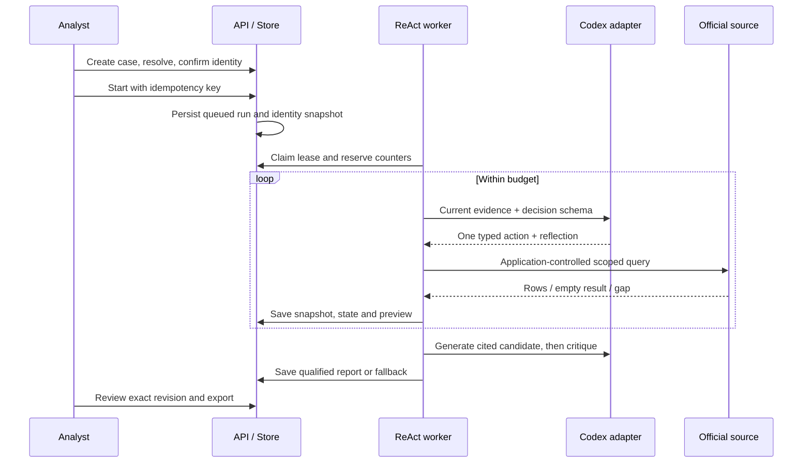

# Study guide: understand agents by tracing PropertyBrief

This guide follows the implemented Day 3 product, not a generic agent demo. Read [measured validation](validation-2026-10-15.md) first: 153 Python tests pass, the frozen corpus has 3,346 actual records, and the final sparse-property model run completed. Dense/conflict-heavy runs remain partial. No independent accuracy benchmark or Windows production acceptance exists yet.

## 1. Start with the customer problem

A buyer's analyst needs to turn scattered NYC building records into questions worth asking before a purchase progresses. The useful output is an evidence-backed diligence pack and a seller/inspector/attorney follow-up plan—not a declaration that the property is safe.

The input is a property case plus a question. The application confirms the building identity, checks eight official datasets, adapts its next check to observations, assembles cited findings, challenges the candidate report, and allows a human to review/export it.

This is **ReAct**: reasoning/decision summaries interleaved with actions and observations. **React** is the frontend library. A React page alone does not make a ReAct agent. A prompt saying “think carefully” does not implement an enforceable loop.

## 2. Code reading order

Read these files in order rather than starting with the largest UI file:

1. [Product contracts](../../packages/contracts/src/contracts/propertybrief.py): what may cross each boundary.
2. [Source registry/client](../../apps/propertybrief-api/src/propertybrief_api/sources.py): actual datasets, identifiers, filters and transport limits.
3. [Evidence interpretation](../../apps/propertybrief-api/src/propertybrief_api/evidence.py): normalization, exact citations and conservative guards.
4. [Durable store](../../apps/propertybrief-api/src/propertybrief_api/store.py): queue, revisions, counters, checkpoints and review/export rules.
5. [Worker](../../apps/propertybrief-api/src/propertybrief_api/worker.py): `run_once`, `Session.generate`, `context`, schemas and fallback.
6. [Shared Codex adapter](../../packages/agent-core/src/agent_core/codex_local.py): local executable, strict schema conversion, timeout cleanup and tool auditing.
7. [API](../../apps/propertybrief-api/src/propertybrief_api/api.py): authentication, routes, safe run views and Markdown export.
8. [Web workbench](../../apps/propertybrief-web/src/main.tsx): case confirmation, chat, progress, report, evidence and review.

Keep [C4 architecture](architecture.md) alongside the code. Context shows people/external systems; containers show API/worker/storage/browser; components show responsibilities; code-level structure maps those responsibilities to actual modules/classes.

## 3. Trace one investigation end to end



Resolution happens before the loop. The model cannot silently choose a different building. Start/message requests persist conversation and job state together. The worker claims a lease so two workers cannot legitimately publish over each other. Every saved source observation immediately supports a deterministic preview, even before prose exists.

## 4. Observe: turn external data into usable evidence

An observation is not “the tool worked.” It contains source identity, raw rows, normalized rows, exact query, timestamps, SHA-256, outcome, completeness and quality flags.

In `SourceClient.fetch`, follow one HPD violation query. Notice stable row-key ordering, pagination, metadata before/after, byte/attempt limits and bounded errors. Then follow `normalize_record` to see how `violationstatus=Close` becomes historical rather than current physical clearance.

The vital distinction:

- `no_records` + `complete_for_query`: the executed source query completed and returned no matching records.
- `unavailable` / `unknown`: the application cannot establish the query result.
- `truncated`: a cap prevented full acquisition.
- `records_not_in_context`: records exist in storage but some are absent from this model prompt.

The fourth item is **not** a source outage. Context management and acquisition completeness are different problems.

Real lesson: an HPD complaint can match a building ID while disagreeing in BIN/BBL. Discarding it hides uncertainty; treating it as unqualified evidence risks wrong-property conclusions. The implementation preserves it with conflict flags and marks affected completeness unknown.

Read tests `test_source_failure_is_not_zero_results`, `test_metadata_failure_after_rows_keeps_completeness_unknown` and `test_conflicting_secondary_identity_is_visible_not_silently_discarded`.

## 5. Think: choose the next useful action

`AgentDecision` has `action`, `tool`, `summary`, `reflection` and `record_ids`. `Session.generate` supplies current observations, coverage, the last result, recent decisions, bounded conversation and remaining counters.

The model chooses one next action: query, inspect, compare, finish or clarify. It does not receive arbitrary HTTP/SQL/shell execution. `decision_schema` narrows tools and record IDs; `validate_decision` independently checks that inspected IDs belong to the specified source.

This combines mandatory coverage with adaptive order/depth. Checking eight sources is a policy. Whether a parcel conflict warrants comparison or a particular row needs inspection is an evidence-dependent choice. It is not an unconstrained autonomous researcher.

A useful visible decision summary says which check is needed and why. We do not request or store private chain-of-thought.

Read `test_unknown_inspection_ids_are_repaired_before_dispatch` and `test_decision_schema_limits_ids_to_supplied_records`. A plausible-looking ID is not a valid action argument.

## 6. Act: application code owns execution

Read the dispatch branches in `run_once`:

- Query invokes a source client using confirmed identity.
- Inspect selects captured rows; it does not invent or fetch arbitrary records.
- Compare summarizes coverage and known conflicts.
- Finish checks required-source attempts before synthesis.

Pydantic validates the tool envelope; additional checks validate row count, raw hash, duplicate keys, source and property scope. Only then is the observation saved.

The installed Codex CLI is a generation adapter. The product does not call a direct model API, but Codex still uses authentication/network for inference. “Locally installed” does not mean offline inference. The Windows laptop is the service host, not a promised local GPU model server.

Isolation is defense in depth: restricted runtime config, ephemeral read-only invocation, ignored user rules/config, no alternate native tools, event auditing and subprocess cleanup. Tests reject native shell/MCP tool events even if final JSON looks valid. Configuration restrictions alone are not an OS network sandbox; repeat acceptance after CLI upgrades.

## 7. Reflect: account for what just changed

Reflection is carried in the next typed decision, using the last observation and saved evidence. It need not consume a separate call after every action.

In the actual building 399115 recovery, the planner explicitly recognized that both HPD rows were now visible and `inspection_rows_omitted=0`. It then proposed record-specific document/inspection checks while preserving uncertainty about present conditions. The subsequent provider timeout still made that run partial. Successful reflection and successful full-report completion are separate outcomes.

Do not judge reflection by whether its wording sounds thoughtful. Check whether the trace accounts for the actual previous result and changes its next action/qualifications appropriately. Scripted tests prove orchestration invariants; actual-model traces supply different evidence about model behavior.

## 8. Max iterations: enforce limits outside the model

“Stop after 16 steps” in a prompt is not an execution limit. `Store.reserve` atomically reserves counters before work; `Session.check` enforces cancellation/deadline; the controller stops exploration and uses a reserved finalization allowance.

Current policy per grant: 16 dispatched actions, 24 model calls, 48 worker HTTP attempts and a default 900-second deadline. Planning stops before consuming the last three model calls. Repairs, failed attempts and critique consume the same model-call budget. One action may involve several HTTP pages/metadata requests.

Separate counters matter: eight source actions are not eight model calls or eight HTTP attempts. The final successful actual case used **8 actions, 11 model calls**: eight decisions, one finish decision, one synthesis and one critique.

One invocation is bounded by 120 seconds or remaining deadline. Repeated identical actions stop rather than spin. Crash recovery preserves deadline/counters. Explicit resume grants additional bounded work, with cumulative ceilings of 32 actions / 48 calls / 96 HTTP attempts across at most two grants.

Read `test_iteration_limit_uses_reserved_finalization_calls`, `test_repeat_loop_stops_with_hard_budget`, `test_malformed_decision_repairs_once_and_counts_calls` and `test_resume_keeps_saved_observations_and_cumulative_calls`.

## 9. Self-critique: challenge a candidate, don't certify reality

Synthesis produces `ReportDraft`. Each finding requires references. `report_schema` specializes allowed sources, actual row IDs and actual field names. `validate_draft` checks exact row/field/value equality, task references and selected unsafe status/scope language.

Then a separate call produces `Critique`: pass, revise or insufficient, with unsupported finding IDs and issues. The controller removes rejected findings/dependent tasks and permits one conservative revision. Unresolved critique remains visible and partial. A revised draft is not silently treated as independently re-assessed.

The critic receives actual cited rows. If cited evidence cannot fit the bounded context, omitted-row accounting prevents a pass. The prompt distinguishes citation review from exhaustive finding recall: reviewing selected evidence cannot establish that no important uncited record was missed.

There are three different checks:

1. Schema validity: the output has the permitted structure.
2. Provenance validity: cited fields really equal captured values.
3. Semantic adequacy: the prose follows from those fields and covers material issues.

Pydantic/exact equality cover the first two, not the third in general. Same-model critique is advisory. Independent reviewers and gold labels are still needed for precision, recall and useful follow-up assessment.

Read `test_critique_removes_unsupported_claims`, `test_citation_identity_and_exact_field_validation`, and `test_report_schema_binds_fields_to_the_actual_source`.

## 10. Graceful degradation: partial work is a product output

The earlier TenderLens lesson applies here: a later timeout must not erase earlier observations or appear only as an unexplained top-level error.

After each validated observation, the store can build a preview without AI. On provider/parse/critique failure the worker saves a qualified narrative if available, otherwise a deterministic record-derived fallback. It records the failing stage and terminal stop reason. Critique not performed remains `not_assessed`, never pass.

A partial report may be reviewed/exported only with explicit limits acknowledgment. Export retains coverage, timestamps, stop reason, critique state, exact citations and source hashes. An immutable old report remains available after a later recovery attempt.

This is useful degradation, not pretending an incomplete investigation succeeded. A missing report due to storage failure cannot be magically persisted; the guarantee is limited to the last durable checkpoint. Cooperative cancellation also waits for the in-flight bounded operation.

Read `test_later_timeout_preserves_preview_and_failure_history`, `test_partial_export_carries_gaps`, and the real timeout/recovery artifacts in the validation report.

## 11. Identity, persistence and review are agent concepts too

A BIN identifies a building; BBL identifies a parcel. The same parcel can contain more than one building. DOB historical rows can retain an old lot while matching the current BIN. Our real-data bug was querying only current parcel fields, which silently omitted valid historical building records. Source-specific five-digit DOB lot padding differs from the BBL's four-digit lot component.

SQLite WAL stores cases, runs, messages, snapshots, events, reports, exports and worker heartbeat. Transactions and lease fencing are what make retries/recovery safe—not fluent model prose.

Idempotency prevents duplicate starts when the browser retries. Optimistic revisions prevent stale review edits from silently winning. Material edits create a new report ID, preserve the parent and reset critique to `not_assessed_after_edit`. Approval applies to an exact revision, not a mutable case.

Read `test_identity_confirmation_and_run_idempotency`, `test_lease_fencing_checkpoint_and_counters`, and `test_review_edits_create_new_revision_and_revalidate`.

## 12. Learn by running focused tests

```bash
# Complete implementation suite:
.venv/bin/python -m pytest -q
# Loop/degradation:
.venv/bin/python -m pytest tests/test_propertybrief_agent.py -q
# Context, schema, identity and revision regressions:
.venv/bin/python -m pytest tests/test_propertybrief_hardening.py -q
# Actual frozen payloads; skipped if corpus is absent:
.venv/bin/python -m pytest tests/test_propertybrief_actual_data.py -q
# UI helpers and production build:
make propertybrief-test
```

Exercises: predict the outcome before running a test. Why is a valid JSON citation with the wrong value rejected? Why does an empty complete query differ from a timeout? Why can a passing model critique not override a source gap? Why do material reviewer edits remove the old critique pass?

For a TDD exercise, add a new malformed/overbroad case with an expected rejection, see it fail, make the smallest implementation change, then rerun both focused and full suites. Keep synthetic mutations labelled as tests, never natural real-world observations.

## 13. Inspect actual evidence yourself

Start with `make propertybrief-up`; use the configured credentials at http://127.0.0.1:8002/. See [operations](operations.md) for Windows commands and auth behavior.

The completed frozen model example is building **706227**, BIN **5042227**, official address **107 ABBOTT STREET**, Staten Island. Its one complaint is historical. A new live UI investigation can return different data because the public sources are mutable; do not expect an exact frozen replay or guaranteed passing critique.

Confirm identity, start investigation, watch checks/events, inspect an exact citation, ask a scoped follow-up, review a report and export it. Verify gaps and acquisition times survive export. A completed investigation means the defined process finished, not that the property is safe. Actual browser interaction has not been verified in this environment, so these are your manual acceptance steps, not a claimed browser test pass.

For reproducible frozen evaluation, use [data commands](../../data/propertybrief/README.md). Actual model commands consume authenticated Codex usage. Preserve the session directory, source manifest and code hashes. Never overwrite failed results to make a clean story.

## 14. What we still need to learn

Can dense/conflict-heavy investigations reliably produce useful complete narratives? Can independently reviewed findings meet the provisional precision/recall targets? Does adaptive planning outperform a simpler checklist plus one-shot report? Does critique catch errors without rejecting supported prose? Does the old Windows laptop meet service/reboot/resource requirements? Does a buyer save enough active time to pay?

These are experiments, not answers supplied by the architecture. The [single blog draft](blog.md) tells the implementation story; the [evaluation plan](data-and-evaluation.md) defines the outstanding quality/commercial work.
