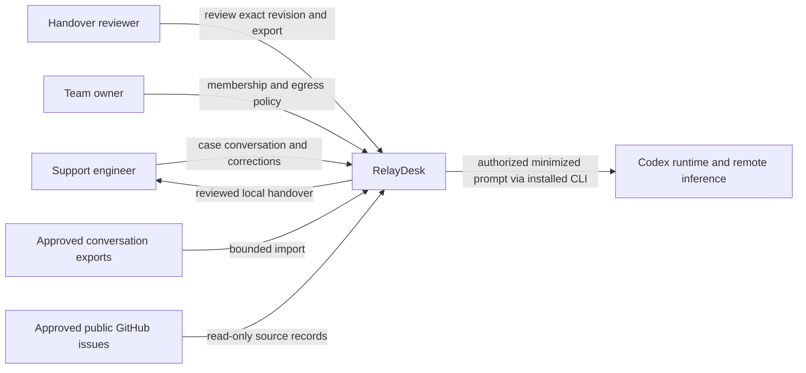
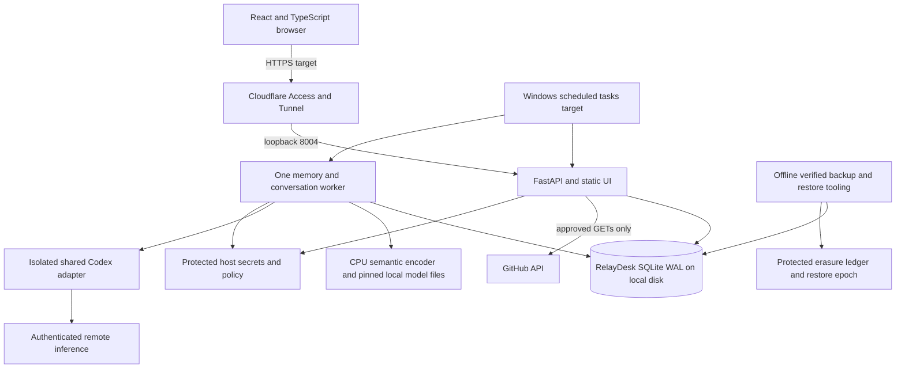
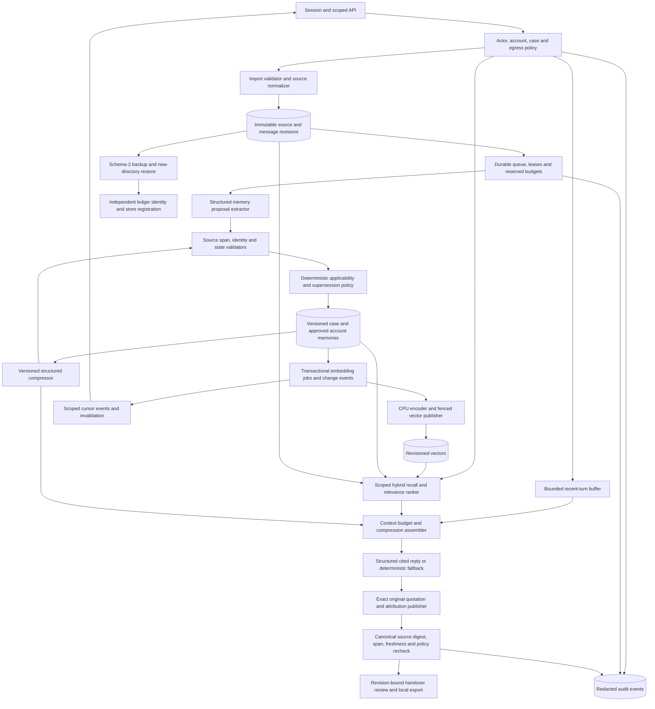
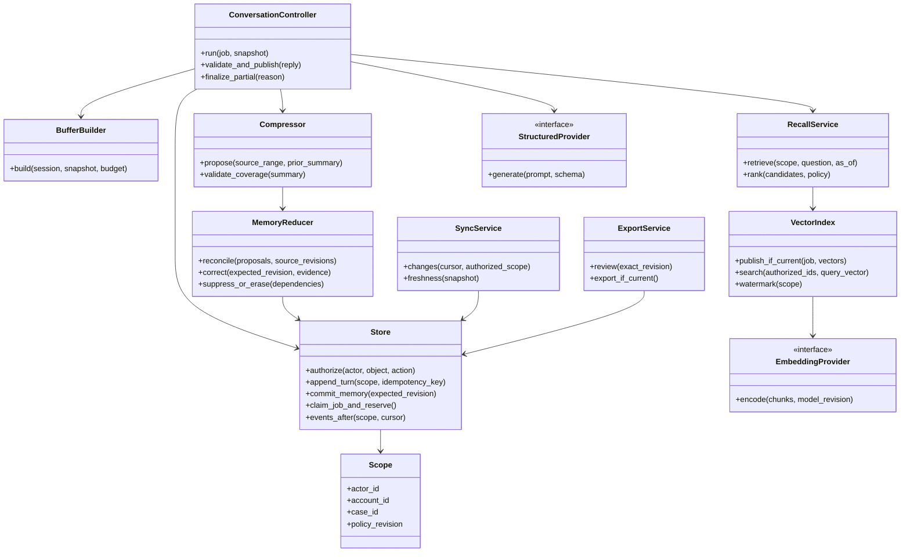
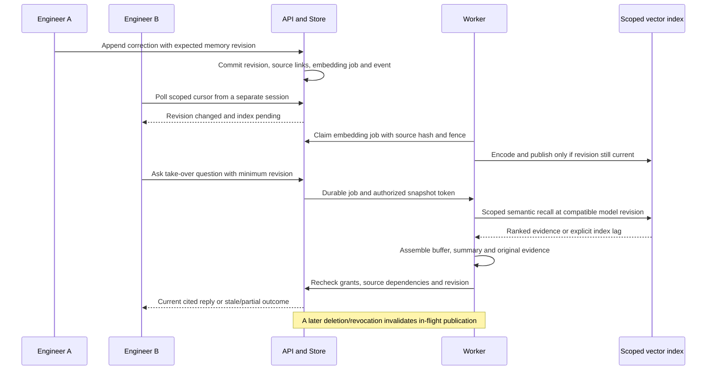
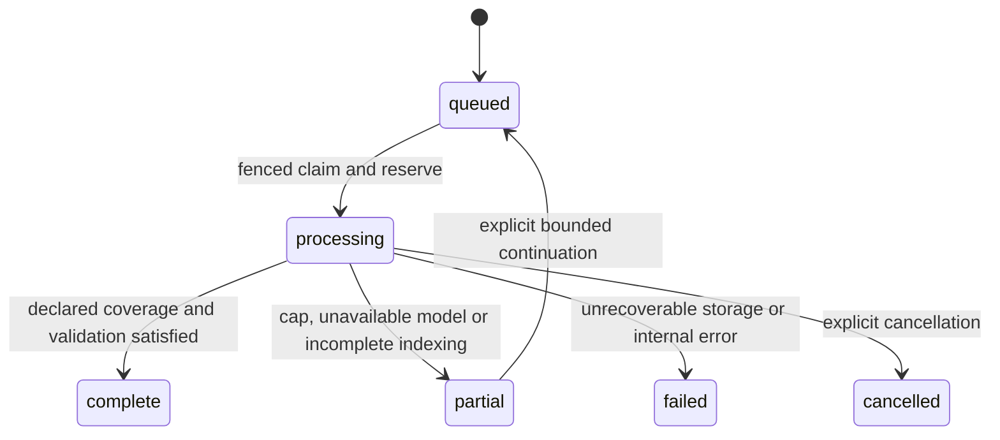

# Architecture: C4 levels 1–4

Status: implemented pilot, 16 October 2026. Local API/static UI, bounded worker, SQLite and genuine CPU embeddings run on macOS; Windows and protected Cloudflare remain acceptance targets. Installed Codex may use authenticated remote inference. [Actual code-level C4 and implementation deviations](implementation-and-operations.md) supersede indicative interfaces below.

Corrective architecture, 17 October: `grounding.py` adds a factual publication boundary between model response and `Store.finish`: exact single-source quotations, attribution/spans and neutral server summary rather than unverified narrative. Recall now uses a call-local matrix of SQL-authorized compatible vectors; publication/read paths revalidate source integrity and revision fences. `ledger.py` binds store identity to independent erasure authority, with explicit offline legacy enrollment; backups use schema 2. Context serialization includes omission metadata and projects recent turn fields only. These extend the C4 boundaries below; [corrective validation](corrective-validation-2026-10-17.md) records measured behavior and remaining gates.

## C4 level 1 — system context

There is no customer-message, production-command or repository-write arrow. An account/case boundary is an authorization boundary, not merely a browser filter. Model output is untrusted structured data.

## C4 level 2 — containers

These are C4 containers, not Docker requirements. Metadata, source/message bodies, memory revisions, normalized float32 vectors and index jobs live in the same product database. Separate model artifacts/logs/corpus archives are files with manifests. No external vector service or GPU is required by the initial proposal; actual CPU feasibility remains a gate.

Exact vector search operates over a SQL-authorized scope before similarity/top-k selection. Optional in-memory arrays are revision-keyed caches, not authority. Embedding computation happens outside write transactions; a short fenced commit publishes only vectors whose memory/text/model revisions still match. No network/model operation holds a database lock.

## C4 level 3 — application components

Compression is a derived view, never an authority above original sources. Extraction proposes memory; it does not approve promises, link customers or execute actions. Currentness comes from explicit state/revision policy, not from a model saying “latest.”

## C4 level 4 — proposed code interfaces

This preserves the original indicative interfaces. The pilot combines buffer/compression in `context.py` and sync/evidence/reduction in `store.py`, alongside `api,worker,ingest,embeddings,recall,reports,backup,common`. The [implementation supplement](implementation-and-operations.md) maps actual classes/functions. Shared provider interfaces are reused, never another product's database/orchestrator.

## Sequence — restart, recall and concurrent correction

Sync is server-mediated across sessions attached to this instance. Offline multi-master writes, merging independent databases and peer-to-peer laptop synchronization are not v1.

## State and persistence

Memory lifecycle is separate: proposed → active/rejected; active → disputed/superseded/suppressed; any eligible state → erased with dependency invalidation. Summary lifecycle: pending → validated/published; source changes → stale → rebuild. An existing response is historical or stale after changes; “complete job” is not verified technical resolution.

Proposed durable tables: users, sessions, memberships, accounts, cases, conversations, messages/source revisions, memory revisions, memory-source dependencies, summaries/coverage, embeddings/model manifests, jobs/checkpoints, events, reviews/exports, erasure receipts and settings. Server ownership and grants apply to every table/object path. Restore creates a new cursor epoch and consults the independent erasure ledger before serving.

## Architecture decisions

| Decision | Consequence |
| --- | --- |
| Durable messages, bounded reconstructed buffer | Session restart does not erase history; short-term window remains bounded |
| Case-first semantic vectors plus lexical evidence | Genuine long-term recall without arbitrary account blending |
| Same SQLite for authoritative data and vectors | Transactional ownership/revision checks; no second service initially |
| Async fenced indexing with visible watermark | Deletions/corrections cannot be resurrected by late jobs; lag is explicit |
| Structured compression plus original source access | Context savings do not silently become lossless-history claims |
| Ordered events and optimistic edits | Cross-session consistency, explicit conflicts rather than last-writer-wins guesses |
| Isolated CLI generation and local CPU embedding | Fits stated hosting model; remote generation privacy/availability remains relevant |

See [memory](memory-and-recall.md), [sync](compression-and-sync.md) and [operations](operations.md) for detailed bounds and acceptance.
