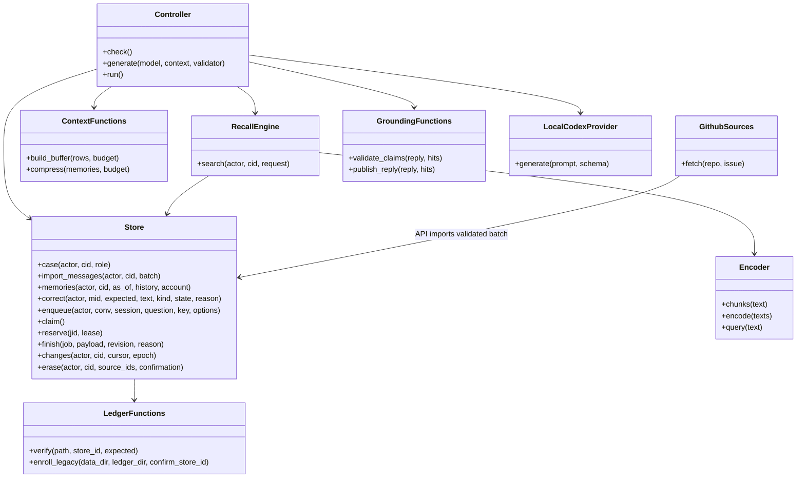

# Implemented RelayDesk: architecture, limits and runbook

**Release blocked:** defects found in [aggressive validation](aggressive-validation-2026-10-16.md) now have corrective code and passing regressions. See [corrective validation](corrective-validation-2026-10-17.md) and [remaining gates](product-acceptance.md). Use only controlled pilot data; these commands are not production approval.

This is the current code-level supplement to the original design pack. It supersedes the original “docs only/no runtime” status. The pilot is implemented; broader acceptance targets remain gates.

## Code and concept map

| Concept / boundary | Actual implementation |
| --- | --- |
| Short-term buffer | `context.build_buffer`: bounded suffix of the current session's durable turns; historical questions exclude current turns |
| Long-term vector memory | `embeddings.Encoder`: pinned local ONNX MiniLM, CPU pooling/L2; `recall.index_case`: revision/model-keyed SQLite chunk vectors |
| Recall | `recall.RecallEngine.search`: scope/temporal/tombstone filtering before cosine, exact source spans and partial-index fallback |
| Context compression | `context.compress`: serialized text/metadata budget; full omission count/hash, at most eight sample IDs, authorized ledger lookup and partial status |
| Relevance scoring | `hybrid-initial-2-uncalibrated`: `.65×semantic + .28×lexical + .04×recency + .03×status`; initial thresholds, not learned confidence |
| Cross-session sync | `Store.changes`, immutable revisions, expected-revision corrections, account invalidation, restore epoch; React two-second polling/refetch |
| Strict model boundary | `contracts.relaydesk` plus `grounding`: strict Pydantic schemas; factual claims are exact original quotations with one supplied memory ID; neutral server summary, source attribution/spans |
| Generation and degradation | `worker.Controller`, shared isolated `LocalCodexProvider`, durable reservations/leases, one repair/stage, safe timeout/validation events |
| Auth/privacy | `Store`: PBKDF2 passwords, hashed session tokens, roles; `api`: same-origin/CSRF, owner egress/erasure; external deletion ledger |
| Evidence/export | `reports.markdown`, exact-revision review/export; permission rechecks on promoted source reads |
| Source data | `ingest.GithubSources/GithubTransport`: read-only GitHub public-IP pinned HTTPS; source identity, pagination, byte/time caps, bot exclusion |
| UI | `apps/relaydesk-web/src/main.tsx`: case rail, persistent chat/resume/new session, history options, evidence, memory review, grants, exports |
| Recovery | `backup.backup/restore`: schema-2 snapshot, manifest/source integrity, new-dir restore, identity-bound independent ledger, erasure reconciliation and reindex |

All backend modules are under `apps/relaydesk-api/src/relaydesk_api/`; shared contracts are under `packages/contracts/src/contracts/relaydesk.py`. No earlier product database/orchestrator is imported.

The buffer projects turn fields only; it never embeds nested prior output artifacts. Recall batches only authorized compatible vectors, validates source digests and excludes the active question as its own evidence. Index publication fences source changes inside its commit transaction. `Store.finish/output` independently validate source hashes/spans. Prompt version is `relaydesk-2-extractive-grounding`; factual paraphrase entailment is not claimed. Historical retrieval is available, but model egress rejects inactive source revisions and may conservatively fall back for historical requests.

API differences from the indicative planning table: suppression is a correction with `state=suppressed`, not a separate `/suppression` route. Current compression uses `/v1/cases/{cid}/summary`, not `/summaries/{id}` history. Erasure confirmation describes conservative effects; per-artifact dry-run preview is not implemented. Event cursors/`has_more` are supported; the Activity UI intentionally shows the first 100 events while snapshot polling provides current state.

### C4 level 4 — actual code relationships



ContextFunctions, GroundingFunctions and LedgerFunctions group module functions; they are not runtime classes. C4 levels 1–3 and deployment are in [architecture](architecture.md). Actual source acquisition runs synchronously at the API/explicit validation boundary; the worker handles indexing and model generation. There is no external vector database.

## Deliberate pilot limits versus the original target

Compression is extractive selection, not a recursive LLM summary chain. It preserves selected text but can omit critical facts, which remain labelled partial and available in the ledger. Model extraction samples ≤8 sources/18,000 characters per job; the entire imported non-bot history remains raw episodes and is indexed. Categories and source links are implemented; automatic environment/entity reconciliation and a verified attempt/outcome graph are not.

Ranking weights/thresholds are uncalibrated defaults. No independent semantic-entailment validator or broad quality score is claimed. A valid source ID/quote is necessary, not sufficient for a correct interpretation. Historical source bodies are eligible no earlier than their known update; new model proposals/manual corrections are eligible from their own creation, not backdated. Missing earlier body revisions are not reconstructed.

Promotion requires explicit owner/reviewer action and retains originating-case read permission. Case changes conservatively invalidate account-related drafts; source erasure conservatively redacts account-related outputs. This favors privacy over draft availability. Already downloaded exports, acquisition archives and backup media need separate governance; no certified secure wipe.

## Install and launch

```sh
.venv/bin/pip install -e '.[dev]'
npm --prefix apps/relaydesk-web ci
make relaydesk-model  # once; omit if the pinned model directory already exists
make relaydesk-up
make relaydesk-status
make relaydesk-down
make relaydesk-test
```

Windows Make selects `.venv/Scripts/python.exe`; direct Python commands use that path. UI: `http://127.0.0.1:8004/`. The development launcher can reuse TenderLens bootstrap settings when explicit RelayDesk settings are omitted. It does not reset an existing user's password. Production runner requires explicit RelayDesk bootstrap settings. Individual new users have no case access until granted.

Use `.env.example` settings: `RELAYDESK_USERNAME/PASSWORD` (unique 12+ character password), `RELAYDESK_DATA_DIR` (`var/relaydesk`), `RELAYDESK_ERASURE_LEDGER_DIR` (`var/relaydesk-erasure`), `RELAYDESK_EMBEDDING_DIR` (`var/models/relaydesk-minilm`), port `8004`, `RELAYDESK_CODEX_COMMAND`/`CODEX_COMMAND`, optional explicitly supplied `RELAYDESK_GITHUB_READ_TOKEN`. Use `RELAYDESK_SECURE_COOKIES=1` for protected HTTPS deployment, `0` only for loopback HTTP.

Models are explicitly provisioned once from the trusted repository at a pinned revision; runtime downloads and source-selected models are prohibited. Missing/corrupt encoder gives labelled lexical degradation, never semantic readiness. Existing stores without their independent erasure ledger fail closed. Egress is case-denied by default: owner separately approves model context and allowed public repositories. Installed Codex is an adapter, **not offline inference**.

### Implemented ceilings

20 MiB HTTP body, 2,000 messages per import/capture, 32 KiB UTF-8 source body, 6,000-character question. GitHub transport: 4 MiB/response, 64 MiB/200 attempts/600 seconds, no automatic quota retries, no arbitrary/private/redirect destinations. Oversized bodies produce visible gaps rather than silent truncation.

Single active worker lease, pending queue 20, renewable lease 150 seconds, original deadline 600 seconds, model timeout ≤120 seconds/remaining deadline. Four model calls per grant including one repair/stage; ≤2 explicit cumulative grants, no deadline reset. Resident encoder batches ≤16, intra-op threads 2/inter-op 1. Idle indexing publishes up to 32 new memories/pass without repeatedly starving later rows.

Buffer 5,000 characters, compression 6,000, serialized selected recall hits 20,000, full prompt/schema ≤48,000. These are actual character ceilings, **not exact Codex token accounting**. Scope cap is 10,000 memory objects, each potentially multiple chunks; hit count ≤30. All caps/omissions are partial, not full-case certification. Bootstrap/model/runtime compatibility and five-product memory/latency capacity remain host acceptance tasks.

### Windows and edge

`infra/windows/install-relaydesk.ps1 -RepoPath ... -Credential ... [-Start]` installs two limited-account startup tasks, refuses replacement and checks Python/web/model files. The foreground service runner loads explicit product settings and rotates role logs at 5 MB ×3 backups. Development logs in `var/relaydesk-dev/` do not rotate. Provision Codex authentication under the service identity separately; this is Task Scheduler packaging, not an SCM installer.

Cloudflare example routes `relaydesk.example.com → 127.0.0.1:8004`; configure actual Access protection, DNS and secure cookies before public use. Never tunnel Codex directly. No external account/DNS/tunnel settings were changed.

### Backup and restore

```sh
.venv/bin/python -m relaydesk_api.backup backup var/backups/relaydesk-unique --data-dir var/relaydesk --ledger-dir var/relaydesk-erasure
# Stop services; restore into a NEW nonexistent path, never over the live store.
.venv/bin/python -m relaydesk_api.backup restore var/backups/relaydesk-unique --data-dir var/relaydesk-recovered --ledger-dir var/relaydesk-erasure
```

SHA-256/store-identity/SQLite integrity checks precede restore. The current independent ledger reapplies later erasures. Restore rotates epoch, expires sessions, cancels in-flight jobs, marks outputs stale and deletes vectors for scoped reindex. Explicitly switch data-dir only after inspection. Never restore an old ledger over the live ledger. Backup contains sensitive source text/password hashes: protect it separately from model artifacts and acquisition archives.

Schema 2 additionally binds the snapshot/store to the ledger identity and per-store registration nonce; unrelated existing ledgers are rejected before copying data. Canonical source digests are checked at backup and after erasure reconciliation on restore. Schema-1 snapshots are not accepted by the normal restore path. Preserve/quarantine them for deliberate operator migration; do not edit their manifest to bypass checks.

### Existing unbound store migration

Stop RelayDesk first. Confirm the exact live store identity and authoritative current ledger path; do not enroll an arbitrary restored old snapshot. Use a new snapshot destination:

```sh
make relaydesk-down
.venv/bin/python -m relaydesk_api.ledger --data-dir var/relaydesk --ledger-dir var/relaydesk-erasure --confirm-store-id EXACT_LIVE_STORE_ID --backup-directory var/backups/relaydesk-pre-binding-UNIQUE
make relaydesk-up
```

The CLI creates a quarantined pre-enrollment SQLite snapshot, checks identity/tombstones, binds the ledger, stales old drafts, rotates epoch and expires sessions. It does not roll back or bundle the external ledger as restorable authority. A stale clone with the same identity cannot be detected solely from its binding: protect the latest authoritative ledger.

The existing local store was migrated with snapshot `var/backups/relaydesk-pre-binding-2026-10-16/`, then restarted. Passwords were not changed; sign in again because old sessions expired. The snapshot is sensitive and is not a normal schema-2 restore package.

## Manual validation workflow

Open the service and select the retained “RelayDesk HTTP real-data validation” account/case, or create your own. Import a captured message batch; alternatively grant a public repository in Permissions, then import its issue. Verify indexed/eligible counts. Ask about prior attempts and inspect exact sources and ranking. Start a new session or resume the conversation: the short-term buffer resets while the durable memory remains.

In a second signed-in session, correct a memory; verify the other session refetches revision/state and blocks old exports. A stale simultaneous edit must conflict. Review the current partial handover with its limits before Markdown/JSON export. For a disposable test case only, erase a source and verify dependent corrected memories/vectors/drafts disappear; exercise backup restore with its current external ledger.

These manual browser checks still require execution because no browser connection was available here. Actual Windows reboot, sign-out, service identity, protected edge, disk/ACL failure, child cleanup, concurrent imports and five-product capacity remain open. See [validation](implementation-validation-2026-10-16.md).
