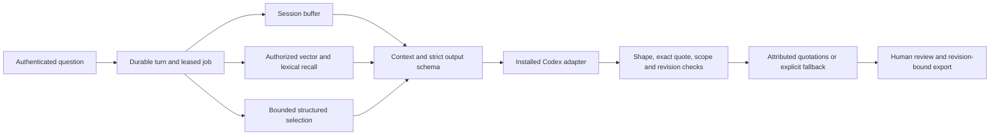

# Study guide: memory-enabled conversation agents through RelayDesk

Updated 17 October 2026. This teaches the implemented product, including its corrective design—not an idealized chatbot. Start with [current acceptance](product-acceptance.md) and [validation findings](validation-findings.md). Passing engineering tests is not independent answer-quality or Windows release approval.

## Learning route

Read this in three passes: follow a question, inspect the six concepts, then reproduce the failure boundaries. You need basic Python, HTTP, React state and SQL; no prior vector-database knowledge is assumed.

RelayDesk helps the next support engineer resume a technical investigation. The desired outcome is less repeated investigation with traceable reported attempts and unresolved questions. It does not execute source commands, certify fixes or contact customers.

## 1. Follow one question



Find routes in `api.py`, durable input in `Store.enqueue`, orchestration in `worker.Controller`, retrieval in `recall.py`, context in `context.py`, factual publication in `grounding.py`, and final publication in `Store.finish`.

Generation permission is case-specific and denied by default. Sources, memory and vectors live on the service host. The installed Codex CLI may use remote inference: “locally installed adapter” does not mean an offline LLM.

## 2. The six concepts, concretely

| Concept | What RelayDesk actually does | What to inspect |
| --- | --- | --- |
| Short-term buffer | Bounded suffix of durable turns in the current session | `context.build_buffer`, output `buffer` |
| Long-term vectors | Pinned CPU encoder; persistent revision/model-keyed chunks in SQLite | `embeddings.Encoder`, `recall.index_case` |
| Recall | Authorized and temporally eligible evidence selection | `RecallEngine.search`, hits, coverage, exact spans |
| Context compression | Structured source-preserving selection with bounded omission metadata | `context.compress`, coverage and ledger hash |
| Relevance scoring | Explainable initial semantic/lexical/recency/status rank | Hit score components, policy version |
| Cross-session sync | Shared durable state, optimistic revisions, events and restore epoch | `Store.changes/correct`, UI polling, backup restore |

### Short-term buffer: immediate context, not the whole memory

A new interactive session has a fresh buffer; the case still has its source records and durable memories. Recent whole turns are selected within the character budget. An oversized turn is omitted and counted, not silently sliced into a misleading fragment.

A subtle bug was that a short assistant turn could contain a nested old output with a huge evidence payload. The buffer now projects only turn fields—body, role and identifiers—and budgets their serialization. Previous answers are conversational context, not original evidence.

Exercise: ask a question, ask a follow-up in the same session, then create a new session. Compare `buffer.messages` and recall hits. A recalled old fact alone does not prove vector retrieval; inspect the mode, model namespace and source references.

### Long-term vectors: learned similarity, durable provenance

The genuine MiniLM ONNX encoder produces 384-dimensional normalized vectors on CPU. For unit vectors:

`cosine(q, m) = Σ q[i] × m[i]`

Token-boundary chunks avoid quietly truncating long records. Model/tokenizer hashes and pooling/chunk policy form the namespace. Wrong dimensions, non-finite values, zero vectors or wrong namespaces cannot become valid semantic evidence.

Source bodies, source revisions, memories and vectors are different objects. A memory can be proposed, corrected, suppressed or erased. A vector represents text; it cannot grant permission or prove that text is true.

The model is explicitly provisioned, not downloaded at runtime based on source instructions. Missing embeddings yield labelled lexical degradation, not fabricated semantic success.

### Recall: filter authority before scoring

The order is important: resolve actor and case; determine eligible current/historical, non-erased records; obtain only their compatible vectors; rank; build exact source hits; recheck revisions and permissions.

The current question is stored durably, but an identical `turn:` episode is excluded from supporting its own answer. Prior user-reported information is not indiscriminately deleted.

Vector computation runs outside the write transaction. Publication then checks the current memory revision, source hash, active source, state and actor permission inside a short transaction. Otherwise an import edit during embedding could publish superseded vectors.

Retrieval uses batched authorized IDs and a call-local NumPy matrix. It does not cache global plaintext across users. This removed per-candidate connection work without weakening scope checks.

Exercise: correct a source while indexing, revoke a grant during a request, and try unrelated-case recall. Read the regressions before trying destructive actions; use disposable stores.

### Compression: selection with an honest denominator

RelayDesk does not recursively rewrite an LLM summary. It groups source-linked memories into environment, attempts, outcomes, workarounds, commitments and other categories, then selects whole items.

The budget includes serialized metadata and text. Reporting every omitted ID previously made a “small summary” larger than the complete model prompt. The corrected representation includes a bounded sample of at most eight omitted IDs, the full omission count, a hash, and a reference to the authorized memory ledger at the pinned revision.

Example: selecting ten of ten thousand memories means 9,990 are omitted. A compact representation must preserve that denominator. It does not become exhaustive because its JSON fits.

The production context builder also restricts summary entries to the evidence pool that can actually be cited. Coverage remains based on the full eligible scope.

Exercise: compare 1k/5k/10k reports. Check serialized characters, not just selected body lengths. Character ceilings are not exact model-token accounting. Critical-fact preservation still needs independent labels.

### Relevance: rank is not confidence

Current policy: `hybrid-initial-2-uncalibrated`.

`rank = .65 × semantic + .28 × lexical + .04 × recency + .03 × status`

Semantic similarity helps paraphrases; lexical overlap helps error codes and product versions. Recency/status are small rank components. Authorization and erasure are hard gates, never negative score adjustments.

These are initial engineering weights, not trained calibration or correctness probabilities. Negation, contradictory environments and irrelevant exact quotations can still rank highly. Evaluate against independent questions and baselines before tuning; keep a blind held-out set.

Exercise: compare hybrid, lexical-only and vector-only results. An extractive query copied from a source favors lexical overlap and is not an independent natural-language quality benchmark.

### Cross-session sync: memory must respect later changes

SQLite is authoritative; browser state is not. Corrections require the revision the user observed. If two clients edit revision 1, only the first may create revision 2; the second must conflict.

Events and approximately two-second UI polling/refetch support catch-up. Case/account changes conservatively invalidate old drafts. Review and export are bound to an exact output/current revision. Restore rotates the epoch and expires sessions.

Two HTTP clients exercised these boundaries. That is useful server evidence, but it does not demonstrate two-browser focus, keyboard, responsive layout or accessibility.

## 3. Why strict JSON Schema was not enough

An answer can cite an allowed memory ID while inventing a recovery outcome. Pydantic verifies shape; an ID enum verifies membership; neither establishes semantic support.

The corrective publication policy is deliberately narrower:

1. Each factual claim cites exactly one supplied memory.
2. Its text must be a contiguous span of the cited original source quote.
3. CRLF/LF rendering is mapped back to original offsets; arbitrary paraphrase is rejected.
4. The server publishes the original quotation, author/state/time/type and exact source citation.
5. The model's free-form summary is not published as factual narrative; a neutral server summary reports quotations or abstention.

Read `grounding.validate_claims/publish_reply`. Proposed questions and limitations are not factual verification. Quotation proves provenance, not truth, relevance, completeness or applicability to a customer's environment. Human review remains mandatory.

This also avoids a naïve substring rule that rejected “There is no evidence that tests passed” because it contained “tests passed.” The replacement is an enforceable publication boundary, not permission to trust every model assertion.

## 4. Failure, integrity and deletion

The worker reserves calls before invocation, uses leases/deadlines, permits one repair per stage and keeps successful earlier work when a later stage fails. A fallback preserves inspectable evidence but must not be counted as a successful AI answer.

Source integrity uses a canonical digest of body/author/source timestamps, plus source revision and exact span checks. Retrieval, prompt construction, publication and backup have relevant rechecks. A structurally intact SQLite file can still contain corrupted source content.

Erasure closes over derived memories, vectors and dependent outputs. A separate ledger records tombstones outside ordinary backups. A schema-2 backup binds store identity to an independently identified ledger plus registration nonce; restore rejects an unrelated ledger before copying data.

Existing unbound stores require explicit offline enrollment with a pre-enrollment snapshot and exact store identity. A stale clone of the correct ledger is still an operational hazard: identity is not proof of latest history. Protect and retain the authoritative latest ledger. Already downloaded exports and backup-media disposal require separate policy; no secure-wipe claim.

Read `ledger.py`, `backup.py`, `Store.erase/finish/output` and the runbook before any recovery experiment.

## 5. Reproduce the engineering evidence

```sh
make relaydesk-up
make relaydesk-status
make relaydesk-test
.venv/bin/python -m pytest tests/test_relaydesk_aggressive_regressions.py tests/test_relaydesk_corrective.py -q
.venv/bin/python -m pytest -q --runxfail
npm --prefix apps/relaydesk-web test
```

Use the acceptance runner and unique evidence directories described in [product acceptance](product-acceptance.md). Historical failed runs remain retained; tuning and retesting the same examples is corrective regression testing, not a new blind evaluation.

The final unmasked acceptance run reported **283 Python tests passed**, plus three frontend state tests and a successful production build. The real cohort is now 89 distinct threads/22 repositories/6,680 non-bot messages. Eleven live jobs completed the AI stage and published 78 exact source-resolving quotations, all in partial drafts—not an independent quality score. Consult the [corrective validation report](corrective-validation-2026-10-17.md) for provider/capacity details; do not mix intermediate and final builds.

## 6. Read the code with questions

- `contracts/relaydesk.py`: what can JSON Schema enforce, and what needs application checks?
- `store.py`: which authority/revision checks must be inside the write transaction?
- `recall.py`: why authorize before matrix construction? What invalidates a vector?
- `context.py`: are coverage metadata and prior assistant artifacts included in budgets?
- `worker.py`: what survives a timeout? What consumes a call? What is a partial result?
- `grounding.py`: what exactly is guaranteed by a quoted claim—and what is not?
- `ledger.py/backup.py`: why must the deletion ledger not roll back with the database?
- `main.tsx`: what makes an export stale? Which refreshes affect client state?

Self-check: explain a new session versus erasure; similarity versus truth; suppression versus deletion; exact quotation versus entailment; passed engineering checks versus full product acceptance. If you can trace each distinction to a concrete function, test and report, you understand the agent beyond its prompt.
