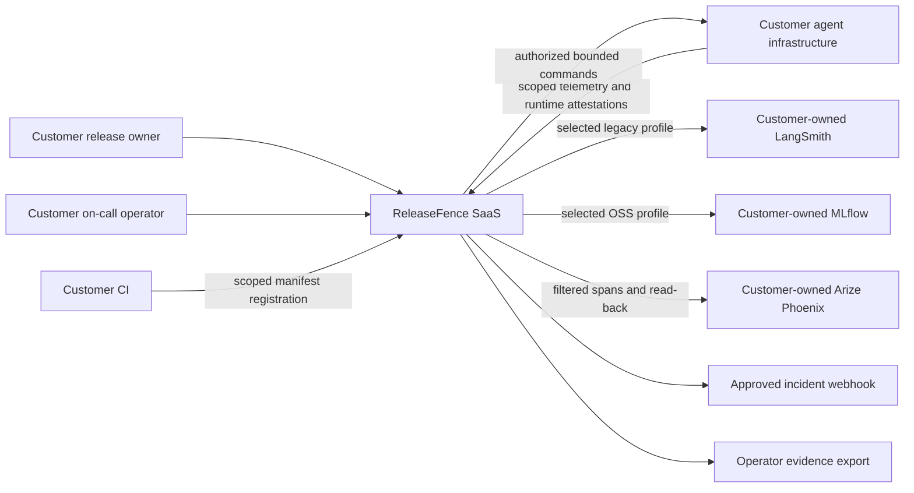
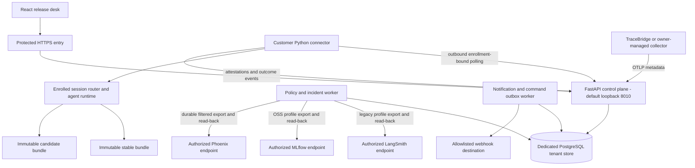
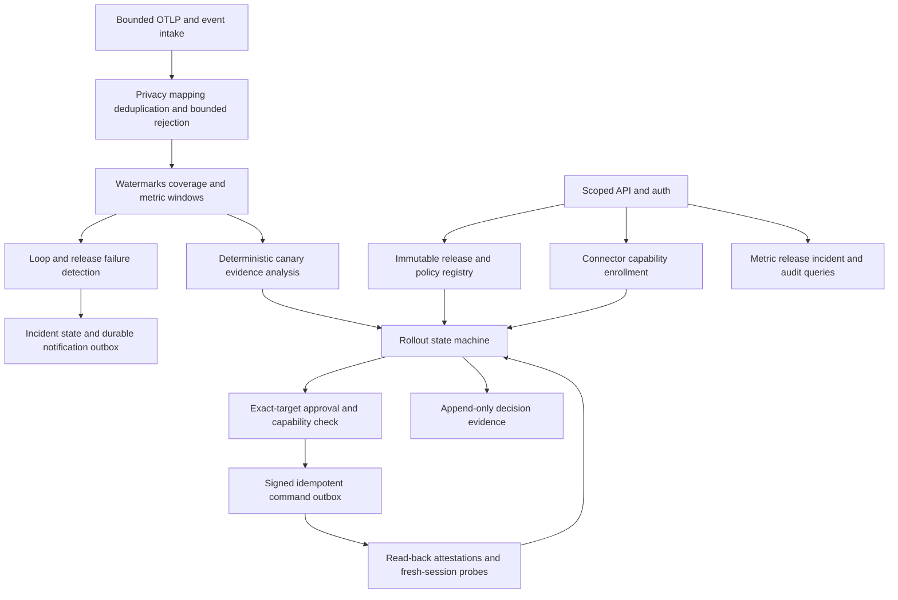
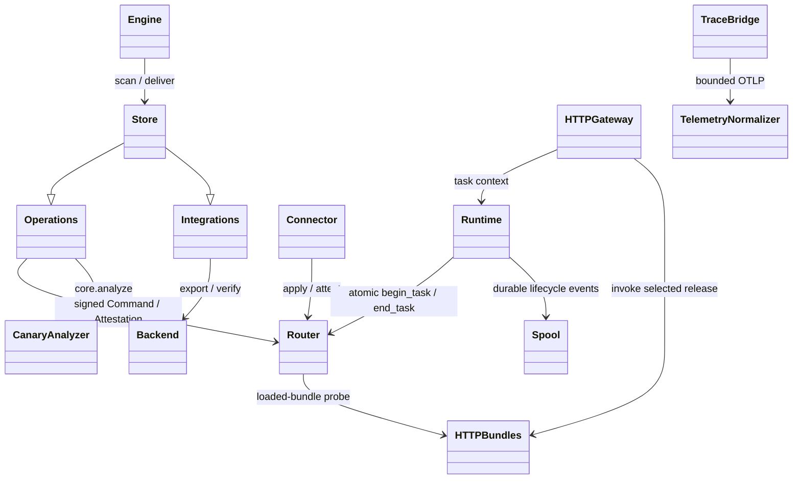

# Implementation architecture — C4 levels 1–4

Diagrams describe component boundaries, not qualified deployed infrastructure. Other cohort products
are external workloads reached through explicit adapters/HTTP; no imports from
their application internals or reuse of their databases/secrets/grants.

MLflow and LangSmith nodes are **alternative profiles**, not three simultaneously
enrolled destinations. Each organization retains the two-backend cap. The chosen
policy profile is bound into approval scope; see [ADR 0002](adr-0002-self-hosted-mlflow.md).

## C4 level 1: system context

Observe-only mode has no deployment-command capability. Customer inference remains
in customer infrastructure. Optional incident summarization uses only approved
redacted evidence through the installed-Codex port and cannot actuate a change.

## C4 level 2: containers and trust boundaries

PostgreSQL owns transactions, RLS-enforced tenant records, durable work/outbox and
decision evidence. Raw third-party trace storage remains in customer backends;
ReleaseFence stores minimal normalized events/aggregates and trace references.
No Redis/Kafka dependency is mandatory initially. Windows/WSL2 or external managed
PostgreSQL feasibility must be measured; no silent SQLite substitution for SaaS.

## C4 level 3: control-plane components

## C4 level 4: implemented code relationships

`HTTPGateway`, `TelemetryNormalizer` and `CanaryAnalyzer` are diagram labels for
`gateway.create_gateway`, `telemetry.normalize_otlp` and `core.analyze`, not classes.
The module map and concrete entrypoints are in implementation-notes.md.

## Deployment and failure sequence

The future lab control plane is independently runnable on the Windows laptop;
only authenticated application routes pass through Cloudflare. Database, collector,
Phoenix, admin ports and Codex are not publicly exposed. No commercial availability
claim follows from a tunnel. A commercial service needs its own availability,
restore, isolation, capacity and support qualification.

If control-plane/telemetry connectivity is lost, connectors keep the last committed
routing configuration (which can still include canary traffic), reject expired new
commands and buffer only
bounded telemetry. They do not autonomously expand a canary. A requested rollback
without current runtime evidence remains unverified, not successfully completed.
Approval expiry is not a runtime traffic lease and does not itself change routing
or kill in-flight inference. Operationally monitor this exposure; no autonomous
offline rollback or forced task cancellation is claimed.
