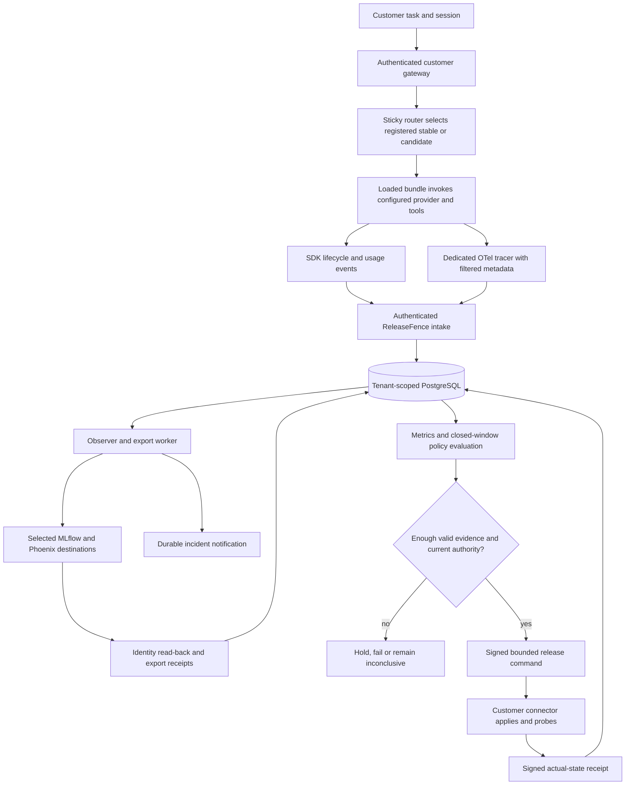

# ReleaseFence study guide: production-agent observability and release control

Day 11 of the 14-day, 12-product challenge. Written on 22 October 2026 after the
[browser and larger-cohort checkpoint](followup-acceptance-2026-10-22.md).

This guide connects the concepts to shipped code, tests and measured failures.
The learning cadence is complete; full product acceptance is not. The latest live
cohort failed, and Windows/Cloudflare validation is still pending.

## 1. Understand the product before the tools

ReleaseFence is an agent release-assurance workbench. Its intended buyer is an
engineering/platform lead operating customer-facing agents and regularly changing
their code, prompts, model configuration or tools.

The proposed job is to answer four operational questions:

1. Which whole-agent release is serving this session?
2. Is that release failing, looping, slowing down or consuming unmeasured usage?
3. Is there enough trustworthy evidence to expand a canary?
4. If rollback is authorized, did the enrolled runtime actually return to stable?

Tracing platforms help inspect executions. ReleaseFence adds a bounded workflow
across telemetry, policy, approvals and runtime verification. This is a product
hypothesis, not proof of uniqueness, customer demand or willingness to pay.

Customer inference remains behind an adapter. Our acceptance workload invokes the
installed Codex executable rather than adding a direct model API client to domain
logic. That does not mean inference is offline, model weights run on the laptop or
the subscription has a verified per-call USD price.

## 2. Map the requested concepts to actual implementation

| Concept | ReleaseFence implementation | Read first |
| --- | --- | --- |
| Production tracing | Privacy-minimal OTel intake, durable export records, exact backend identity read-back | [`telemetry.py`](../../apps/releasefence-api/src/releasefence_api/telemetry.py), [`integrations.py`](../../apps/releasefence-api/src/releasefence_api/integrations.py), [`Backend.verify`](../../apps/releasefence-api/src/releasefence_api/backends.py) |
| Latency and cost dashboard | Lifecycle-derived durations, coverage, usage deduplication and reported/estimated/unknown costs | [`metrics`](../../apps/releasefence-api/src/releasefence_api/core.py), [React workbench](../../apps/releasefence-web/src/main.tsx) |
| Alerting on loop failure | Deterministic detectors, durable incidents, signed webhook outbox, bounded retries/dead letters | `detect` in `core.py`, [`Engine`](../../apps/releasefence-api/src/releasefence_api/engine.py) |
| Canary testing | Immutable releases, sticky session routing, closed windows and fixed-look analysis | [`Router`](../../apps/releasefence-api/src/releasefence_api/connector.py), `analyze` in `core.py`, [`analyze_rollout`](../../apps/releasefence-api/src/releasefence_api/service.py) |
| Rollback | Independent scoped approval, signed/fenced commands, runtime receipts and loaded-bundle probes | `control`/`attest` in `service.py`, [`HTTPBundles`](../../apps/releasefence-api/src/releasefence_api/gateway.py) |

The original design named LangSmith and Arize Phoenix. With user approval, the
qualified alternative became **MLflow + Phoenix**, selected by
`mlflow-phoenix-v1`. Legacy `langsmith-phoenix-v1` remains the API default for
policies omitting that field. New UI rollouts explicitly select the OSS profile.
LangSmith and Arize AX are not qualified by another backend's successful test.
Read [ADR 0002](adr-0002-self-hosted-mlflow.md) for the requirement change and
customer-owned deployment/licensing boundary.

## 3. Follow one execution through the architecture



This simplifies asynchronous retries and command states; it is not a deployment
receipt. Read the [C4 architecture](architecture.md) for trust/container boundaries.

PostgreSQL holds control-plane tenant records. Customer-local SQLite holds routing
and the event spool. The optional tracing servers have their own stores. They are
not interchangeable databases, and a successful trace upload is not routing proof.

Suggested code-reading order:

1. [Contracts](../../packages/contracts/src/contracts/releasefence.py): `Release`,
   `Policy`, `Event`, `Usage`, `Span`, `Command` and `Attestation`.
2. [`sdk.py`](../../apps/releasefence-api/src/releasefence_api/sdk.py): `Runtime.task`,
   attempt accounting and the durable spool.
3. `gateway.py` and `connector.py`: actual bundle dispatch, session routing and probes.
4. `core.py`: pure metrics, detectors and sampled analysis.
5. `service.py`: database-backed authority, lifecycle and verification gates.
6. `integrations.py`, `backends.py`, `engine.py` and
   [`worker.py`](../../apps/releasefence-api/src/releasefence_api/worker.py): durable work.
7. [`api.py`](../../apps/releasefence-api/src/releasefence_api/api.py) and React:
   authenticated transport and presentation, not alternate policy authorities.

## 4. Traces, lifecycle events and audit records answer different questions

A trace connects an agent root to child LLM/tool/retrieval spans. Its trace ID,
span IDs and parent relationships explain execution structure. An event records
accepted work, terminal outcome, usage or a tool/heartbeat observation. An audit
record explains who changed authority/state and what was requested or verified.

Consider a task that makes two model attempts because the first times out:

- One accepted task and one terminal task outcome.
- Two attempted model calls, including the uncertain/failed one.
- Potentially one agent root and two LLM child spans.
- Separate export records for each span in each required backend.

This is not three tasks, three bills or six independent executions. In the actual
larger campaign, **200 roots + 239 invocation spans = 439 unique spans**. Reading
each from two backends gives 878 backend observations, not 878 model calls.

Read-back must match the selected scope, original IDs, parent and release metadata.
`HTTP 200` or a nonempty dashboard is insufficient. MLflow's pinned read API uses
base64 protobuf-JSON ID fields; Phoenix exposes hexadecimal context IDs. The
adapter normalizes representation without weakening identity checks.

## 5. Export is a state machine, not a print statement

`integrations.py` persists per-backend/per-span export work. Workers lease bounded
batches, export, query the destination, then record verification or retry/dead-letter
state. Unknown attempts remain attempts. An owner gets one bounded replay rather
than an unlimited retry button.

The selected profile requires proof from both backends for both release arms in
the applicable window. Pending/dead-letter exports hold qualification. A backend's
latest successful read-back must not hide other unfinished records.

This distinction mattered in the larger campaign: six Phoenix records reached
dead letters even though both backend databases eventually contained all spans.
A separate fresh-backend replay passed. That did not retroactively verify the
original export records or establish the original failure's exact cause.

## 6. Privacy is part of observability

The control plane does not need raw task input, output, tool arguments, credentials
or hidden model reasoning to compute these release signals. Instrumentation filters
metadata before export; tool fingerprints use keyed hashes rather than retaining
arguments. Exception payloads are not deliberately recorded as trace content.

Metadata can still be sensitive. Release IDs, timing and tenant relationships
need scoped access, retention and review. A keyed fingerprint is not a promise
that every possible input becomes anonymous.

Use [`store.py`](../../apps/releasefence-api/src/releasefence_api/store.py) to study
PostgreSQL RLS and non-bypass runtime roles. Browser identity, machine enrollment,
CI registration, webhook credentials and signing keys have different jobs.
Cloudflare protection will supplement application authorization, not replace it.

## 7. Calculate metrics without manufacturing certainty

At the core level:

```text
lifecycle coverage = completed tasks / accepted tasks
cost per successful task = (reported cost + explicitly estimated cost) / successes
```

The second value is available only when successes exist, lifecycle is complete
and there are no unknown calls. Missing data is `null`, not zero. Known-cost
subtotals do not imply that calls with unknown cost were free.

Important details in `metrics`:

- Deduplicate event IDs; reject conflicting evidence under the same ID.
- Namespace runtime-local task/session/attempt IDs across enrollments.
- Deduplicate model attempts, and do not add inclusive parent usage as another bill.
- Keep reported and estimated costs separate; estimates require a pinned revision.
- Cached input is a subset of input, not an additional input charge/category total.
- Include failed closed tasks in latency, rather than measuring only fast successes.
- Show incomplete lifecycle, absent latency and orphan events explicitly.

Example: 100 input tokens with 30 cached tokens means 70 uncached input tokens,
not 130 input tokens. If the per-call price is unknown, token availability does
not make USD cost known.

Dashboard p95 is descriptive. It is not a customer SLA or proof that a release is
safe. The cohort's wall-clock discontinuities make representative latency claims
particularly inappropriate. Rounded UI display fixes readability, not measurement
validity.

## 8. Detect loops and deliver alerts durably

Study `detect` separately from `Engine.scan` and `Engine.deliver`:

1. A deterministic detector identifies a repeated action without progress,
   iteration exhaustion, deadline/schema exhaustion or missing terminal work.
2. The observer persists an incident and notification work rather than relying
   on the request handler to finish delivery.
3. A worker attempts HMAC-signed delivery; receivers deduplicate by stable identity.
4. Bounded retries lead to a visible dead letter, with bounded owner replay.

Legitimate polling and bounded human waits are not automatically loops. Repeated
HTTP success is not task success if the task exhausted its budget. Acknowledging
an incident does not prove mitigation or authorize incident closure.

Delivery is at least once, not magical exactly-once execution at the receiver.
Crashes and lost responses can leave uncertain attempts. The independent worker
readiness heartbeat is published after successful cycles; process existence alone
does not demonstrate that the observer is doing useful work.

## 9. Canary testing requires more than a traffic percentage

A release hash binds code, prompt, model configuration, tool schema, policy
revision and an optional compatible index. A rollout pins baseline/candidate,
scope, policy and enrolled runtimes. Changing a prompt without changing its bundle
identity undermines attribution.

`assignment(scope, session, seed, weight)` deterministically chooses a cohort.
Turns/retries stay with their session. Selecting session IDs until the desired
arm appears can be useful in a declared mechanical drill, but cannot establish
an unbiased live traffic split.

The larger campaign did not filter IDs to balance arms. Its 5% stage produced
**189 stable and 11 candidate sessions**. A policy requiring at least 100 per arm
was not satisfied merely because the total was 200.

Learn three different gates:

| Gate | Question |
| --- | --- |
| Data integrity | Do lifecycle, usage, current runtime counters and selected-backend proof agree? |
| Statistical evidence | At a predeclared look, do conservative failure/latency/cost bounds meet policy? |
| Authority | Does a current independent approval permit this exact transition? |

`analyze` uses a versioned fixed-look method, conservative binomial bounds and
reproducible resampling for latency/cost ratios. `analyze_rollout` adds closed
event-time windows, lateness, runtime freshness, signed counters and backend/backlog
checks. Persisted decisions cannot be re-peeked until a convenient pass appears.

`inconclusive` is useful output. Minimum admission counts are not adequate power
for every decision: controlled tests show 100 perfect known-cost samples per arm
still cannot pass the default conservative failure margin. The 402/403 boundary
test is a mathematical fixture under its assumptions, not a production sample-size
recommendation. Critical hard failures also block expansion independently of a
favorable sampled aggregate.

The failed larger campaign never reached its closed-window decision or rollback.
Do not claim that its observed 11-candidate split demonstrated statistical safety.

## 10. Verify rollback instead of trusting an acknowledgement

Read `control`, `authorize_command`, `Router.apply`, `Router.attest` and `attest`.
The important distinction is between requesting a change and observing it applied.

```text
Scoped independent approval
  → signed command with expiry, expected revision and fencing epoch
  → authorized customer-side application, idempotent by command identity
  → fresh signed state receipt and loaded-bundle probe
  → verified only when the declared runtime scope agrees
```

Compare-and-set revision checks reject stale competing changes. The connector
rechecks authorization before new execution. If an acknowledgement is lost, it
reconciles the same committed command instead of blindly issuing another change.
Stale/replayed proofs must not move observed state backward.

Rollback changes future routing to a registered compatible stable bundle. In-flight
candidate exposure can keep recovery partial. An offline runtime or unavailable
baseline cannot be erased from the verification scope to obtain a green result.
Emails, payments, database mutations and remote tasks are not reversed by routing.

Signatures establish integrity/origin under key assumptions; they do not prove
semantic task correctness or protect against a compromised signing host.

## 11. Learn what TDD did—and what it did not prove

The [observed checkpoints](tdd-checkpoints.md) record meaningful red/green slices:
unknown cost handling, actual Phoenix protocol/project headers, approval guards,
runtime receipts, cohort summaries, accessibility contrast and archive paths.
Not every scaffold/documentation line was test-first.

The source-archive fix is especially instructive. Joining an absolute runner path
under an evidence directory escaped that directory, leaving its self-copy missing.
The failed cohort has 23 matching archived files and one missing runner archive.
A new test protects future snapshots; it cannot recreate the missing old source.

Tests answer their declared questions. Six browser tests do not prove all browser
states. A controlled fault is not a natural customer incident. A real PostgreSQL
test is not an accepted Windows service. A correct schema does not ensure a
provider response or a valid business answer.

## 12. Keep the validation denominators straight

| Evidence | What was measured | What it does not establish |
| --- | --- | --- |
| Source volume | 1,000 actual USDA products; 1,000 sessions and 12,000 deterministic lifecycle/tool events | 12,000 model calls or expert semantic labels |
| Controlled fault matrix | 150 source-bound scenario cases | 150 spontaneous model failures or calibrated production rates |
| Bounded OSS smoke | Six fresh calls in its final campaign, actual dual read-back, alerts and signed/probed rollback | Representative statistical promotion |
| Larger live cohort | 200 attempted products, 239 calls, 165 successful source-bound outputs; failed export completion | A passing cohort, 82.5% general model accuracy or valid latency/SLA evidence |
| Metadata replay | 439 retained live spans read in each fresh backend; zero inference | New task outcomes or original dead-letter-state recovery |
| Browser/build | Six actual Chrome cases; four domain tests and production build | Full accessibility certification or all-browser coverage |
| Final monorepo | 850 passed, five unrelated skips | 850 ReleaseFence E2E cases or acceptance of the skipped tests |

The original approval spent 24/24 calls. A separate larger approval spent 239/240.
Never reset a ledger, reuse another product's grant or treat failure as a refund.
The 200-product workload is drawn from the frozen corpus, not 200 new customer
accounts or an additional independent 1,000-record source sample.

## 13. A practical study session

From the repository root, these focused tests make no model calls:

```sh
.venv/bin/python -m pytest -q tests/test_releasefence_core.py tests/test_releasefence_validation.py
npm --prefix apps/releasefence-web test
```

Read a test before running it. Inspect unknown-cost handling, sticky assignment,
the 100-per-arm hold, the new approval ledger and absolute source-archive test.
For database/process or browser tests, use an isolated test database and the
[operating guide](implementation-notes.md). The
[follow-up](followup-acceptance-2026-10-22.md) contains explicit browser and
zero-inference replay commands. Do not invoke live acceptance as a study exercise.

Useful exercises without new inference:

- Add a duplicate event to a fixture and explain why metrics must not rise.
- Remove a usage price while retaining tokens; predict cost-per-success.
- Trace how one dead-letter export becomes a promotion hold.
- Compare an owner request, independent approval and runtime verification receipt.
- Read the failed cohort report alongside its replay receipt and list which claims
  each actually supports. Reports under `var/validation/` are local retained
  artifacts, excluded from Git; availability is not guaranteed in a fresh clone.

## 14. Self-check

1. **Why not calculate the dashboard entirely from exported traces?** Lifecycle
   accounting and export completeness are separate responsibilities; unavailable
   traces must not silently erase accepted or failed work.
2. **Is zero known cost equivalent to free inference?** No. Unknown calls keep total
   cost/cost-per-success unqualified.
3. **Does a successful replay clear original dead letters?** No. It proves a new
   replay's read-back, not recovery of the original durable records.
4. **Can an owner who made the rollout approve it independently?** Not under the
   default independent-approval rule; role alone is not exact control authority.
5. **Why did 200 tasks not supply 100 candidate observations?** Assignment was 5%,
   not a forced balanced experiment; the candidate arm contained 11 sessions.
6. **Can deployment on Windows make every open gate pass?** No. Host validation,
   provider reliability, export recovery, billing completeness, statistical power
   and independent review need their own evidence.

## 15. What remains before a stronger acceptance claim

The Windows laptop must become reachable through an authorized connection before
service identity/ACLs, restart supervision, resource pressure, protected Cloudflare
browser/machine paths and host recovery can be qualified. The original larger-run
provider/export failures, clock continuity, sufficiently powered actual traffic
and verified billing evidence remain open independently of that deployment.

See [acceptance gates](validation-and-acceptance.md),
[latest measured results](followup-acceptance-2026-10-22.md),
[metrics](metrics-and-cost.md), [canary/rollback](canary-and-rollback.md) and
[permissions](permissions-and-security.md) for the detailed specifications.
The core lesson is not “add more charts.” It is **make evidence, authority and
uncertainty explicit before changing what an agent serves**.
