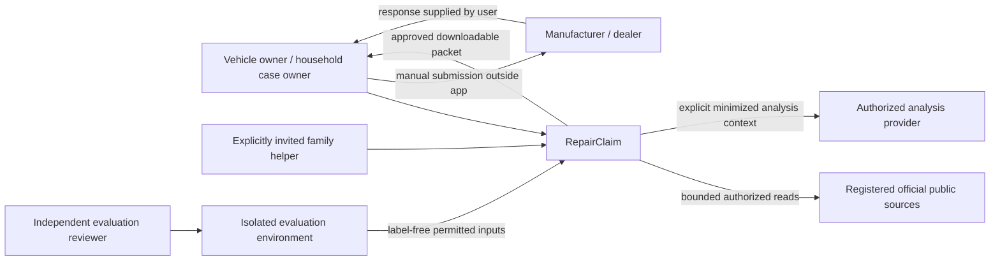
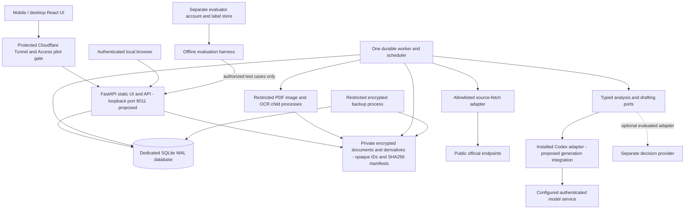
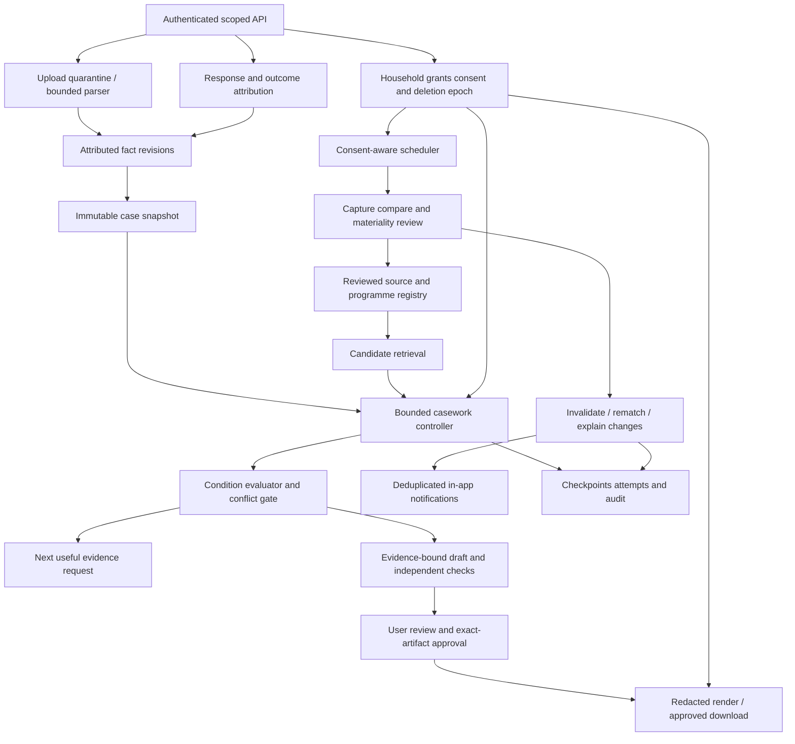
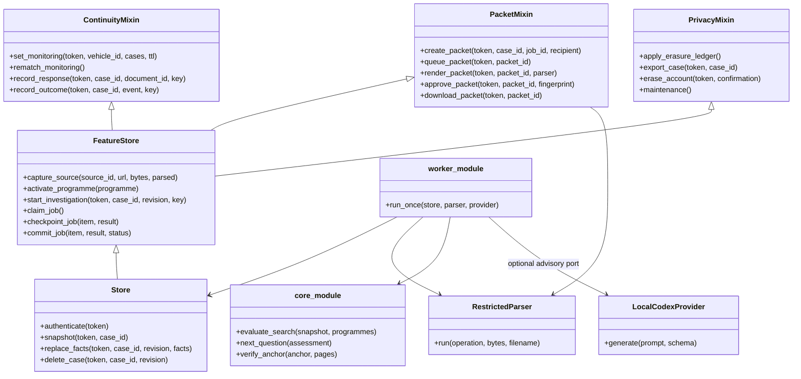

# Architecture — C4 levels 1–4

The API, worker, ingestion, registry, monitoring, packets and React UI are
implemented. Deployment/evaluation nodes below still describe target qualification,
not an installed Windows/tunnel/evaluation environment. See the
[actual implementation map](implementation-notes.md) and [status](implementation-status.md).
The design supports all [twelve requirements](functional-requirements.md) without depending on
an experimental provider. Product API/web and shared contracts are additive to the
monorepo. No import from another product's application package or reuse of its DB.

## C4 level 1: system context

No RepairClaim-to-recipient arrow: manual submission is a deliberate first-release
boundary. A helper cannot grant their own authority or approve an outbound packet.
Official-source evidence is untrusted content, not instructions or consumer consent.

## C4 level 2: containers and deployment boundary

Single Windows host is a bounded pilot target, not highly available SaaS. SQLite is
chosen for one writer, serialized expensive work and modest concurrency; use a
scoped repository with household keys on every query and constraint. There is no
database RLS claim. Measure lock/load behaviour; if capacity fails, re-plan storage
before launch instead of silently dropping durability or scope checks. Do not run
all portfolio workloads concurrently without measured host admission limits.

The app has its own authentication and household grants; Cloudflare is an extra
pilot gate, not the identity or authorization model. Private files are never served
as static assets. No credentials/source/model calls on basic startup or health checks.

## C4 level 3: application components

Mandatory conditions are evaluated deterministically when computable. Semantic
matching is advisory; source ambiguity remains a review obligation. A changed
source, fact, grant, consent or renderer invalidates dependent approval as needed.

## C4 level 4: implemented code relationships

The Store facade inherits feature mixins to share one scoped SQLite transaction
boundary. Core evaluation and document primitives remain separate modules.

Implemented ownership: `apps/repairclaim-api/src/repairclaim_api/` (API, auth, store,
ingestion, coverage, casework, packets, monitoring, worker, operations),
`apps/repairclaim-web/` (consumer UI),
`packages/contracts/src/contracts/repairclaim.py` (bounded shared schemas),
`tests/test_repairclaim_*.py` and frontend domain tests. These modules and the React
app exist; interactive browser verification remains open. The public shared
LocalCodexProvider adapter is optional. Port 8011 is the development default and
the launcher checks occupancy before starting. Windows and Cloudflare nodes remain
deployment targets. See actual module names and design deltas in implementation notes.

## Key sequences and consistency

Upload → quarantine → safe extraction → user confirmation → immutable snapshot →
retrieval → condition findings → focused clarification or draft → independent checks
→ rendered disclosure preview → owner approval → authorized download.

Source capture → reviewed material change → invalidate impacted assessments and
approvals → consent check → durable rematch → source-linked change notification.
Invalidation precedes notification completion; failures leave stale outputs blocked.
Household scope, deletion epoch, expected revision and lease token are rechecked
at writes and downloads, not just at the beginning of a long job.
