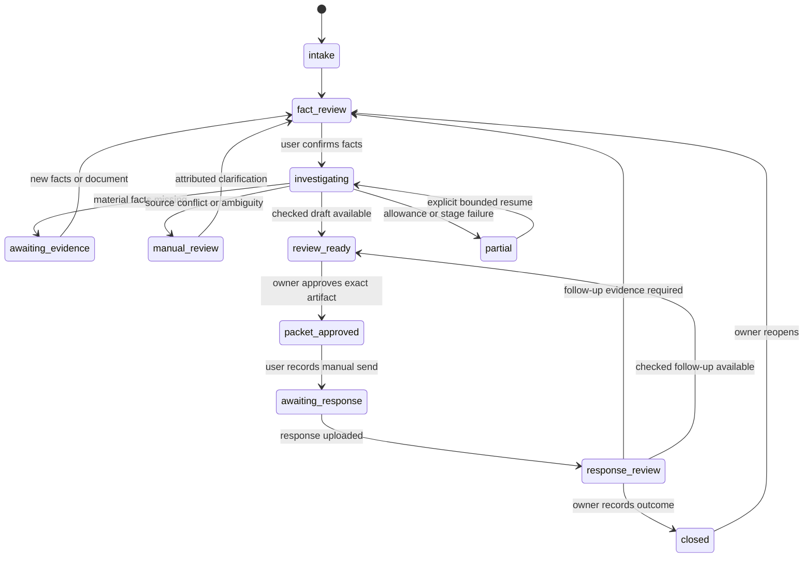

# Casework protocol and bounded investigation

Planned behaviour for FR-01–FR-06 and FR-09–FR-11. Lifecycle, assessment and
outcome are separate dimensions; neither a green job nor a successful export is a
successful claim. All transitions are persisted, scoped and revision-checked.

## Lifecycle

Any non-deleted state may be cancelled. Material changes move dependent artifacts
to stale; approval does not survive by keeping an old lifecycle value. Deletion is
a separate terminal barrier, revokes grants/consents and cancels jobs. Unsupported
scope exits with an explanation and evidence-preserving case, not an invented lead.

Assessment states are exactly those in FR-03. A completed investigation can find
no supported programme. Source failure is an operational state, not that conclusion.
Outcome records represent manufacturer confirmation, approvals and payment events
with evidence attribution; they do not mutate the original evidence snapshot.

## Bounded stages

1. Validate identity, household scope, consent and supported inventory.
2. Freeze case facts, programme registry version and authorized egress fields.
3. Retrieve candidates using exact programme/component/vehicle metadata plus an
   evaluated semantic-ranking option. Preserve excluded candidates/reasons.
4. Check every mandatory condition; validate citations against frozen source bytes.
5. Select the next material question, request review, or prepare a draft.
6. Independently validate claims, amounts, references, uncertainty and forbidden
   assertions. Judge agreement alone cannot waive unsupported evidence.
7. Allow at most two constrained draft revisions, retaining earlier valid versions.
8. Return review-ready, needs-evidence, conflict, unsupported or partial with reasons.

Initial per-investigation limits: six analysis/drafting invocations including parse
retries, two draft revisions, three source-fetch attempts per URL, 120 seconds per
provider attempt, 12 minutes total active job time and a 20,000 input-token estimate
ceiling per call. These are proposed bounds, not performance measurements. Tests
must prove counters survive restart. Unknown usage/timeouts create a visible hold;
budget increases require a new explicit allowance, never an automatic reset.
Pause for a human is outside the active job deadline and never triggers polling
model calls. Concurrency is one expensive job per product until host qualification.

Malformed/unsupported tool output produces a validation-history event before any
bounded retry. Timeouts and nonparse failures also have explicit events. Persist
accepted stages immediately; a later fault must not erase completed facts,
findings or a safe earlier draft. A partial draft is clearly unapproved and cannot
inherit successful evaluation/approval from a sibling artifact.

## Evidence question policy

Prefer a question that resolves a mandatory condition, avoids redundant requests
and exposes its reason. Do not pretend to know which question maximizes success
without evaluation. A not_satisfied mandatory condition can be explained first;
asking for irrelevant receipts must not imply a likely refund. Users can pause,
answer unknown or request a records-request draft under the same review controls.

## Response and rejection processing

Attribute every reason to response text or to the user's account. Distinguish a
request for more records, a conditional/partial approval, an explicit refusal and
an ambiguous reply. Link reasons to condition IDs and relevant evidence revisions.
If response interpretation conflicts with the source, preserve both; do not resolve
it by majority vote or model confidence. Do not infer admission of error from
silence. A follow-up is reviewed as a new artifact with its own approval.

## Approvals and outcomes

Owner approval binds exact rendered bytes and attachment set, facts/source hashes,
recipient, redactions, renderer version, case revision and authorization epoch.
Source age or authority changes force re-review before a finalized download. A
previously downloaded copy cannot be revoked; show that limitation explicitly.

`user_reported_sent` stores channel/date and optional evidence. Actual delivery is
unknown in release one. Payment/approval amounts require separate attributed
events; neither a reminder nor a signed packet establishes a financial outcome.
