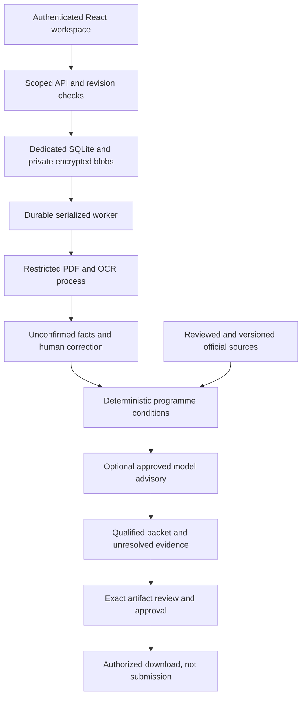

# RepairClaim study guide: building an evidence-bound consumer agent

Day 12 of the 14-day, 12-product challenge. Written on 24 October 2026.

This guide explains the product through its implemented concepts, code and observed
failures. It is a learning checkpoint, not a claim of full product acceptance.
The [implementation ledger](implementation-status.md) and
[real-document report](public-repair-document-validation-2026-10-24.md) are the
authoritative evidence references. Browser interaction, general invoice-understanding
quality, Windows deployment and consented customer outcomes remain unpassed.

## 1. Start with the consumer's job

RepairClaim helps a vehicle owner organize repair evidence, check an explicitly
supported official programme inventory, understand missing information and prepare
a factual coverage enquiry or reimbursement-request packet.

It is not an AI mechanic, an authoritative warranty lookup, legal representation
or an automated claim-submission service. A plausible programme match is a lead
to investigate, not proof that a manufacturer owes the owner money.

Consider this illustrative case:

> An owner uploads a repair invoice and asks whether manufacturer coverage might
> apply. The invoice has a total, but the repair-time mileage and in-service date
> are unclear.

A useful agent preserves those unknowns, asks for the missing evidence, checks
documented conditions and prepares a qualified enquiry. It does not fill the gaps
with likely values to produce a more confident answer.

Read the [twelve functional requirements](functional-requirements.md) first. They
cover intake, discovery, conditions, questions, packets, responses, monitoring,
change explanations, disclosure control, timeline, outcomes and household privacy.

## 2. Follow the actual architecture



This is a simplified execution path. Monitoring and privacy also act across it;
see the [C4 architecture](architecture.md) for their boundaries.

Important distinctions:

- RepairClaim's application store is SQLite. The full monorepo regression also
  exercises other products using real PostgreSQL; that does not make RepairClaim
  a PostgreSQL application.
- Installed Codex is an optional provider adapter, not proof that model weights
  execute offline on the laptop. No actual RepairClaim Codex calls were measured.
- Windows plus protected Cloudflare access is a deployment target, not a completed
  deployment or a high-availability SaaS architecture.
- No application endpoint sends an email, submits a portal claim or accepts money
  or a settlement on the user's behalf.

## 3. Map concepts to the product

| Concept | How it appears in RepairClaim | Code to read |
| --- | --- | --- |
| Structured outputs | Typed facts, evidence anchors, conditions and outcomes; explicit tool-response validation | [Contracts](../../packages/contracts/src/contracts/repairclaim.py), [worker](../../apps/repairclaim-api/src/repairclaim_api/worker.py) |
| Grounding | Source hash, document ID, page and literal quote bind a claim to a captured version | [Core](../../apps/repairclaim-api/src/repairclaim_api/core.py), [features](../../apps/repairclaim-api/src/repairclaim_api/features.py) |
| Uncertainty and human control | Unknown/conflicting findings, focused questions, unconfirmed extraction and explicit approval | Core, [routes](../../apps/repairclaim-api/src/repairclaim_api/routes.py), [UI](../../apps/repairclaim-web/src/main.tsx) |
| Durable execution | Queued work, leases, checkpoints, attempt receipts and stale-result fences | Features, worker |
| Provider isolation and budgets | Separate advisory adapters, exact egress consent and durable usage journals | [Jev gateway](../../apps/repairclaim-api/src/repairclaim_api/jev.py), [proxy adapter](../../apps/repairclaim-api/src/repairclaim_api/jevmodel.py) |
| Stateful continuity | Retained case history, response review and revocable source-change monitoring | [Continuity](../../apps/repairclaim-api/src/repairclaim_api/continuity.py) |
| Artifact authority | Exact packet fingerprint, expiry, freshness checks and revocation | [Packets](../../apps/repairclaim-api/src/repairclaim_api/packets.py) |
| Privacy and recovery | Household scope, per-case encryption, erasure ledger and quarantined restore | [Privacy](../../apps/repairclaim-api/src/repairclaim_api/privacy.py), [operations](../../apps/repairclaim-api/src/repairclaim_api/operations.py) |

This is not a claim that every technique from the preceding eleven products was
reimplemented here. In particular, durable case history is not automatically a
vector-memory system, and reviewed programme matching is not unrestricted web RAG.

## 4. Learn the evidence model before the model adapter

A fact needs a value, a type and attribution. For example:

```json
{
  "field": "invoice_total",
  "value": "106.45",
  "unit": "USD",
  "status": "user_reported",
  "anchor": null
}
```

This reflects the manual-entry attribution used in the historical-invoice test.
It does not assert that the owner paid that amount, that it is reimbursable or
that a reviewer independently authenticated the invoice.

An extracted fact starts unconfirmed. A selected proposal can become confirmed
with an anchor identifying its document hash, page and literal quote. Manual
correction creates a new revision and remains user-reported; the application does
not manufacture a source anchor for it.

Three checks answer different questions:

1. **Schema validation:** is this a legal date, quantity, currency or evidence shape?
2. **Grounding validation:** does the value/quote resolve to the bound page and bytes?
3. **Semantic review:** does that evidence mean what the application says it means?

Passing the first two does not establish the third. A quoted delivery date is not
necessarily the in-service date. A subtotal is not necessarily an invoice total.
A paid stamp does not by itself establish an authenticated refundable amount.

Read `Fact`, `EvidenceAnchor`, `Condition` and `OutcomeEvent` in the contracts, then
`_parsed_response` in the worker. Notice that parser output is validated as a tool
response; it is not trusted merely because it came from our own subprocess.

## 5. Understand condition evaluation and uncertainty

The core checks explicit programme conditions rather than asking a model for an
unconstrained yes/no decision. Findings include:

- `satisfied`: the available fact meets this condition.
- `not_satisfied`: the fact violates it.
- `unknown`: a necessary fact is missing.
- `conflicting`: evidence disagrees.
- `confirmation_required`: an external check is still necessary.

Overall assessment states include `potentially_applicable`, `missing_evidence`,
`appears_outside_conditions`, `conflicting_information` and
`no_supported_programme_found`. Unsupported make/jurisdiction and unavailable
sources are separate search statuses, not fabricated coverage verdicts.

Reason through an illustrative 150,000-mile condition:

- Exactly 150,000 miles can satisfy an explicitly inclusive maximum.
- 150,001 miles cannot.
- Current mileage cannot substitute for mileage at the repair.
- A kilometre value needs the correct conversion, not a relabelled unit.
- A missing repair mileage stays unknown even when every other fact looks promising.

Calendar-month limits also need explicit anniversary semantics, not an approximate
number of days. Tests exercise the implemented clamp-to-last-day policy.

The next question should target a material unknown. Asking for a diagnosis or
in-service date can be more useful than generating a longer explanation from the
same incomplete facts. A manufacturer's VIN-specific confirmation remains outside
the authority of our model or rules.

## 6. Treat PDF parsing as a security and reliability boundary

Read [documents.py](../../apps/repairclaim-api/src/repairclaim_api/documents.py),
[parser.py](../../apps/repairclaim-api/src/repairclaim_api/parser.py) and
[parser_child.py](../../apps/repairclaim-api/src/repairclaim_api/parser_child.py).

Untrusted uploads are processed by a restricted native macOS child or a configured
local unprivileged container. Resource limits, no-network execution, bounded file
types/sizes and active-content rejection matter independently of extraction quality.
There is no unsafe in-API parsing fallback when the isolated runtime is absent.

The real-data finding is instructive: seven historical public attachment packs
parsed successfully, but initially produced no fact proposals. A bounded DTC-label/
OCR-separator correction produced one unconfirmed diagnostic-code proposal; six
packs still produced none. That is not successful general invoice understanding.

The UI now explicitly warns about empty or incomplete extraction and directs the
user to review and correct facts. Its notice has a red/green frontend test. The
fallback is implemented; real-browser interaction and broad extraction quality
are still unpassed.

Redaction is a separate property. Rasterizing an attachment removes underlying
selectable text, but rasterization without redaction does not hide visible private
content. Previewing and choosing the correct redactions remain necessary.

## 7. Separate model advice from decision authority

The optional providers are ports behind the domain logic. Deterministic results
are checkpointed before advisory work, so a provider failure need not erase useful
case progress. Structured output, bounded retries/attempts and logged validation
failures constrain the interaction; they do not guarantee a correct interpretation.

The Jev adapter uses native Choice/Noul responses for bounded advisory decisions.
Choice probabilities are not independently calibrated probabilities of coverage.
An advisory disagreement or uncertainty routes to review rather than silently
overwriting the deterministic finding.

Distinguish the tested routes:

- The Vercel route recorded rejected access attempts, not successful Jev decisions.
- The separately authorized jevmodel.org proxy returned validated decisions using
  its documented alias. Its reported model version is not independent attestation
  of the upstream system or its architecture.
- Proxy token receipts do not establish a USD bill. Reservations, unknown usage,
  actual token use and remaining allowance are different ledger fields.

The first proxy campaign validated 11 decisions and retained three advisory
disagreements. The later metadata campaign validated another eight decisions.
Those 19 campaign decisions are not 19 independent verified customer outcomes;
the successful access probe is a separate observation.

The actual repair-document campaigns made no provider calls and sent no raw
consumer document text or identifiers to a model. Do not reuse a credential,
route approval or exhausted quota as if it were a fresh authorization.

## 8. Understand durable work and approval freshness

A job is more than a function call. Its stored inputs, lease, attempts, checkpoint
and terminal/partial state survive beyond an individual HTTP request.

Study these failure sequences:

1. A worker starts work, then a fact is corrected. Its late result must not become
   the authoritative assessment for the new revision.
2. A lease expires and another worker resumes. The old worker must not commit as
   though it still owns the lease.
3. An owner erases a case while a parser is running. Late parsing must not restore
   erased private content.
4. A provider times out after possibly consuming tokens. Unknown usage must not
   become zero-cost permission for unlimited retries.

Packet approval is similarly version-bound. Review applies to exact content,
attachments and fingerprint, under current facts and source state. Download checks
freshness again. A fact or source change cannot inherit old approval merely because
the owner once clicked a button.

Actual real-document tests verified preapproval denial, exact approval, downloaded
PDF/manifest hash agreement, revocation and stale approved-download denial after a
fact revision. This is artifact control, not proof of delivery to a manufacturer.

## 9. Keep continuity, privacy and money honest

Monitoring requires separate revocable consent. It rematches retained cases when
reviewed source revisions change; it does not authorize disclosure, renew retention
forever or turn a newly discovered old notice into a newly issued programme.

Response text is attributed evidence. A historical regulator request for more
records can exercise response review and follow-up generation, but is not a real
reply to our unsent packet or a manufacturer's confirmation.

Financial events distinguish requested, confirmed-covered, approved, received and
avoided-cost amounts. They use Decimal quantities, separate currencies, explicit
evidence classes and bounded reversals. Never add approved and received values
together as though they were separate savings.

The historical invoice test entered an invoice total manually, rejected an attempt
to record it as a documented refund and left outcome totals empty. This is a useful
negative test: refusing an unsupported success is part of correct behaviour.

Household scope applies to cases, documents, jobs and exports. Erasure uses a
durable ledger and key/file deletion; restore must replay deletion authority before
making old data available. Previously downloaded external copies cannot be recalled.

## 10. Read the validation results without inflating them

| Evidence | What was measured | What it does not establish |
| --- | --- | --- |
| Full regression | 1,040 passed, five existing optional skips; native RepairClaim process checks enabled | 1,040 RepairClaim-only tests or full product acceptance |
| Scoped verification | 187 Python tests, three process skips in the normal invocation; four frontend tests, build/lint passed | Actual browser/mobile/accessibility interaction |
| Official-source corpus | 12 downloaded PDFs; 11 parsed/68 pages; one quarantine | Complete supported inventory or independent rule labels |
| Authored boundaries | 48 HTTP/worker scenarios against frozen official sources | 48 actual consumer repair cases |
| Public complaint metadata | 400 records; four distinct minimized input signatures; eight representative live decisions | 400 substantive independent assessments or narrative understanding |
| Public repair packs | Seven distinct packs/52 pages; expanded case controls and one account-erasure/isolation check passed | Seven clean invoices, consented users, general extraction accuracy or refunds |

The final expanded repair-document campaign took 43.49 seconds; the latest full
regression took 114.78 seconds with six upstream warnings. These are test-run
durations, not production latency guarantees. The five full-suite skips concern
two NATS checks and three other products' process-test opt-ins; RepairClaim's own
three process checks were enabled and passed in that full run.

Use the frozen reports rather than adding repeated reruns together as new cases.
Engineering assertions, independent quality labels, browser acceptance and consumer
outcomes require different evidence. See [acceptance gates](validation-and-acceptance.md).

## 11. A practical reading and exercise sequence

1. Read contracts and core; explain why unknown, false and unsupported differ.
2. Read document parsing and worker validation; trace one proposal into a confirmed
   fact and contrast it with manual correction.
3. Read features/store and worker; trace a queued job through claim, checkpoint,
   commit and a stale-result rejection.
4. Read packets; list everything that can invalidate an approved download.
5. Read continuity/privacy; trace source-change consent, a response and erasure.
6. Read the [TDD record](tdd-checkpoints.md) beside tests, then the real-data reports.
7. Read React/domain rules last and compare their messages with backend authority.

Safe local verification commands:

```bash
make repairclaim-test repairclaim-lint
REPAIRCLAIM_PROCESS_TESTS=1 .venv/bin/python -m pytest tests/test_repairclaim_process.py -q
```

The second command requires the supported restricted parser runtime. These commands
do not establish independent quality, acquire fresh data, invoke a live model or
submit a claim. Do not enable live campaign scripts just to reproduce unit tests.

Exercises, with expected reasoning:

- **An invoice says 106.45 but has no verified payment evidence. What is received?**
  Unknown; an invoice total is not a refund, approval or authenticated payment.
- **The same historical record is replayed five times. How many unique cases?**
  One distinct evidence input, five workflow executions; report both denominators.
- **A proxy returns valid JSON and a confident contrary answer. What wins?**
  Preserve the deterministic findings and route the disagreement to review.
- **A packet was approved yesterday, then a material source changed. Download it?**
  No; re-evaluation and exact current review are necessary.
- **The PDF has readable OCR but no proposals. Is evidence absent?**
  No; show the extraction limitation and use review/manual correction.
- **All tests are green. Can we claim Windows, browser or customer acceptance?**
  Only with separate measured evidence for those gates; currently we cannot.

## 12. What remains to learn from actual acceptance

The next evidence must address independently reviewed rule/document labels,
positive and hard-negative real repair/programme pairs, reliable invoice review,
actual browser/mobile/accessibility journeys, the target Windows/container/tunnel
environment and consented customer/reply outcomes. Security and dependency/license
review also remain deployment obligations.

The central lesson is not that a model can confidently explain an invoice. It is
that an agent must preserve the difference between what was extracted, what was
reported, what was supported, what was approved and what actually happened.
