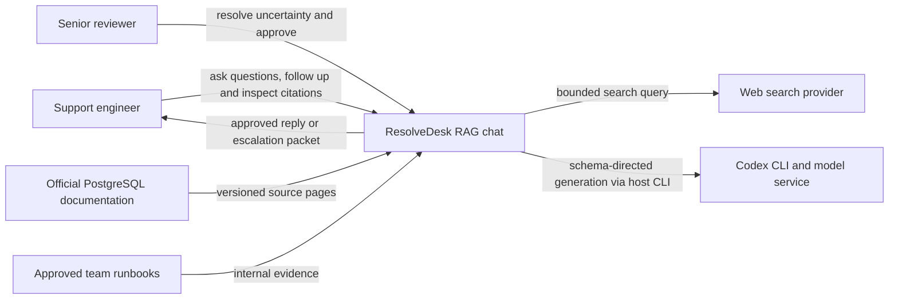
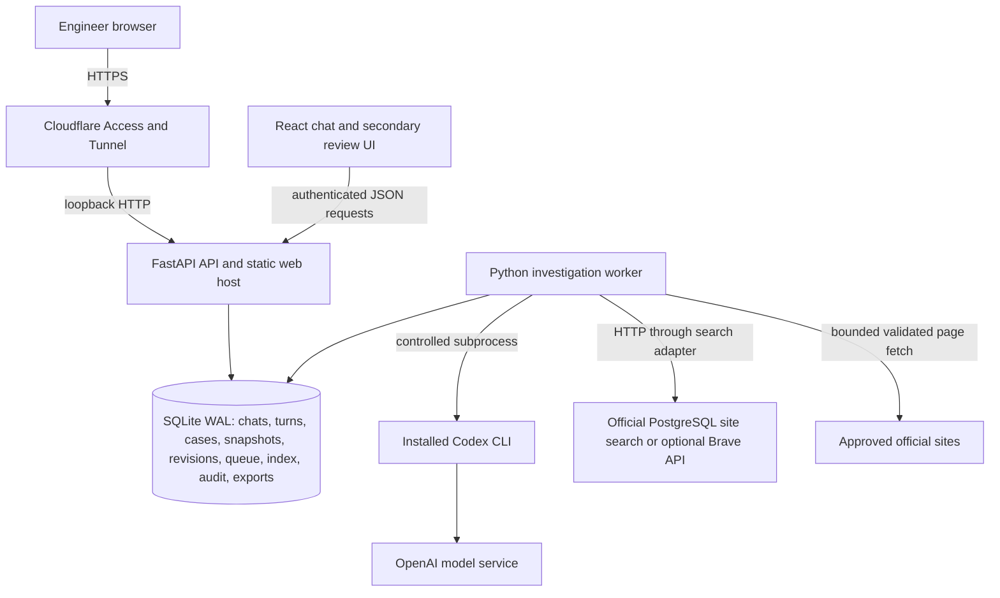
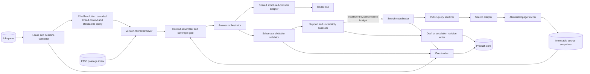
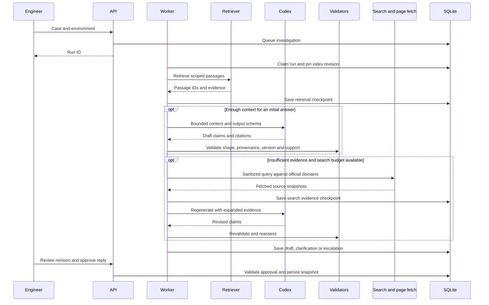
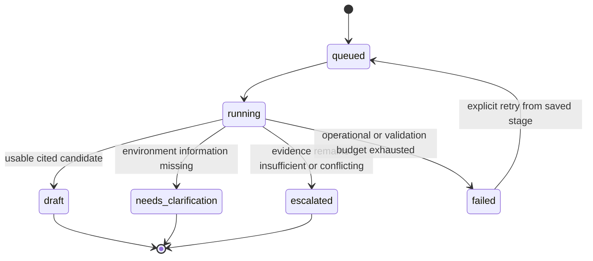

# Architecture

The primary interface is persistent RAG chat; see [conversation sequence and contracts](chat.md). Review/export is secondary. Conversations and ordered turns reuse the durable run/answer pipeline. A schema-validated contextualization step precedes fresh retrieval for each message.

API, worker, UI, lexical retrieval, source snapshots, grounding, and search adapters are implemented. Windows startup tasks and protected Cloudflare deployment are provided as scripts/configuration but await target-host acceptance. C4 levels follow the [C4 model](https://c4model.com/diagrams).

## C4 level 1 — system context

Public support posts provide evaluation questions, not automatically trusted production knowledge. Users explicitly approve any runbooks added to the source collection.

## C4 level 2 — containers

The target Windows host runs the API/static assets, one worker, and SQLite. The React UI executes in the engineer's browser. Model generation and remote search remain external dependencies. ResolveDesk uses port 8001 by default. Each product has separate process state, data, and configuration. Normalized snapshots and exports are in SQLite; raw acquisition HTML is a separate ignored corpus cache. No GPU or always-running vector database is required by the baseline.

## C4 level 3 — worker components

Ingestion is a bounded synchronous API operation or acquisition script. It parses headings/sections, snapshots content, and publishes each source atomically with a new index revision; a failed source refresh retains that source's prior publication. Queued collection-wide atomic ingestion remains a later extension. Retrieval pins an index revision and source snapshot IDs for each investigation. Tool responses are checked against stored passage identity, content, visibility, version, and scope before generation.

Retrieval uses SQLite FTS5 BM25 with product/version metadata filters and a utility-page preference when a ticket names tools such as `pg_dump`. The preference was added after a real-source regression showed the relevant rule falling outside the context budget. Fetched search pages use the same passage ranking rather than taking only the front of a page. A semantic retriever can be added if measured recall improvement justifies Windows CPU/RAM costs.

Expanded chat validation found that choosing only the first utility could suppress restore evidence when a question named both `pg_dump` and `pg_restore`. All named utility pages now share the preference before BM25 ranking. Privacy-safe search retains the fixed official `pg_hba` topic. The remote search adapter does not stop on unrelated release notes when an expected utility/reference page is absent: it tries its bounded second topic query and ranks discovered reference pages first. This is domain routing of retrieved results, not treating a hardcoded URL or snippet as evidence. Generation still requires validated fetched passages.

For `pg_hba`, the remote query uses the fixed canonical public spelling `pg_hba.conf`; actual service tests showed the stem could miss the reference page. This spelling is application-controlled, not an arbitrary user-supplied filename. See [measured validation](validation-2026-10-14.md).

## C4 level 4 — code responsibilities

```mermaid
classDiagram
  class AnswerOrchestrator {
    +investigate(case, budget) AnswerRevision
  }
  class Retriever {
    <<interface>>
    +retrieve(RetrievalRequest) RetrievalResult
  }
  class SearchProvider {
    <<interface>>
    +search(SearchRequest) SearchResult
  }
  class PageFetcher {
    +fetch(ApprovedURL) SourceSnapshot
  }
  class StructuredProvider {
    <<interface>>
    +generate(prompt, schema) StructuredGeneration
  }
  class CitationValidator {
    +validate(claims, passageMap) CitationCheckResult
  }
  class EvidenceAssessor {
    +assess(claims, environment) EvidenceAssessment
  }
  class ResolveDeskStore {
    +create_chat(ChatCreate, actor)
    +send_message(chat, ChatMessage, key, actor)
    +chat_context(run) BoundedConversation
    +saveCheckpoint(run, stage, payload)
    +saveRevision(answer)
    +approveRevision(review)
  }
  AnswerOrchestrator --> Retriever
  AnswerOrchestrator --> SearchProvider
  AnswerOrchestrator --> PageFetcher
  AnswerOrchestrator --> StructuredProvider
  AnswerOrchestrator --> CitationValidator
  AnswerOrchestrator --> EvidenceAssessor
  AnswerOrchestrator --> ResolveDeskStore
  class ChatResolution {
    +question
    +documentation_versions
    +server_version
    +client_version
    +needs_clarification
  }
  AnswerOrchestrator --> ChatResolution : validates contextual query before retrieval
```

The existing `StructuredProvider`/`LocalCodexProvider` in `packages/agent-core` can be reused. The existing extraction orchestrator imports TenderLens contracts and hardcodes its product identity; do not reuse it as if it were a generic RAG orchestrator. Define ResolveDesk contracts in a new product module and generalize shared helpers only where justified.

## Dynamic flow — investigate and search

## State and durability

Approval is a separate revision property, not a generation state. Additional case information creates a new investigation revision. A retry resumes the same pinned run's completed retrieval/fetch stages; already approved revisions remain immutable. If a provider fails after a draft was validated, preserve it as an unapproved candidate with the error and evidence limits visible. Incomplete streamed text is never an approved reply.

## Trust and deployment boundaries

Cloudflare Access protects remote entry; API authentication protects case and source routes as well. Tenant-level authorization is deferred because the initial pilot is one team, but public/internal source visibility applies from the start. Source text cannot authorize tools or commands. Fetches validate destinations and redirects; search query construction excludes private ticket content. The application proposes advice and never executes database commands. See [operations](operations.md) for the Windows and failure drills.
