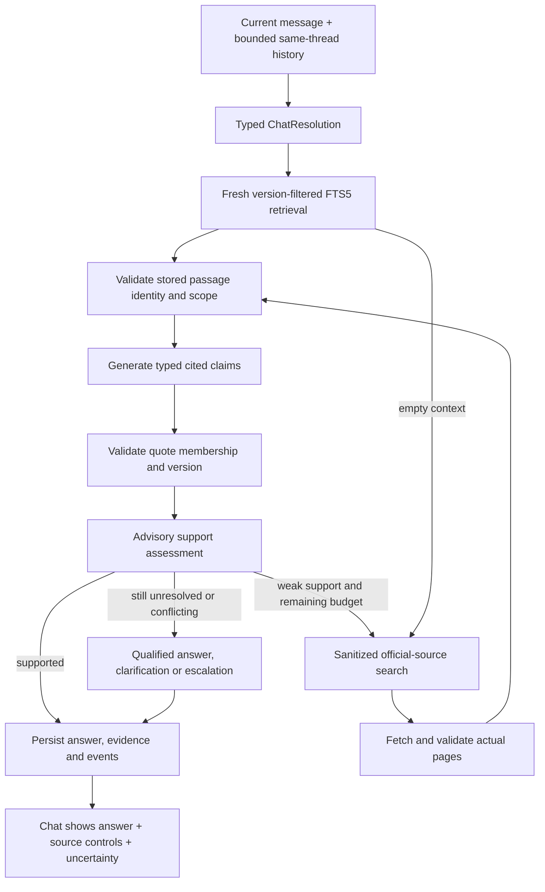

# Study guide: understand RAG by tracing ResolveDesk

Day 2 of the 14-day / 12-product challenge. Written after the actual-document functional validation completed on 14 October 2026.

Read this alongside the running product at `http://127.0.0.1:8001/`. The aim is not to memorize definitions: it is to explain what happens to a question, why each boundary exists, and how we tested it.

## 1. Start with the product, not the acronym

ResolveDesk is PostgreSQL support chat. An engineer asks a question, gets an answer with inspectable source passages, and asks follow-ups in the same conversation. It initially supports selected PostgreSQL 16/17 documentation. Knowledge management and optional customer-reply approval/export are secondary workflows, not prerequisites for chatting.

A useful first conversation:

1. Ask: “Can pg_dump 16 back up a PostgreSQL 17 server?”
2. Click a citation and read the stored quote and surrounding passage.
3. Ask: “Does that rule also apply to 16? Cite version 16 documentation.”
4. Refresh and reopen the thread. Both answers should retain their own evidence.

Distinguish the server version from the client utility version. A version-16 client manual can be the appropriate authority for explaining that client's limitations against a version-17 server. Comparing manuals must not silently change the recorded server environment.

The relevant rule is documented in the [PostgreSQL 16 pg_dump manual](https://www.postgresql.org/docs/16/app-pgdump.html) and [version-17 manual](https://www.postgresql.org/docs/17/app-pgdump.html): a dump client cannot dump a server whose major version is newer than its own. Do not confuse dumping a server with loading an existing dump into a different server.

## 2. The four requested concepts

| Concept                       | Meaning in this product                                                                                                    | Where to read the implementation                          |
| ----------------------------- | -------------------------------------------------------------------------------------------------------------------------- | --------------------------------------------------------- |
| Retrieve context              | Turn the current question into a version-scoped query and retrieve bounded passages from saved sources                     | `Store.retrieve`, `bounded`, `investigate`                |
| Generate answers with sources | Generate typed claims against those passages, then check citations and assess support                                      | `AnswerDraft`, `validate_draft`, `SupportVerdict`         |
| Flag low confidence           | Show partial, conflicting or insufficient evidence; ask a necessary question or abstain instead of inventing facts         | `empty_draft`, evidence-state handling, `confidenceLabel` |
| Fallback to search            | If local support is missing or weak and budget remains, search official sources, fetch pages, rank passages and regenerate | `search_evidence`, `PostgresSearch`, `fetch_page`         |

The chat welcome disclosure explicitly explains these concepts. Completed answers show indexed-context retention and search provenance. A source button opens evidence; it is not just a decorative reference number.

## 3. Understand the complete turn



The search loop is bounded, not an invitation to research forever. Conversation, retrieval, generation, validation and storage are different responsibilities.

### Conversation context is not evidence

History answers “What does ‘that rule’ refer to?” Retrieved documentation answers “What is the rule?” Prior assistant answers can be wrong; they must not become trusted knowledge merely because they appear in the thread.

`Store.chat_context` loads only the same conversation's recent turns. It considers up to six previous turns, caps each prior user/assistant message at 1,200 characters, and caps total history at 8,000 characters. Known environment is carried forward from the previous resolution. Long conversations do not have unlimited memory.

`ChatResolution` asks the model for a standalone retrieval question, documentation versions, known environment and any essential clarification. General questions such as “What is pg_dump?” need no mandatory server/client form. Contextual resolution is itself model-dependent and requires evaluation.

Every new user message gets a new run and fresh retrieval. Reusing a saved checkpoint while retrying the same failed run is different: that preserves the run's original evidence scope rather than silently changing its provenance.

## 4. Retrieval: why this is RAG without embeddings

Retrieval-augmented generation means generation is conditioned on retrieved external evidence. It does not require a vector database, embeddings or a particular agent framework.

ResolveDesk starts with SQLite FTS5 lexical retrieval and BM25 ranking. It matches terms, filters by requested documentation version and permitted source scope, and gives named utility pages preference. FTS5's ranking is not an answer-confidence probability.

Why this baseline? A single Windows service host benefits from fewer runtime dependencies, and PostgreSQL questions often contain exact names such as `pg_dump` or `sslmode`. This is a starting engineering choice, not proof that lexical search always wins. Semantic or hybrid retrieval should be added if measured recall improvements justify the host cost.

The context assembler currently supplies at most eight passages and 16,000 characters. Retrieving a relevant page is not enough if the important paragraph falls outside that budget.

### Sources, passages and index revisions

- A source snapshot stores immutable normalized content, URL, version, visibility and hash.
- A passage stores a snapshot ID, exact normalized text and offsets.
- Section metadata retains headings/anchors where available.
- Publishing a source advances the index revision. A run pins the collection revision it uses.
- Later source refreshes must not rewrite the evidence attached to an earlier answer.

Offsets refer to normalized extracted text, not original HTML byte positions. Search-fetched snapshots can support the current run without being automatically published as trusted indexed knowledge.

Read [ingest.py](../../apps/resolvedesk-api/src/resolvedesk_api/ingest.py), then [store.py](../../apps/resolvedesk-api/src/resolvedesk_api/store.py).

## 5. Generation and citation grounding

The model returns an `AnswerDraft`, not unrestricted Markdown. It contains claims, their display order, questions, limitations and an evidence state. Each material claim has its own citations.

A simplified conceptual shape:

```json
{
  "id": "c1",
  "text": "A supported explanation of the compatibility rule.",
  "version": "16",
  "category": "explanation",
  "citations": [
    {
      "passage_id": "stored-passage-id",
      "quote": "An exact supporting excerpt."
    }
  ]
}
```

This example is a shape illustration, not an actual accepted answer or real passage ID.

The server checks that the cited passage was supplied to this run, its stored identity/scope is valid, the normalized quote belongs to its text, and the claim's version agrees with its evidence. A cross-version claim labelled `both` requires citations for both supported versions. Claim IDs and display references must be unique and complete.

Source controls resolve URLs from validated passage records. A plain-text URL emitted in claim prose is not independently validated citation authority; inspect the actual source control.

### Provenance is not entailment

These are different questions:

1. Did this quote really occur in this supplied source?
2. Does the quote actually support the claim, including caveats and negation?
3. Is the answer complete and appropriate for this user's situation?

Exact quote checks address the first. A separate `SupportVerdict` evaluates the second, but it uses the same model provider and is advisory. Human-adjudicated evaluation is still needed for the second and third. A valid-looking citation does not make an answer true.

Read [contracts](../../packages/contracts/src/contracts/resolvedesk.py), then `validate_draft` and the support-assessment path in [worker.py](../../apps/resolvedesk-api/src/resolvedesk_api/worker.py).

## 6. Low confidence is a behavior, not a percentage

| Evidence state | How to interpret it                                                                        |
| -------------- | ------------------------------------------------------------------------------------------ |
| `supported`    | Current assessment accepts the supplied evidence; still verify before consequential action |
| `partial`      | Some useful support exists but visible limitations remain                                  |
| `conflicting`  | Relevant evidence or claim assessment conflicts; expert review is needed                   |
| `insufficient` | The available evidence cannot support a reliable answer                                    |

Evidence state and workflow status are separate. A run can need clarification, be escalated, fail, or produce a draft. Human approval is another separate state for optional customer-facing export. None is interchangeable with “the answer is correct.”

Examples from actual validation:

- “It failed again” as the first message requires clarification.
- An undisclosed private contract's recovery commitment cannot be inferred from public manuals.
- PostgreSQL 9.0/9.1 is outside this pilot's version scope.
- If search fails and local evidence is missing, show the limitation rather than a confident generic answer.

The UI labels uncertain/incomplete answers “Low confidence” and displays questions/limitations. It does not invent a confidence percentage. Numeric probabilities would require calibration against independent labels.

## 7. Search fallback is a second evidence pipeline

Search is triggered when local context is empty, or generation/assessment finds weak support and remaining budget allows recovery. It is not required for every question, and it cannot discover a private contractual fact simply by searching public manuals.

The default adapter uses PostgreSQL's actual remote site search. The optional Brave adapter is separate and was not live-validated without credentials. The model does not browse autonomously.

The recovery sequence is:

1. Construct a query from a fixed public vocabulary, not the raw customer message.
2. Scope discovery to supported official documentation versions.
3. Validate search-result shape and URLs.
4. Fetch actual pages. Search snippets are discovery information, not final evidence.
5. Enforce the HTTPS/host/path allowlist and public DNS destination checks.
6. Snapshot fetched content and rank its passages with the same retrieval machinery.
7. Regenerate and reassess against the new evidence, or retain uncertainty.

The product fetcher checks bounded responses and validates redirects; DNS is resolved and pinned for the connection. This reduces SSRF exposure. Source text and conversation text are treated as untrusted data, not instructions to execute commands.

### What the real failure taught us

The local authentication overview did not contain the detailed `pg_hba.conf` matching rule. Initial fallback fetched irrelevant material and safely abstained. Testing found that a privacy filter dropped the topic, the search adapter stopped too early on release notes, and the site's search recognized `pg_hba.conf` more effectively than `pg_hba`.

We reproduced each problem with tests, preserved the failed reports, and corrected topic preservation, bounded second-query behavior and fixed public filename spelling. The final full run fetched and cited the missing reference page after an initial local assessment, using five model calls in 48.68 seconds.

This is why “the search tool returned results” is not a sufficient test. The needed fetched evidence must actually reach and support the answer.

Read [network.py](../../apps/resolvedesk-api/src/resolvedesk_api/network.py), then `search_evidence` in the worker.

## 8. How Day 1 concepts carry into Day 2

| Day 1 concept                 | ResolveDesk implementation                                                                                                          |
| ----------------------------- | ----------------------------------------------------------------------------------------------------------------------------------- |
| Pydantic / JSON Schema        | Typed chat input, contextual resolution, retrieved passages, answer claims and support verdict; provider schema derived from models |
| Validate tool responses       | Validate result shape plus stored identity, scope and version; reject forged or changed evidence                                    |
| Retry parse/validation errors | Bounded repair with feedback, not an unlimited regenerate loop                                                                      |
| Log validation failures       | Persist parse/schema/evidence failures, retries and stage outcomes in run events                                                    |

JSON that parses can still fail a schema. Schema-valid JSON can still contain an invented citation. A valid citation can still be misinterpreted. Each layer addresses a different failure.

Chat has a six-model-call limit, a 600-second run deadline and a 180-second per-call ceiling, reduced by remaining time. Legacy ticket runs retain four calls. These are ceilings, not speed promises.

## 9. Product engineering around the model

The local Windows laptop is the intended service host. Python/FastAPI serves the API and built React UI; SQLite stores the corpus, conversations, jobs and evidence; one worker invokes the installed Codex executable through a provider adapter.

The product does not call an LLM API directly. However, the installed Codex CLI still needs authentication and network access for model inference. This is not offline inference on the laptop. Remote search also needs network access. Cloudflare should expose the protected application endpoint, never the Codex runtime or database.

Reliability details to understand:

- Message creation and job creation happen atomically, so an accepted message has a durable run.
- An idempotency key makes retrying a send safe. Reusing a key for a different request is a conflict.
- `expected_turn_count` detects stale multi-tab sends; a pending turn prevents interleaved conversation work.
- Checkpoints retain resolution, retrieval, search and validated candidates across eligible retries.
- A timeout preserves the user's message and any incomplete candidate, with a visible failure rather than a completed supported answer.
- Retrying an older failed turn after a later message is rejected to protect later context.
- Backup uses SQLite's online backup mechanism; restore targets a new directory and validates integrity/source hashes.

The worker is serial. Queue wait can exceed a short smoke-test timeout even when the worker is healthy. Test execution latency and user-facing queue latency separately.

## 10. How to read the tests without fooling yourself

The final complete live matrix passed 11 scenarios / 12 turns with 16 source-page checks, 23 generated claims and 31 structurally valid citation references. There are also 89 Python regression tests and five frontend presentation tests. See the [validation record](validation-2026-10-14.md).

These numbers have different meanings:

| Test type                   | What it can establish                                                            | What it cannot establish                                            |
| --------------------------- | -------------------------------------------------------------------------------- | ------------------------------------------------------------------- |
| Fake-provider unit test     | Deterministic behavior for controlled failures, schema errors, guards and limits | Real model answer quality                                           |
| Frozen real-corpus test     | Source integrity and measured retrieval behavior on those pages                  | Broad passage recall or answer correctness                          |
| Live Codex/search case      | Integration actually works on that input and external service response           | Population accuracy, stability across future runs or production SLA |
| Presentation unit test      | Confidence and search labels follow their inputs correctly                       | Layout, keyboard accessibility or real browser interactions         |
| Human-adjudicated benchmark | Quality against independent reviewed expectations                                | Unlimited generalization beyond its domain and sample               |

Our scenario expectations are provisional and adapted. A failed run stays in the record; a rerun is a new report. The proposed 60-case independently reviewed benchmark is not complete. No database incident was reproduced because the required host tools/daemon were unavailable. Browser and Windows/Cloudflare acceptance remain open.

## 11. Reproduce the learning

From the repository root, with dependencies and local credentials configured:

```sh
make resolvedesk-up
make resolvedesk-test
# Opt-in: real Codex and official-source search; service usage applies.
make resolvedesk-validate-live
# A focused hard recovery case:
.venv/bin/python scripts/validate_resolvedesk_chat.py --live --cases weak-local-search
# Real HTTP checks, sequentially on an idle worker queue:
.venv/bin/python scripts/smoke_resolvedesk_chat.py
.venv/bin/python scripts/smoke_resolvedesk_http.py
make resolvedesk-status
```

On Windows, use `.venv/Scripts/python.exe` and the [operations guide](operations.md) if Make is unavailable. Raw official HTML fixtures must be acquired before real-corpus tests can run; acquisition checks the frozen manifest rather than silently updating it.

Exercises:

1. Ask a question, inspect its citation, then change the documentation version in a follow-up. Find the distinct runs and evidence snapshots.
2. Run the empty-index recovery case. Confirm retrieval starts at revision zero, fetched evidence is cited, and the index remains unpublished.
3. Run the private-policy and outage cases. Explain why a plausible generic answer would be a test failure.
4. Read the forged-citation and parse-repair tests. Identify which layer fails and which event is recorded.
5. Compare the initial failed weak-search report with the final passing report. Find the point where useful evidence first entered the pipeline.

## 12. Suggested code-reading order

1. [Contracts](../../packages/contracts/src/contracts/resolvedesk.py): vocabulary and invariants.
2. [Ingestion](../../apps/resolvedesk-api/src/resolvedesk_api/ingest.py): what becomes searchable evidence.
3. [Store](../../apps/resolvedesk-api/src/resolvedesk_api/store.py): retrieval, pinned revisions, conversations and atomic sends.
4. [Worker](../../apps/resolvedesk-api/src/resolvedesk_api/worker.py): the complete contextual RAG turn and failure boundaries.
5. [Network](../../apps/resolvedesk-api/src/resolvedesk_api/network.py): public query, search, allowlist and fetch.
6. [API](../../apps/resolvedesk-api/src/resolvedesk_api/api.py): authenticated entry points.
7. [Chat UI](../../apps/resolvedesk-web/src/ChatApp.tsx) and [presentation rules](../../apps/resolvedesk-web/src/chatPresentation.ts): what users are told about evidence.
8. [Conversation tests](../../tests/test_resolvedesk_chat.py), [acceptance regressions](../../tests/test_resolvedesk_acceptance.py), and [live runner](../../scripts/validate_resolvedesk_chat.py): what our claims are based on.

Afterward, explain this in your own words: “The conversation tells us what to look for. Retrieved sources supply evidence. Typed outputs make claims inspectable. Validation and uncertainty constrain what we present. Search can add evidence, but it cannot manufacture authority.”
