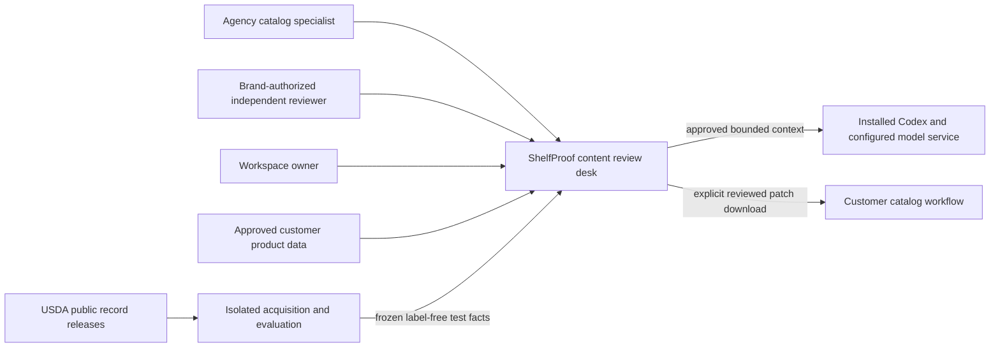
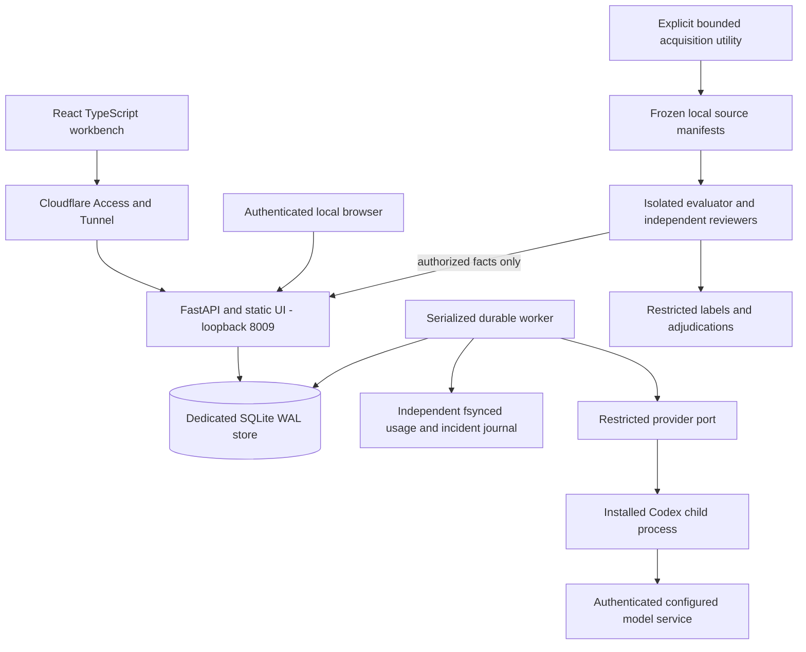
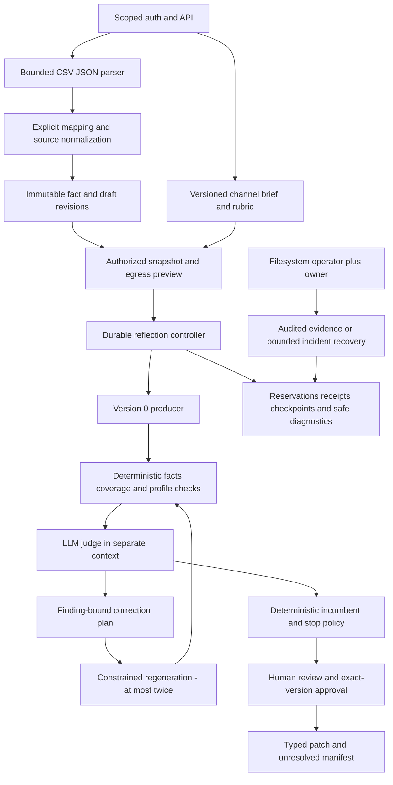
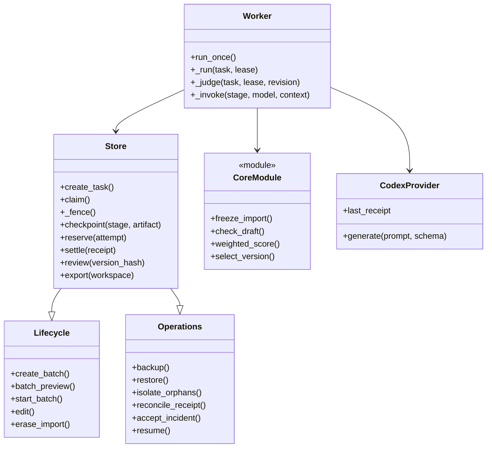

# Architecture — C4 levels 1–4

The application components are implemented; deployment and independent evaluation
remain acceptance work. External reviewers/gold/tunnel boxes are target boundaries,
not a claim those resources have been acquired or deployed. Products remain
independently runnable, without application-to-application imports or shared data.

## C4 level 1: system context

No arrow publishes to a retailer. Public research facts are not customer approval;
evaluation labels are outside runtime authority. Local hosting and remote model
egress are separate trust boundaries.

## C4 level 2: containers

Port 8009 is the implemented loopback default; a temporary owned-fixture stack was
started/stopped on macOS. Windows identity/tunnel qualification remains pending.
Gold isolation needs process/account ACLs, not
merely directory naming. No source fetching, model health call or evaluation occurs
on ordinary startup. Bulk acquisition is not part of the public service.

## C4 level 3: application components

The selection policy never treats a judge score as factual authority. Source gaps
stop with `needs_data`; a later fault preserves earlier versions. Models cannot
edit facts, change the rubric, add iterations, approve exports or grant egress.

## C4 level 4: implemented code relationships

Actual package: `apps/shelfproof-api/src/shelfproof_api/` contains `api`, `store`,
`core`, `workflow`, `worker`, `runtime`, `lifecycle`, `operations`, `corpus`,
`validation` and `errors`. Frontend: `apps/shelfproof-web/`; bounded untrusted
contracts: `packages/contracts/src/contracts/shelfproof.py`. Pure core functions
are shown as a module, not imaginary application classes. See the
[implementation map](implementation-notes.md) for consolidation decisions.

## Data ownership and immutable bindings

Workspace -> client-scoped imports -> product source revisions -> fact packs and
drafts -> batch/task snapshots -> attempts and checkpoints -> version/evaluation/
plan lineage -> selected incumbent -> review -> export manifest.

Every evaluation binds version hash, fact hash, profile/rubric revision and task
snapshot. Each plan binds the exact findings and parent version. Approvals bind the
selected text, evidence, policy and authority, not merely a mutable product ID.
Audit/accounting retain minimal hashes after case-content erasure as documented in
[security](permissions-and-security.md) and [recovery](audit-and-recovery.md).

## Execution sequence and failure boundary

1. API validates scope, expected revision and idempotency key, then persists intent.
2. Worker acquires runtime guard/lease and checks current authority plus allowances.
3. Reserve before each invocation; persist even failed/unknown attempts.
4. Validate output, record findings/receipt, checkpoint accepted stage once.
5. Run the bounded state machine; materialize incumbent and terminal reason.
6. Human independently reviews exact current artifacts; explicit patch download only.

Lease loss fences late success *and* failure writes. A restart reuses stage
checkpoints, not fresh counters. Restore creates a new quarantined root, revokes
sessions and leaves old jobs stale. See [audit/recovery](audit-and-recovery.md).

Real child/HTTP and crash/recovery engineering tests exist. Browser responsiveness,
real-model quality and Windows/tunnel deployment need their own actual acceptance
evidence; a healthy API cannot clear those gates.
