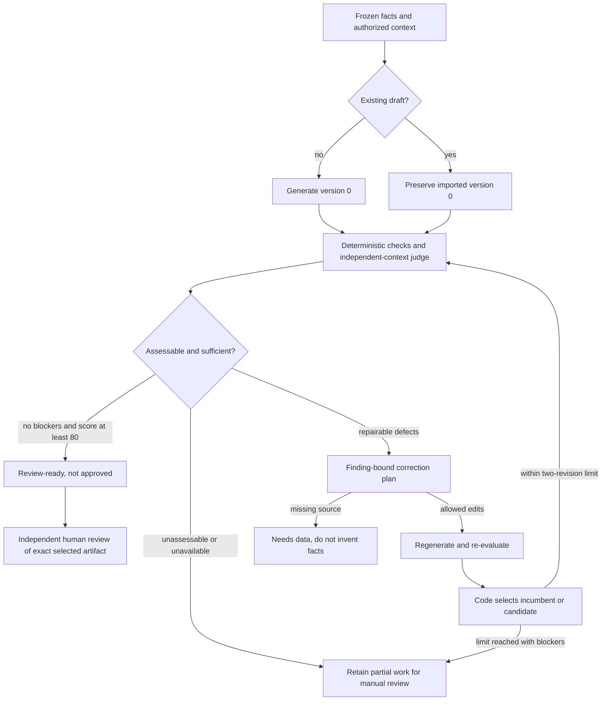

# ShelfProof study guide: self-reflection with bounded auto-evaluation

Day 10 of the 14-day, 12-product challenge. Written after the bounded live
validation checkpoint on 21 October 2026.

Use this guide to connect the concepts to actual code and observed behaviour.
[Implementation status](implementation-status.md) and the
[validation log](real-data-validation.md) are the authority for measured results.
The learning cadence is complete; production acceptance is not.

## 1. Start with the buyer's problem

ShelfProof is a review-and-repair workbench for packaged-food listing copy.
Its intended buyer is a grocery-commerce agency maintaining listings for brands.
The proposed value is a clearer, source-linked review handoff: identify unsupported
copy, repair what the approved facts support, and preserve what changed and why.
Customer willingness to pay and time savings have not been demonstrated.

The inputs are an explicitly mapped, frozen fact pack and optionally an existing
draft. The output is reviewable title/description text, evaluations, a correction
history and a partial export after independent human approval. It is not a food
safety certification, regulatory label generator or automatic retailer publisher.

The first fact profile is narrow: literal product ID, brand, name, net package
quantity/unit, ordered ingredients and source reference. A serving weight cannot
stand in for package weight. A brand owner cannot stand in for a missing brand.

The central question is: **what may the model propose, and what must code enforce?**

## 2. Map the five concepts to the implementation

| Concept | ShelfProof behaviour | Where to read |
| --- | --- | --- |
| Execute | Generate version 0 from frozen facts, or begin with an imported draft | [`Worker._run`](../../apps/shelfproof-api/src/shelfproof_api/workflow.py) |
| Evaluate: LLM as judge | Separate-context evaluation of the draft against facts, channel profile and five dimensions | `Worker._judge`, [judge specification](judge-and-rubric.md) |
| Critique reasoning | A concise correction plan names finding IDs, operations and supporting fact references | `reflect:1`/`reflect:2` in the worker; [contracts](../../packages/contracts/src/contracts/shelfproof.py) |
| Regenerate with constraints | Produce a candidate from the validated plan; recompute checks and select deterministically | `draft:1`/`draft:2`, [`select_version`](../../apps/shelfproof-api/src/shelfproof_api/core.py) |
| Log improvement metrics | Persist version-linked scores, resolved/introduced findings, coverage gaps and selection reasons | Worker metric checkpoints; [store](../../apps/shelfproof-api/src/shelfproof_api/store.py) |

These are distinct responsibilities, not five labels for a single prompt.
Critique means observable findings and an edit plan—not access to private
chain-of-thought. Self-reflection does not train or change model weights.

## 3. Trace one product through the system



This diagram simplifies durable stage replay. A known completed stage is reused
after an eligible resume; a later failure does not erase an adopted incumbent.

Start in `Worker._run`, then follow `_invoke`, `_judge`, `check_draft`,
`select_version` and the store's checkpoint/selection functions. React displays
these stored states; it does not decide which revision is valid.

The service runs through FastAPI, React/TypeScript, SQLite and a separate worker.
The provider port calls installed Codex rather than embedding a direct model API
client in product logic. Local hosting/CLI execution does not imply offline
inference: authorized context can reach the CLI's configured model service.
Windows/Cloudflare is the target deployment, not an accepted deployment result.

## 4. Structured output is necessary, not sufficient

Pydantic restricts drafts, findings, ratings and correction plans. Extra fields,
out-of-range ratings and unknown reference names cannot silently become policy.
The strict provider schema is also bounded: five explicit rating fields, not an
open-ended dictionary of model-invented dimensions.

There are several different validation questions:

- Shape: does the response match the contract?
- Evidence: does the quoted text equal the stated field's exact Unicode slice?
- References: are these known fact paths, and does the annotation support its claim?
- Semantics/policy: does the whole draft satisfy factual and channel constraints?
- Authority: does the run still have current source, code, role and budget context?

A response can be valid JSON and still fail every other question.
Claim annotations do not exempt unannotated prose from whole-text checks.

Evidence offsets use zero-based Unicode code points with an exclusive end. A
finding's optional quote/start/end must all be null or match the named draft field.
Do not reinterpret JavaScript string offsets as code-point offsets for emoji.

## 5. Understand the judge score

The code calculates a weighted score from integer ratings 0–4:

| Dimension | Weight |
| --- | ---: |
| Fidelity | 30 |
| Coverage | 25 |
| Channel | 20 |
| Clarity | 15 |
| Brand | 10 |

`score = sum(weight × rating / 4)`.

For example, ratings `4, 4, 3, 4, 4` give 95. That is a rubric score, not a
95% probability of correctness. If any dimension is unassessable (`null`), the
aggregate is unavailable—not zero, and not an average over the remaining fields.

`review_ready` requires an assessable score of at least 80 **and no blockers**.
Critical/material findings block; `missing_source` also blocks even when labelled
minor. A high judge score cannot waive these conditions.

Producer and judge receive the same channel-profile constant. The judge does not
receive a desired score, previous score or producer reasoning. Separate contexts
reduce one source of anchoring; using the same provider/model still allows
correlated errors. It is not independent expert assessment.

Read `test_independent_judge_receives_same_channel_constraints_without_producer_history`
in the [workflow tests](../../tests/test_shelfproof_workflow.py).

## 6. A correction plan is an enforceable edit proposal

The controller assigns IDs such as `check:0` and `judge:0`. A plan refers to those
IDs, not a model-invented replacement list. Allowed operations include removing
unsupported wording, replacing from a fact, clarifying a basis, requesting source
data and retaining a non-blocking point with a reason.

The validator rejects unknown or duplicate IDs, omitted blockers, attempts to
retain a blocker, unsupported replacements and an attempt to invent missing data.
`request_source` stops at `needs_data`; it is not a request for another creative draft.

An illustrative, synthetic example—not a USDA record:

```text
Approved fact: package quantity = 500 g
Imported draft: "Example Oat flakes 700 g"
Finding: the draft's package quantity contradicts the approved fact
Plan: replace from net_quantity and net_unit
Candidate: "Example Oat flakes 500 g"
```

Even this obvious repair must pass fresh checks and evaluation. A plan saying
“fixed” is not evidence that the candidate actually contains the correct quantity.

## 7. The application owns adoption

Read `select_version` in [core.py](../../apps/shelfproof-api/src/shelfproof_api/core.py).
Its ordering matters:

1. Reject an unassessable candidate.
2. Reject a new blocking-defect family or newly missing required coverage.
3. Compare critical/material blocker counts, with critical first.
4. Prefer improved required coverage when earlier conditions allow it.
5. Otherwise require at least five score points of gain; ties keep the incumbent.

This is a conservative policy, not a proof of semantic correctness. A candidate
can improve while still being blocked; iteration limits then determine the stop.

Selection is not “pick the last response” or “pick the highest score.” Distinct
revision identity remains important even when two drafts have identical text.
Review binds the selected revision/artifact, not just a text hash.

In the actual HANOVER case (`028800274315`), a judge score of 100 coexisted with
four deterministic reference-annotation blockers. A revision resolved those
blockers and was adopted while the score stayed 100. The gain was valid evidence
mapping—not four newly discovered factual errors or an increase in judge score.

## 8. Distinguish retry, revision and recovery

| Mechanism | Trigger | Boundary |
| --- | --- | --- |
| Parse/semantic retry | Returned output fails validation | At most two attempts per stage; replacement feedback preserves original constraints |
| Reflection revision | A valid evaluated draft needs improvement | At most two critique/regenerate/re-evaluate cycles |
| Operator recovery | Interrupted/failed durable work needs an explicit decision | Preserves usage, stage history and applicable row/campaign limits; never automatic unknown forgiveness |

Rows have 16 cumulative calls and four claims. Calls are reserved before invoking
the provider. Provider invocations are bounded to 90 seconds, alongside other
runtime/output and task limits. A retry is charged; it does not create a free revision.

Known malformed responses may receive one replacement attempt with allowlisted
feedback. Rejected raw output, exception payloads and private reasoning are not
echoed into that feedback. The retry's prompt/schema hashes are bound separately.

Missing audited usage is different from an ordinary known parse failure. An
unknown attempt holds dispatch until the documented policy is satisfied; it is
not reported as zero usage. The original unknown in this campaign was accepted
only through an explicit, one-time owner decision, and remains visible and charged.

## 9. Persistence is part of agent correctness

The store keeps immutable artifacts, selected revision identity, source/code/policy
snapshots, leases, reviews and a separate fsynced hash-chain usage journal.
Database/journal disagreement fails closed rather than silently repeating a call.

Key invariants to understand:

- A worker with an expired lease cannot commit a late result.
- Completed known checkpoints can survive a worker crash without repeated inference.
- An adopted partial result survives a later stage failure.
- Changed code or policy makes old context non-current; failed evidence is not rewritten.
- Explicit fixed-code successors retain source/parent linkage and consumed calls/claims.
- Unknown-history warnings follow parent ancestry and still require review acknowledgement.
- Maker and reviewer must be different; hard gates and current artifact binding remain required.

Start with [recovery tests](../../tests/test_shelfproof_recovery.py), then
[real-process tests](../../tests/test_shelfproof_process.py) and
[fixed-code successor tests](../../tests/test_shelfproof_revalidation.py).
Cooperative locks and CLI restrictions are not a hostile-host security sandbox.

## 10. Read the validation evidence without mixing denominators

| Evidence | Measured checkpoint | What it does not establish |
| --- | --- | --- |
| Engineering regression | 785 repository tests, including 104 ShelfProof tests; zero skips/failures; four frontend tests and build passed | Human quality, visual acceptance or Windows deployment |
| Real-source controlled workload | 1,000 distinct-GTIN candidates, 2,131 controlled calls, 869 fixture review-ready and 131 needs-data | Real LLM quality or regeneration performance |
| Fixed-code actual run | Six development products; three generation cases and three injected quantity-error drafts; all six review-ready | Population accuracy or authentic customer-error recovery rates |
| Actual loop observation | Four adopted revisions; two successful bounded judge parse repairs | Independent judge calibration or measured customer ROI |
| Usage | 23 calls in the successful pass; 34/96 cumulative; zero new unknowns, one historical unknown retained | A fully known historical token/cost total |

Source inventory came from a bounded scan of 50,031 USDA records, not the entire
release. The owner-grouped derivative has 533 heuristic groups, not 533 independently
verified product families. Missing literal brands or ambiguous package quantities
were excluded rather than invented. Source fidelity is not current-package truth.

The three injected-error cases scored 58.75 before correction and 100, 100 and
96.25 after selection. These are judge scores on deliberate faults, not externally
labelled quality gains. Four revisions each resolved four blocker findings with
zero introduced findings; do not count overlapping findings as independent errors.

The acceptance utility reports `actual_provider=pass` for this bounded run but
still exits 2 because `production_accepted=false`. Independent labels, browser
acceptance, actual Windows/tunnel qualification and commercial evidence remain open.
No human review or publication was performed.

## 11. Study through safe exercises

Run focused authored tests; these commands do not invoke Codex:

```bash
.venv/bin/python -m pytest -q tests/test_shelfproof_core.py tests/test_shelfproof_workflow.py tests/test_shelfproof_recovery.py tests/test_shelfproof_revalidation.py
npm --prefix apps/shelfproof-web test
```

`make shelfproof-test` also builds the frontend and runs the ShelfProof test family.
Actual child/HTTP process tests require their documented opt-in and local listener
permissions; a skipped process test is not evidence that it passed.

Suggested learning sequence:

1. Read the contracts and identify what shape validation cannot prove.
2. Follow the quantity-repair workflow test and name every stored artifact.
3. Read the selector tests; explain why a higher score may lose.
4. Follow the span-retry test; find the separate retry prompt hash and retained cap.
5. Read the successor-warning regression; explain why changing task ID must not erase history.
6. Inspect the saved actual report and match one selected revision to its metrics.

The local report is
`var/validation/shelfproof-usda-smoke-20261021/fixed-code-round1/report.json`.
Evidence is gitignored and may be absent in a fresh clone; do not fabricate or
automatically regenerate it. Live acquisition, provider runs and recovery commands
are not learning exercises to run casually. They require appropriate explicit
authority and preserve cumulative budgets.

## 12. Check your understanding

- Why is a score of 100 insufficient? Deterministic evidence and policy blockers still apply.
- Why share channel rules but not producer reasoning? The judge needs criteria without being anchored to the producer's justification.
- Why can a score remain unchanged after useful repair? Selection can improve blocker counts or coverage independently of the score.
- What should missing source ingredients cause? A data gap, not invented or silently shortened source facts. Missing ingredients in a draft can instead be repaired from complete approved facts.
- What differs between review-ready and approved? An independent human must approve the exact eligible current artifact.
- Why keep the old failed run? A successful successor does not change what happened, what was spent or what remains unknown.
- What would justify a broader product claim? Independently labelled quality comparisons, real UI/target-host acceptance and customer evidence—not more fixture volume alone.

The transferable pattern is a bounded system in which models propose drafts,
findings and edits, while code owns source authority, validation, adoption,
iteration limits, accounting and the handoff to a human.
