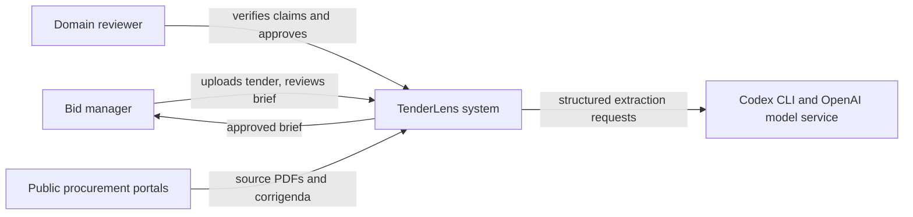
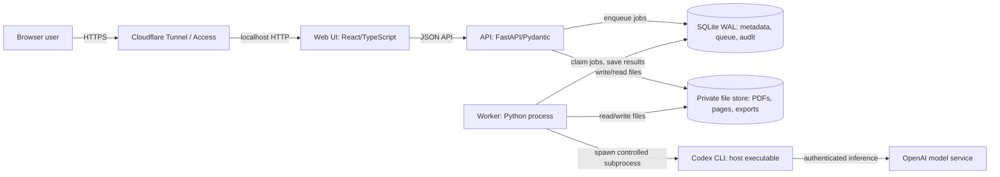
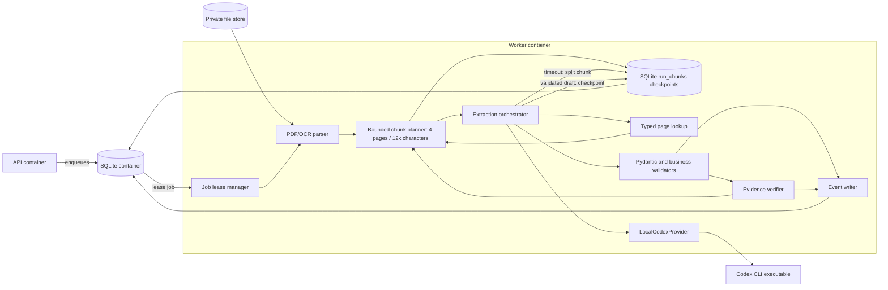
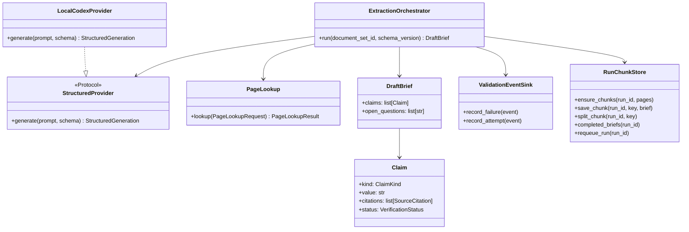
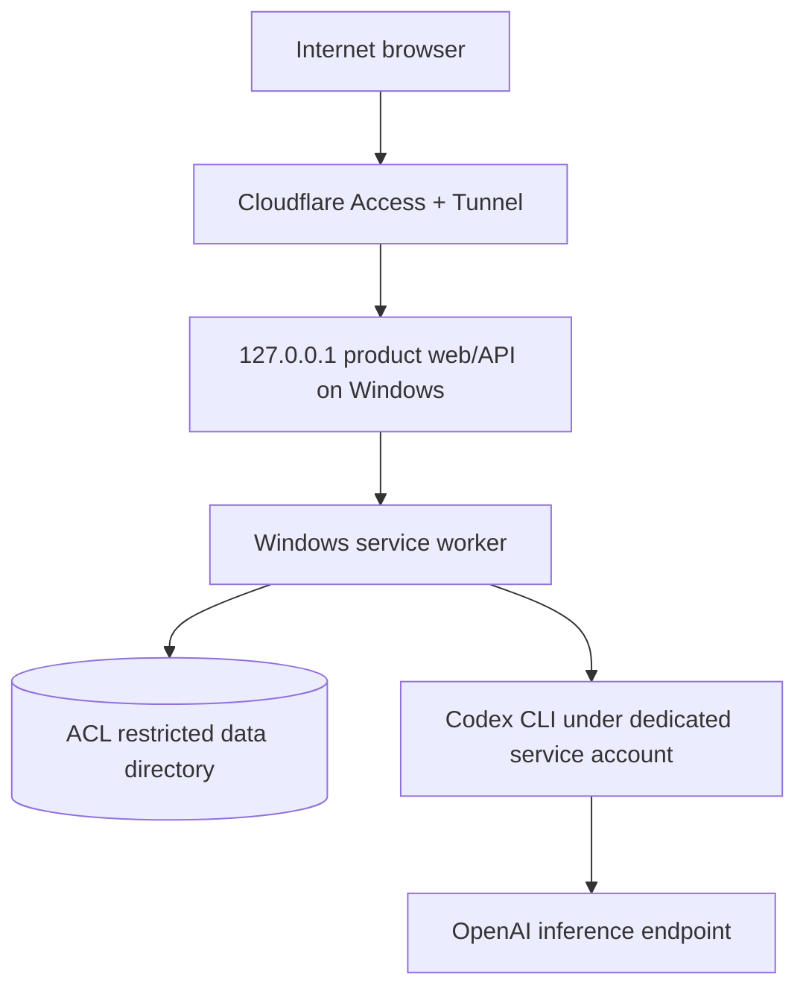

# Architecture

The C4 diagrams mix implemented components with the planned Windows/Cloudflare deployment; the text identifies that boundary. C4 uses four zoom levels: context, container, component, and code. Boxes represent people, software systems, deployable containers, components, or code elements according to their section. Arrows show the primary direction of use or data flow. [C4 reference](https://c4model.com/diagrams).

## C4 level 1 — system context



TenderLens is the system of interest. Public portals are data sources, not trusted instructions. The Codex executable is installed on the host; model inference depends on OpenAI service and authentication. The reviewer authorizes the final brief.

## C4 level 2 — containers



The old Windows laptop and tunnel are the intended deployment, not yet an accepted installation. The current local launcher binds the API to loopback. A single worker is the initial concurrency limit, appropriate for modest host resources; the DB backed job lease allows restart recovery. SQLite is a deliberate single host choice. Daily backup, restore, and integrity checks still need implementation and testing. Move to PostgreSQL only if concurrency or multi-host operation requires it.

## C4 level 3 — worker components



`page lookup` is an application owned tool with typed request and result. Codex receives only bounded, retrieved source text and returns JSON; the application validates both lookup results and final output. The source document is treated as untrusted data so instructions embedded inside a tender cannot change the agent's policy or call arbitrary tools.

The implemented worker pins document hashes at run creation and stores an ordered `run_chunks` tree in SQLite. Initial chunks have at most four pages and 12,000 extracted characters (a single oversized page remains indivisible). A typed provider timeout emits a `provider_timeout` event. A timed-out multi-page leaf is split atomically into two pending children; completed leaves are never regenerated on a retry. The worker checkpoints each validated `DraftBrief` before starting the next leaf. The final brief is assembled only after every leaf completes. A terminal failure after at least one checkpoint produces a `partial` brief for inspection; review and export remain locked. The retry API requeues that same run and resumes pending leaves. This is a single-worker, single-host lease design, not a multi-worker distributed queue.

## C4 level 4 — code view of extraction orchestration



The narrow provider boundary lets later products reuse process control and validation without importing TenderLens models into `agent-core`. `Store` implements the chunk-checkpoint operations shown here; the worker owns chunk planning, split/retry policy, and final/partial materialization.

## Dynamic flow — one extraction job

```mermaid
sequenceDiagram
  participant UI as Reviewer UI
  participant API
  participant W as Worker
  participant P as PDF/OCR parser
  participant C as Codex CLI
  participant V as Validators
  participant DB as SQLite
  UI->>API: Upload document set
  API->>DB: Save metadata and queued job
  API-->>UI: 202 + job ID
  W->>DB: Lease job
  W->>P: Extract pages, quality and offsets
  P-->>W: Typed page records
  W->>C: Prompt + JSON Schema; read-only execution
  C-->>W: Exit state + JSON output
  W->>V: Parse, Pydantic, business and citation checks
  alt Repairable failure and budget remains
    V-->>W: Typed errors
    W->>DB: Validation failure event
    W->>C: Focused repair prompt
    C-->>W: Revised JSON
    W->>V: Revalidate
  end
  W->>DB: Checkpoint validated chunk
  alt Codex timeout on multi-page chunk
    W->>DB: Provider-timeout event and split leaf into smaller pending chunks
    W->>C: Retry smaller leaf (same pinned document set)
  else Terminal failure after saved chunks
    W->>DB: Partial, non-exportable brief plus error and progress
    UI->>API: Retry same run
    API->>DB: Requeue pending leaves; retain completed checkpoints
  end
  W->>DB: Complete draft only when all leaves finish
  UI->>API: Load job and cited brief
  API-->>UI: Draft + source links + attempts
```

## Windows deployment and trust boundaries



Use per user authorization in the API and Cloudflare Access at the edge. Limit uploads by type, bytes, pages, and decompression. The worker invokes a pinned Codex executable with argument arrays, a per job temporary directory, timeout, output size limit, and a low privilege service account. It reads the generated final message file rather than scraping human oriented stdout. Never run Codex with repository write access or approvals enabled for document extraction; confirm the exact sandbox flags in the pinned version. A private data directory and log redaction keep tender content and Codex credentials out of public routes and telemetry. If OpenAI inference is unavailable, preserve the queued job and show a retryable operational state; PDF review and approved exports remain available.

## Failure and retry policy

| Failure | Handling |
| --- | --- |
| Malformed JSON / Pydantic output error | Up to two repair attempts with exact safe validation errors |
| Missing or mismatched quote/page | Reground once, then mark the claim unresolved |
| Invalid page lookup request/result | Reject tool result, emit event, retry only if argument can be corrected |
| Codex timeout on multi-page leaf | Log `provider_timeout`, atomically split the leaf, retry smaller leaves without regenerating completed ones |
| Single-page timeout or other terminal provider failure | Preserve completed leaves as a non-exportable partial brief; expose error and manual retry on same run. Known capacity/quota CLI errors get actionable summaries; they do not consume schema-repair attempts. |
| Worker process crash | Reclaim stale single-worker lease and resume pending leaves from SQLite checkpoints |
| OCR confidence low or conflicting amendment | Human review flag; do not manufacture certainty |

Validation and provider failures record a run ID, stage, error code, summary, and elapsed time when the provider returns it. The run pins document checksums. Successful attempts and CLI/model versions are not yet logged as complete per-attempt telemetry; the evaluation harness records call counts and elapsed time. Raw tender text and secrets are excluded from routine failure events.
